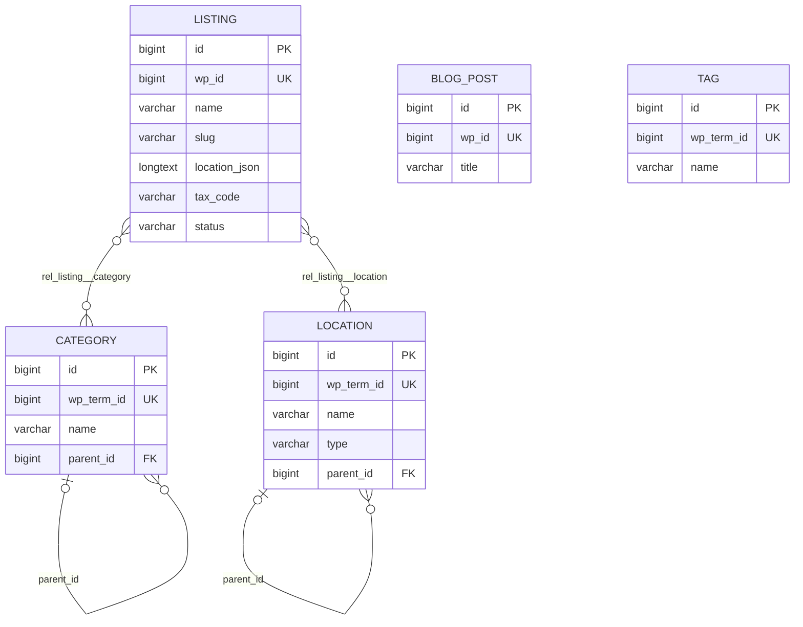
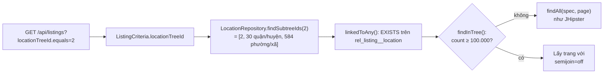

# Yellow Pages Vietnam — Tổng hợp dự án

> Cập nhật: 2026-10-01 · Phạm vi: cấu hình ứng dụng, JDL, mô hình dữ liệu và quan hệ, cách map và đồng bộ dữ liệu từ schema `jhipster_vnyp` sang database của dự án, chức năng phân cấp và lọc theo cây.

## Mục lục

1. [Tổng quan](#1-tổng-quan)
2. [Môi trường phát triển](#2-môi-trường-phát-triển)
3. [Mô hình dữ liệu](#3-mô-hình-dữ-liệu)
4. [JDL](#4-jdl)
5. [Map dữ liệu jhipster_vnyp → dự án](#5-map-dữ-liệu-jhipster_vnyp--dự-án)
6. [Quy trình đồng bộ dữ liệu](#6-quy-trình-đồng-bộ-dữ-liệu)
7. [Chức năng phân cấp và lọc theo cây](#7-chức-năng-phân-cấp-và-lọc-theo-cây)
8. [Elasticsearch](#8-elasticsearch)
9. [Xác thực và JWT](#9-xác-thực-và-jwt)
10. [API công khai cho FE (Next.js)](#10-api-công-khai-cho-fe-nextjs)
11. [Bài viết (Blog): đồng bộ WordPress và trang soạn bài](#11-bài-viết-blog-đồng-bộ-wordpress-và-trang-soạn-bài)
12. [Sinh lại code khi sửa JDL](#12-sinh-lại-code-khi-sửa-jdl)
13. [Lỗi đã gặp và cách xử lý](#13-lỗi-đã-gặp-và-cách-xử-lý)
14. [Việc còn tồn đọng](#14-việc-còn-tồn-đọng)
15. [Lệnh hay dùng](#15-lệnh-hay-dùng)
16. [Giao diện quản trị (bàn giao khách hàng)](#16-giao-diện-quản-trị-bàn-giao-khách-hàng)

---

## 1. Tổng quan

Ứng dụng danh bạ doanh nghiệp (Yellow Pages Vietnam), chuyển từ hệ thống WordPress cũ sang JHipster. Dữ liệu chuẩn đã được trích từ WordPress vào schema MySQL `jhipster_vnyp`, sau đó đồng bộ sang database của dự án.

| Thành phần | Giá trị |
|---|---|
| Generator | JHipster 9.3.0, monolith |
| Backend | Spring Boot 4.1.1, Java 21, Maven |
| Frontend | Angular 22, TypeScript 6 |
| Database | MySQL (dev và prod), Liquibase quản lý schema |
| Tìm kiếm | Elasticsearch (`search * with elasticsearch`) |
| Xác thực | JWT |
| Ngôn ngữ giao diện | `en` (gốc), `vi` |
| Package | `com.mycompany.myapp` |
| Cấu hình generator | [`.yo-rc.json`](../.yo-rc.json) |
| Định nghĩa entity | [`yp-schema.jdl`](../yp-schema.jdl) |
| Script đồng bộ | [`db-sync/`](../db-sync/) |
| Tài liệu API (Swagger) | Giao diện quản trị **Quản trị → API** (`/admin/docs`), hoặc `/swagger-ui/index.html`; JSON ở `/v3/api-docs/springdocDefault`. Chỉ bật với profile `api-docs` (dev mặc định có). Mô tả tiếng Việt, xác thực JWT và mô tả filter theo cây được bổ sung trong [`OpenApiDocsConfiguration.java`](../src/main/java/com/mycompany/myapp/config/OpenApiDocsConfiguration.java). Class này viết tay, không bị `jhipster --force` ghi đè. |

**Ràng buộc kỹ thuật đã thống nhất:** không đổi phiên bản JHipster hay Spring Boot, không thêm thư viện, không đổi cấu trúc package.

---

## 2. Môi trường phát triển

### 2.1 Docker

Khi chạy `./mvnw`, Spring Docker Compose tự bật các container trong [`src/main/docker/services.yml`](../src/main/docker/services.yml):

| Container | Image | Cổng | Ghi chú |
|---|---|---|---|
| `javaspringbootbackend-mysql-1` | `mysql:26.7.0` | `127.0.0.1:3306` | user `root`, mật khẩu rỗng (chỉ dùng cho dev) |
| `javaspringbootbackend-elasticsearch-1` | `elasticsearch:9.4.5` | `127.0.0.1:9200` | 1 node, heap 1 GB, dữ liệu lưu ở volume `javaspringbootbackend_elasticsearch-data`; trạng thái `yellow` là bình thường (xem [mục 8.3](#83-cấu-hình-container-giai-đoạn-0-xong-2026-10-01)) |

> ⚠️ Dữ liệu MySQL nằm trong **anonymous volume** của Docker. Xóa container bằng `docker compose down -v` hoặc `docker rm -v` sẽ **mất toàn bộ dữ liệu**, gồm cả `jhipster_vnyp`.

> Elasticsearch không có giao diện riêng: `http://localhost:9200` chỉ trả JSON. Công cụ xem dữ liệu ở [mục 8.2](#82-giao-diện-quản-trị-elasticsearch).

### 2.2 Hai database trong cùng một MySQL server

| Schema | Vai trò | Ghi chú |
|---|---|---|
| `jhipster_vnyp` | **Dữ liệu chuẩn** (nguồn), trích từ WordPress | Chỉ đọc. Không được ghi vào. |
| `javaspringbootbackend` | Database của ứng dụng | Do Liquibase tạo, dữ liệu chép từ `jhipster_vnyp` |

### 2.3 Cổng và profile

- Backend dev: `http://localhost:8081` (đã đổi từ 8080 trong [`application-dev.yml`](../src/main/resources/config/application-dev.yml)).
- Liquibase dev chạy với `contexts: dev, faker`. Changeset faker đã chạy một lần nên **không chèn lại** dữ liệu giả khi khởi động lại.

### 2.4 Backup

| File | Nội dung |
|---|---|
| `C:\Users\ADMIN\Documents\tuanna\db_backup\jhipster_vnyp_20261001.sql.gz` | Toàn bộ `jhipster_vnyp` (495 MB, `mysqldump --single-transaction --set-gtid-purged=OFF`) |

Khôi phục (chạy trong Git Bash; PowerShell 5.1 làm hỏng UTF-8 khi pipe):

```bash
gunzip -c /c/Users/ADMIN/Documents/tuanna/db_backup/jhipster_vnyp_20261001.sql.gz \
  | docker exec -i javaspringbootbackend-mysql-1 mysql -uroot
```

---

## 3. Mô hình dữ liệu

### 3.1 Sơ đồ quan hệ



`BlogPost` và `Tag` không có quan hệ với bảng nào, giống hệt nguồn. Nguồn không có bảng nối giữa bài viết và thẻ, và bảng `tag` hiện có 0 dòng.

### 3.2 Entity và số liệu

| Entity | Bảng | Số dòng | Mô tả |
|---|---|---:|---|
| `Listing` | `listing` | 1.855.619 | Doanh nghiệp |
| `Category` | `category` | 2.394 | Ngành nghề, dạng cây cha/con |
| `Location` | `location` | 15.313 | Địa phương: 98 `province`, 4.035 `district`, 11.180 `ward` |
| `BlogPost` | `blog_post` | 2.288 | Bài viết tin tức |
| `Tag` | `tag` | 0 | Thẻ |
| (bảng nối) | `rel_listing__category` | 25.184.298 | Listing N–N Category |
| (bảng nối) | `rel_listing__location` | 1.798.195 | Listing N–N Location |
| built-in | `jhi_user`, `jhi_authority`, `jhi_user_authority` | | Người dùng và quyền của JHipster |

### 3.3 Quan hệ

| Quan hệ | Kiểu | Hiện thực trong code | Cột DB |
|---|---|---|---|
| Listing ↔ Category | ManyToMany, Listing là bên sở hữu | `Listing.categories` / `Category.listings` (`mappedBy`) | `rel_listing__category(listing_id, category_id)` |
| Listing ↔ Location | ManyToMany, Listing là bên sở hữu | `Listing.locations` / `Location.listings` (`mappedBy`) | `rel_listing__location(listing_id, location_id)` |
| Category → Category cha | ManyToOne | `Category.parent` | `category.parent_id → category.id` |
| Location → Location cha | ManyToOne | `Location.parent` | `location.parent_id → location.id` |

**Bảng nối không cần entity riêng.** Chúng chỉ có 2 cột khóa ngoại, và `@ManyToMany` + `@JoinTable` đã xử lý đủ. Chỉ tạo entity riêng khi bảng nối cần thêm cột dữ liệu (ví dụ `is_primary`, `display_order`).

> ⚠️ **Hiệu năng:** không gọi `category.getListings()` hay `location.getListings()`, vì một ngành có thể có hàng trăm nghìn doanh nghiệp. Muốn lọc doanh nghiệp theo ngành hoặc địa phương, dùng API có phân trang, ví dụ:
> `GET /api/listings?categoryTreeId.equals=123&page=0&size=20` (lọc theo ngành và mọi ngành con, xem [mục 7](#7-chức-năng-phân-cấp-và-lọc-theo-cây)).

### 3.4 Chi tiết trường

Kiểu JDL được sinh thành kiểu MySQL như sau: `String` → `VARCHAR(n)`, `TextBlob` → `LONGTEXT`, `Instant` → `DATETIME(6)`, `Boolean` → `TINYINT`, `Double` → `DOUBLE`, `Long` → `BIGINT`, `Integer` → `INT`.

#### Listing (`listing`)

| Field | Cột | Kiểu | Ràng buộc | Ghi chú |
|---|---|---|---|---|
| `wpId` | `wp_id` | Long | required, unique | `wp_posts.ID` |
| `apiId` | `api_id` | String(100) | | ID từ API nguồn (dạng chuỗi) |
| `name` | `name` | String(500) | required | Tên doanh nghiệp |
| `nameEn` | `name_en` | String(500) | | |
| `nameAlias` | `name_alias` | String(500) | | |
| `slug` | `slug` | String(500) | | **Không unique**: nguồn có 7 slug NULL và 34 nhóm trùng |
| `description` | `description` | TextBlob | | |
| `phone` | `phone` | String(100) | | |
| `mobile` | `mobile` | String(100) | | |
| `email` | `email` | String(255) | | |
| `website` | `website` | String(500) | | |
| `address` | `address` | TextBlob | | |
| `locationJson` | `location_json` | TextBlob | | JSON: `province`, `ward`, `street`, `province_code`, `ward_code`, `coordinate` |
| `taxCode` | `tax_code` | String(100) | | Mã số thuế |
| `representative` | `representative` | String(255) | | |
| `capital` | `capital` | String(100) | | Vốn |
| `foundedYear` | `founded_year` | String(50) | | Dạng text gốc, ví dụ `2024-01-11` |
| `businessType` | `business_type` | String(100) | | |
| `businessStatus` | `business_status` | String(50) | | |
| `industryCode` | `industry_code` | String(100) | | |
| `managedBy` | `managed_by` | String(255) | | |
| `thumbnail` | `thumbnail` | String(500) | | **ID attachment WordPress**, không phải URL |
| `images` | `images` | TextBlob | | Danh sách ID attachment WordPress |
| `viewCount` | `view_count` | Integer | | |
| `isFeatured` | `is_featured` | Boolean | | |
| `status` | `status` | String(50) | | `publish` (1.855.611), `draft` (8) |
| `publishedAt` | `published_at` | Instant | | |
| `modifiedAt` | `modified_at` | Instant | | |
| `createdAt` | `created_at` | Instant | | Ở nguồn là thời điểm migrate (2026-06-29), không phải ngày đăng |
| `updatedAt` | `updated_at` | Instant | | |
| `esIndexed` | `es_indexed` | Boolean | | |

> **Tọa độ doanh nghiệp** nằm trong `location_json` dưới dạng chuỗi `"coordinate":"21.0001:105.698"` (1.791.151 doanh nghiệp có tọa độ). Phải giữ nguyên dạng text: **không** chuyển sang DECIMAL hay Double, vì làm tròn hoặc thêm số 0 đều làm sai tọa độ.

#### Category (`category`)

| Field | Cột | Kiểu | Ràng buộc |
|---|---|---|---|
| `wpTermId` | `wp_term_id` | Long | unique |
| `name` | `name` | String(255) | required |
| `slug` | `slug` | String(255) | |
| `description` | `description` | TextBlob | |
| `icon` | `icon` | String(255) | |
| `listingCount` | `listing_count` | Integer | |
| `createdAt` / `updatedAt` | `created_at` / `updated_at` | Instant | |
| `parent` (quan hệ) | `parent_id` | → `category.id` | |

#### Location (`location`)

| Field | Cột | Kiểu | Ràng buộc |
|---|---|---|---|
| `wpTermId` | `wp_term_id` | Long | unique |
| `name` | `name` | String(255) | required |
| `slug` | `slug` | String(255) | |
| `type` | `type` | String(50) | `province` / `district` / `ward` |
| `code` | `code` | String(50) | |
| `latitude` / `longitude` | `latitude` / `longitude` | Double | Ở nguồn đã là `double`, giữ nguyên |
| `createdAt` | `created_at` | Instant | |
| `parent` (quan hệ) | `parent_id` | → `location.id` | |

#### BlogPost (`blog_post`)

| Field | Cột | Kiểu | Ràng buộc |
|---|---|---|---|
| `wpId` | `wp_id` | Long | required, unique |
| `title` | `title` | String(500) | required |
| `slug` | `slug` | String(500) | (nguồn có 1 slug trùng) |
| `content` / `excerpt` | `content` / `excerpt` | TextBlob | |
| `thumbnail` | `thumbnail` | String(500) | |
| `status` | `status` | String(50) | |
| `viewCount` | `view_count` | Integer | |
| `publishedAt` / `createdAt` / `updatedAt` | | Instant | |

#### Tag (`tag`)

| Field | Cột | Kiểu | Ràng buộc |
|---|---|---|---|
| `wpTermId` | `wp_term_id` | Long | unique |
| `name` | `name` | String(255) | required |
| `slug` | `slug` | String(255) | |

---

## 4. JDL

File: [`yp-schema.jdl`](../yp-schema.jdl). Nguyên tắc: **bám đúng schema `jhipster_vnyp`** về tên bảng/cột, kiểu, độ dài, NOT NULL, UNIQUE và quan hệ. Lần kiểm tra tự động gần nhất cho kết quả khớp 100%.

### 4.1 Quy ước đặt tên

| Quy ước | Lý do |
|---|---|
| Tên bảng ghi rõ: `entity Listing(listing)`, `entity BlogPost(blog_post)`… | Cố định tên bảng trùng với nguồn |
| Field camelCase, JHipster tự đổi sang snake_case | `wpId` → `wp_id`, `locationJson` → `location_json`… trùng tên cột nguồn |
| Tên quan hệ ManyToMany để **số ít**: `Listing{category(name)} to Category{listing}` | Cột nối sinh ra là `category_id`, đúng như nguồn. Field Java vẫn là số nhiều (`categories`). |
| `required` chỉ đặt khi nguồn là NOT NULL; `unique` chỉ đặt khi nguồn có UNIQUE KEY | Không thêm ràng buộc làm dữ liệu cũ không lưu được |

### 4.2 Tùy chọn

```
dto * with mapstruct
service * with serviceImpl
paginate Listing, Category, Location, BlogPost with pagination
paginate Tag with infinite-scroll
filter Listing, Category, Location, BlogPost
search * with elasticsearch
```

### 4.3 Giới hạn của JDL và JHipster 9.3.0

| Giới hạn | Cách xử lý |
|---|---|
| Bảng nối luôn có tiền tố `rel_` (`rel_listing__category`); JDL không đổi được, vì generator ghi đè tên | Script đồng bộ map `listing_category` → `rel_listing__category` |
| Không khai báo được index thường (`slug`, `status`, `tax_code`, `api_id`, `is_featured`, `type`) | Viết thêm changelog Liquibase tay (xem [mục 14](#14-việc-còn-tồn-đọng)) |
| Không khai báo được `ON DELETE CASCADE` và `DEFAULT` | Như trên |
| Không thêm được cột vào entity built-in `User` (`jhi_user.wp_user_id` của nguồn) | Chưa chuyển user từ nguồn |
| Bảng không có cột `id` làm khóa chính (`staging_listing` dùng `wp_id`) | Không đưa vào app |
| Comment `/** … */` trên field được chép nguyên vào file i18n JSON **mà không escape** | **Không dùng dấu `"` trong comment JDL** (xem [mục 13](#13-lỗi-đã-gặp-và-cách-xử-lý)) |

---

## 5. Map dữ liệu jhipster_vnyp → dự án

### 5.1 Map bảng

| `jhipster_vnyp` | `javaspringbootbackend` | Cách chép |
|---|---|---|
| `listing` | `listing` | Chép thẳng 32 cột, giữ nguyên `id` |
| `category` | `category` | Chép, sau đó đổi `parent_id` (xem 5.2) |
| `location` | `location` | Chép, sau đó đổi `parent_id` (xem 5.2) |
| `listing_category(listing_id, category_id)` | `rel_listing__category(listing_id, category_id)` | Chép thẳng |
| `listing_location(listing_id, location_id)` | `rel_listing__location(listing_id, location_id)` | Chép thẳng |
| `blog_post` | `blog_post` | Chép thẳng |
| `tag` | `tag` | Chép thẳng (0 dòng) |
| `jhi_user`, `jhi_authority`, `jhi_user_authority` | — | **Không chép.** App dùng user mặc định của JHipster (`admin`, `user`). |
| `staging_listing` | — | **Không chép.** Bảng tạm lúc migrate, trùng nội dung với `listing`. |
| `migration_log` | — | **Không chép.** Nhật ký migrate. |

### 5.2 Điểm cần chú ý khi map

1. **`parent_id` ở nguồn trỏ tới `wp_term_id`, không phải `id`.** Ví dụ: `category.parent_id = 523` nghĩa là cha có `wp_term_id = 523`. Khi chép phải tra cha theo `wp_term_id` rồi gán `id` của cha. Đã kiểm tra: 2.354/2.354 category và 15.215/15.215 location có cha đều tìm được cha.
2. **Giữ nguyên `id` gốc.** Quan hệ và đường dẫn cũ vẫn đúng. Entity dùng `GenerationType.IDENTITY`, nên MySQL tự đẩy `AUTO_INCREMENT` lên sau id lớn nhất.
3. **Datetime chép nguyên giá trị, không đổi múi giờ.** App đọc `DATETIME` theo UTC (`hibernate.jdbc.time_zone: UTC`). Nếu dữ liệu nguồn là giờ Việt Nam thì giao diện sẽ hiển thị lệch 7 tiếng (xem [mục 14](#14-việc-còn-tồn-đọng)).
4. **Ảnh doanh nghiệp chưa dùng được.** `thumbnail` và `images` chỉ chứa ID attachment của WordPress. Muốn có URL ảnh cần thêm dữ liệu `wp_posts.guid` từ WordPress.
5. **Tiếng Việt** ở nguồn là UTF-8 chuẩn (`utf8mb4`). Dấu `?` thấy trong PowerShell chỉ là lỗi hiển thị của console.

---

## 6. Quy trình đồng bộ dữ liệu

### 6.1 Các file

| File | Chức năng |
|---|---|
| [`db-sync/sync_from_jhipster_vnyp.sql`](../db-sync/sync_from_jhipster_vnyp.sql) | Xóa dữ liệu đích rồi chép toàn bộ từ `jhipster_vnyp`. Chạy lại nhiều lần được. |
| [`db-sync/verify_sync.sql`](../db-sync/verify_sync.sql) | So số dòng, checksum nội dung, datetime, cây cha/con, AUTO_INCREMENT |

### 6.2 Các bước trong script đồng bộ

| Bước | Việc làm |
|---|---|
| 0 | Xóa dữ liệu đích theo thứ tự khóa ngoại: bảng nối → `listing` → `category`/`location` (đặt `parent_id = NULL` trước) → `blog_post`, `tag` |
| 1 | `category`: chép với `parent_id = NULL`, sau đó `UPDATE … JOIN` theo `wp_term_id` để gán cha |
| 2 | `location`: như bước 1 |
| 3 | `listing`: `INSERT … SELECT` 32 cột cùng tên |
| 4 | Bảng nối: `listing_category` → `rel_listing__category`, `listing_location` → `rel_listing__location` |
| 5 | `blog_post`, `tag` |

Chép category/location với `parent_id = NULL` trước rồi mới gán cha để tránh lỗi khóa ngoại khi bản ghi con được chèn trước bản ghi cha.

### 6.3 Cách chạy

**Bước 1: tăng bộ nhớ InnoDB (bắt buộc).** Image MySQL mặc định chỉ có buffer pool 128 MB và redo log 100 MB. Với cấu hình đó, chép 25 triệu dòng bảng nối mất hơn 1 giờ. Các lệnh sau chỉ có hiệu lực tới khi container khởi động lại:

```bash
echo "SET GLOBAL innodb_buffer_pool_size = 2147483648;
      SET GLOBAL innodb_redo_log_capacity = 2147483648;" \
  | docker exec -i javaspringbootbackend-mysql-1 mysql -uroot
```

**Bước 2: đồng bộ** (Git Bash, tại thư mục dự án):

```bash
docker exec -i javaspringbootbackend-mysql-1 mysql -uroot < db-sync/sync_from_jhipster_vnyp.sql
```

**Bước 3: kiểm tra.** Mọi dòng kết quả phải có `ok = 1`:

```bash
docker exec -i javaspringbootbackend-mysql-1 mysql -uroot < db-sync/verify_sync.sql
```

**Bước 4: reindex Elasticsearch.** Dữ liệu chép bằng SQL không đi qua tầng service nên ES không được cập nhật (xem [mục 14](#14-việc-còn-tồn-đọng)).

**Bước 5: tính lại số doanh nghiệp theo ngành.** Nguồn có `listing_count = 0`, nên sau khi đồng bộ phải chạy `POST /api/admin/categories/listing-counts` (khoảng 1 phút, xem [mục 10.6](#106-ngành-nghề-mục-lục-theo-chữ-cái-số-doanh-nghiệp)).

**Bước 6: sửa đơn vị hành chính 2025.** Đồng bộ chép lại bảng `location` từ nguồn (mã, tên sai), nên gọi `POST /api/admin/administrative-units/fix-locations?dryRun=false` ([mục 7.10](#710-đơn-vị-hành-chính-sau-sáp-nhập-0172025)).

**Bước 7: gắn doanh nghiệp vào đơn vị hành chính mới.** Đồng bộ chép lại `rel_listing__location` (chỉ có liên kết cũ), nên gọi `POST /api/admin/administrative-units/link-listings?dryRun=false` (khoảng 1–2 phút, [mục 7.10](#710-đơn-vị-hành-chính-sau-sáp-nhập-0172025)).

**Bước 8: tạo địa chỉ mới.** `POST /api/admin/administrative-units/new-addresses?dryRun=false&overwrite=false` (giữ địa chỉ quản trị viên đã sửa tay), rồi reindex Elasticsearch `listing` ([mục 7.10](#710-đơn-vị-hành-chính-sau-sáp-nhập-0172025)).

> Nếu terminal bị ngắt giữa chừng, câu lệnh SQL vẫn chạy tiếp trong MySQL. Kiểm tra bằng `SELECT id, time, LEFT(info,80) FROM information_schema.processlist WHERE command <> 'Sleep';` trước khi chạy lại, tránh chèn trùng.

### 6.4 Kết quả đồng bộ ngày 2026-10-01

| Kiểm tra | Kết quả |
|---|---|
| Số dòng 7 bảng | Khớp hết (bảng ở [mục 3.2](#32-entity-và-số-liệu)) |
| Checksum nội dung `listing` (28 cột) | `3982185450798924` ở cả hai phía |
| Datetime `listing` (4 cột) | 0 dòng lệch |
| Checksum hai bảng nối | Khớp |
| Cây cha/con category, location | 0 dòng sai |
| AUTO_INCREMENT | `listing` 1.855.620, `category` 2.395, `location` 15.314, `blog_post` 2.289 |

---

## 7. Chức năng phân cấp và lọc theo cây

Mục này dành cho dev cần hiểu, sửa hoặc mở rộng 3 chức năng:

1. **Xem Địa phương và Ngành nghề dạng cây.**
2. **Lọc doanh nghiệp (Listing) theo địa phương hoặc ngành nghề.** Chọn một nút là lấy cả các cấp con bên dưới.
3. **Dùng chung code cây** ở frontend (`shared/tree`) và backend (`ListingQueryService`).

### 7.1 Đặc điểm dữ liệu: vì sao phải lọc theo cả cây

| | Địa phương (`location`) | Ngành nghề (`category`) |
|---|---|---|
| Số cấp | 3: `province` → `district` → `ward` (98 / 4.035 / 11.180) | Tối đa 4 (40 / 911 / 245 / 1.198 nút theo độ sâu) |
| Phân biệt cấp | Cột `type` | Không có cột cấp, chỉ biết qua `parent_id` |
| Doanh nghiệp gắn vào | **Đúng một** địa phương, ở **bất kỳ cấp nào**: tỉnh 1.456.416, phường/xã 318.783, quận/huyện 22.950; 57.470 doanh nghiệp không có địa phương | Gần như chỉ **ngành lá** (24,4 trên 25,2 triệu liên kết ở cấp 4); trung bình 13 ngành/doanh nghiệp |
| Hệ phân loại | Hành chính | Hai hệ trong cùng một cây: nhóm Yellow Pages cũ (gốc id 1–14, ~494 nghìn doanh nghiệp) và hệ ngành kinh tế VSIC (gốc id 846–866, ~1,24 triệu doanh nghiệp) |
| Số con lớn nhất của một nút | 168 | 415 (gốc "CHƯA PHÂN LOẠI") |

**Hệ quả:** filter có sẵn của JHipster `locationId.equals=X` chỉ khớp doanh nghiệp gắn **đúng** vào X. Ví dụ:

| Lọc | `locationId` (chỉ đúng nút) | `locationTreeId` (cả cây con) |
|---|---:|---:|
| Thành phố Hà Nội (id 2) | 206.901 | **265.942** |
| TP. Hồ Chí Minh (id 51) | 443.460 | **541.032** |
| Huyện Ba Vì (id 256) | 0 | **536** |

Vì vậy dự án thêm 2 filter **theo cây**: `locationTreeId` và `categoryTreeId`.

### 7.2 Giao diện

| Trang / menu | Đường dẫn | Mô tả |
|---|---|---|
| Thực thể → **Tỉnh thành** → Đơn vị hành chính | `/location/tree` | Cây tỉnh → quận/huyện → phường/xã, tải dần từng cấp |
| Thực thể → Tỉnh thành → Tỉnh thành / Quận huyện / Phường xã | `/location?filter[type.equals]=province` (`district`, `ward`) | Trang danh sách Location có sẵn, lọc theo cấp |
| Thực thể → **Ngành nghề** → Cây ngành nghề | `/category/tree` | Cây ngành nghề tối đa 4 cấp |
| Thực thể → Ngành nghề → Danh sách ngành nghề | `/category` | Trang danh sách có sẵn |
| Trang **Listing** | `/listing` | 2 dãy ô chọn: địa phương và ngành nghề, kết hợp được |

- Trên trang cây, mỗi nút có biểu tượng danh sách để mở `/listing` đã lọc sẵn theo nút đó.
- Lựa chọn lọc nằm trên URL, ví dụ `/listing?filter[locationTreeId.equals]=2&filter[categoryTreeId.equals]=848`. Tải lại trang hay gửi link vẫn giữ nguyên bộ lọc.

### 7.3 API

| Mục đích | Request |
|---|---|
| Các nút gốc | `GET /api/locations?parentId.specified=false&size=1000&sort=id,asc` |
| Con của một nút | `GET /api/locations?parentId.equals=2&size=1000&sort=name,asc` |
| Lọc doanh nghiệp theo cây địa phương | `GET /api/listings?locationTreeId.equals=2&page=0&size=20&sort=id,asc` |
| Lọc doanh nghiệp theo cây ngành nghề | `GET /api/listings?categoryTreeId.equals=848&page=0&size=20&sort=id,asc` |
| Kết hợp | `GET /api/listings?locationTreeId.equals=2&categoryTreeId.equals=848&…` (110.642 kết quả) |

Hai API đầu cũng dùng được cho `/api/categories`. Tổng số kết quả trả trong header `X-Total-Count`. Id không tồn tại thì trả danh sách rỗng, không báo lỗi.

> ⚠️ Ô **tìm kiếm** trên trang Listing gọi `/api/listings/_search` (Elasticsearch). Endpoint này **bỏ qua mọi filter**, kể cả filter theo cây. Hiện chưa kết hợp được tìm kiếm với lọc theo cây.

### 7.4 Backend: luồng xử lý



| Thành phần | File | Việc làm |
|---|---|---|
| Filter mới | [`ListingCriteria.java`](../src/main/java/com/mycompany/myapp/service/criteria/ListingCriteria.java) | Thêm `locationTreeId`, `categoryTreeId` (`LongFilter`, chỉ dùng `.equals`); Spring tự bind từ query string |
| Lấy cây con | [`LocationRepository.findSubtreeIds`](../src/main/java/com/mycompany/myapp/repository/LocationRepository.java), [`CategoryRepository.findSubtreeIds`](../src/main/java/com/mycompany/myapp/repository/CategoryRepository.java) | JPQL `left join` lên cha, ông, (cụ): nút + mọi cấp con |
| Điều kiện lọc | [`ListingQueryService.linkedToAny`](../src/main/java/com/mycompany/myapp/service/ListingQueryService.java) | Sinh `EXISTS (SELECT 1 FROM rel_listing__x r WHERE r.listing_id = l.id AND r.x_id IN (…))` |
| Chọn cách truy vấn | `ListingQueryService.findInTree` | Đếm trước; tập lớn thì lấy trang với `semijoin=off` |

**SQL thực tế Hibernate gửi đi** (đã kiểm tra trong `performance_schema`):

```sql
SELECT COUNT(l1_0.id) FROM listing l1_0
WHERE EXISTS (SELECT ? FROM rel_listing__location l2_0
              WHERE l2_0.location_id IN (...) AND l1_0.id = l2_0.listing_id)
```

**Vì sao dùng `EXISTS` mà không dùng join** (đo trên TP.HCM, 541 nghìn doanh nghiệp):

| Cách viết | Đếm | Lấy trang 1 |
|---|---:|---:|
| `join` của JHipster (`locationId`) | Trùng dòng nếu doanh nghiệp gắn nhiều nút trong cây | |
| `id IN (SELECT … JOIN listing …)` | 3,3 s | 3,0 s |
| **`EXISTS` chỉ trên bảng nối** | **1,1 s** | 1,2 s |

**Vì sao tắt semi-join khi tập lớn** (đo với cách `EXISTS`):

| Cấu hình MySQL | Đếm | Lấy trang 1 đủ cột |
|---|---:|---:|
| Mặc định (semi-join) | **1,35 s** | 3–22 s: dựng cả 541 nghìn dòng rồi mới sắp xếp |
| `semijoin=off` | 2,4–3,7 s | **0,002 s**: duyệt `listing` theo khóa chính, dừng khi đủ 20 dòng |

Vì vậy `findInTree()` **đếm bằng cấu hình mặc định**, rồi:
- **Tập ≥ 100.000** (`LARGE_TREE_RESULT`): lấy trang với `SET SESSION optimizer_switch = 'semijoin=off'`, và bật lại trong `finally` để connection trả về pool ở trạng thái mặc định.
- **Tập nhỏ:** giữ cách mặc định. Doanh nghiệp của một huyện có thể dồn ở cuối bảng (Ba Vì: id ~1,44 triệu); tắt semi-join thì phải duyệt từ đầu, mất 3,3 s thay vì 0,2 s.

**Tốc độ hiện tại** (khi MySQL đã có dữ liệu trong bộ nhớ đệm; trang 20 dòng, sắp theo id):

| Bộ lọc | Số doanh nghiệp | Thời gian |
|---|---:|---:|
| TP.HCM | 541.032 | ~1,1 s |
| Hà Nội | 265.942 | ~0,65 s |
| Hải Phòng / Bình Dương / Đồng Nai | 53–64 nghìn | 0,5–0,6 s |
| Tỉnh, huyện nhỏ | < 6 nghìn | 0,1–0,3 s |
| Ngành < 120 nghìn doanh nghiệp (đa số ngành) | | 0,3–0,5 s |
| "Dịch vụ lưu trú và ăn uống" (VSIC) | 323.939 | ~3 s |
| "Công nghiệp chế biến, chế tạo" (VSIC) | 717.984 | ~8 s |
| "Bán buôn và bán lẻ…" (VSIC) | 1.088.771 | **~33 s** |

Nhóm VSIC lớn chậm vì **phần đếm** phải loại trùng hàng triệu liên kết (7,7 triệu với "Bán buôn và bán lẻ"). Không chỉnh được bằng cách viết lại truy vấn; hướng xử lý ở [mục 14](#14-việc-còn-tồn-đọng).

### 7.5 Frontend: component dùng chung `shared/tree`

| File | Export | Vai trò |
|---|---|---|
| [`tree-source.ts`](../src/main/webapp/app/shared/tree/tree-source.ts) | `TreeItem`, `TreeSource`, `createTreeSource(service)` | Bọc service entity của JHipster thành nguồn cây: `roots()`, `children(id)`, `find(id)`, dựa trên filter `parentId` có sẵn của API |
| [`tree-view.ts`](../src/main/webapp/app/shared/tree/tree-view.ts) | `<jhi-tree-view>` | Cây tải dần: mở nút nào mới gọi API lấy con nút đó |
| [`tree-filter.ts`](../src/main/webapp/app/shared/tree/tree-filter.ts) | `<jhi-tree-filter>` | Dãy ô chọn; ô cấp sau chỉ hiện khi nút đang chọn có con |

**`<jhi-tree-view>`**

| Input | Bắt buộc | Ý nghĩa |
|---|---|---|
| `source` | ✔ | `TreeSource` |
| `entityRoute` | ✔ | Ví dụ `/location`; link chi tiết là `/location/{id}/view` |
| `listingFilterName` | ✔ | Ví dụ `locationTreeId.equals`; link "Xem doanh nghiệp" là `/listing?filter[...]={id}` |
| `isLeaf` | | Hàm biết trước nút lá (địa phương: `type === 'ward'`). Mặc định: lá khi đã mở mà không có con |
| `itemLabel` | | Hàm trả khóa i18n hiện cạnh tên (địa phương: tên cấp) |
| `leafIcon` | | Icon nút lá, mặc định `circle` |

Gọi `load()` qua template ref để làm mới, ví dụ `<jhi-tree-view #tree …/>` rồi `(click)="tree.load()"`.

**`<jhi-tree-filter>`**

| Input | Ý nghĩa |
|---|---|
| `filters` | `IFilterOptions` của trang danh sách (trang Listing truyền `filters`) |
| `source` | `TreeSource` |
| `filterName` | Ví dụ `categoryTreeId.equals` |
| `placeholders` | Khóa i18n cho lựa chọn "tất cả" từng cấp; cấp sâu hơn dùng khóa cuối |

Cách hoạt động:
- **Chọn:** đặt filter bằng **nút sâu nhất** đang chọn (thay giá trị cũ), sau đó tải con của nút đó; có con thì hiện thêm một ô. Bỏ chọn một cấp thì lọc theo cấp cha.
- **Đồng bộ với URL:** đọc `filter[<filterName>]` trên URL. Khi URL đổi từ bên ngoài (tải lại trang, bấm × trên chip filter, mở link từ trang cây), component đi ngược lên cha bằng `find()` để dựng lại đủ các ô.
- **Không tải lại thừa:** trang Listing đọc filter qua signal, nên `removeFilter` rồi `addFilter` liền nhau chỉ gây **một** lần tải lại.

### 7.6 Thêm bộ lọc theo cây cho entity khác

Ví dụ: lọc `BlogPost` theo cây chuyên mục.

1. **Dữ liệu:** entity cây cần quan hệ `ManyToOne` `parent` tới chính nó (JDL `relationship ManyToOne { X{parent(name)} to X }`), và filter `parentId` (bật `filter X` trong JDL).
2. **Repository:** thêm `findSubtreeIds(id)` với đủ số tầng `left join … parent` bằng **độ sâu tối đa** của dữ liệu.
3. **Criteria:** thêm field `LongFilter xTreeId` vào `<Entity>Criteria`, kèm getter/setter, `optional…()`, constructor copy, `equals`, `hashCode`, `toString`.
4. **QueryService:** trong `createSpecification` thêm `linkedToAny(Entity_.xs, X_.id, xRepository.findSubtreeIds(id))`. Nếu tập kết quả có thể lớn, áp dụng cách của `findInTree()`.
5. **Frontend:** trong component danh sách tạo `readonly xTree = createTreeSource(inject(XService))`, rồi thêm `<jhi-tree-filter [filters]="filters" [source]="xTree" filterName="xTreeId.equals" [placeholders]="[...]" />`.
6. **Trang cây** (nếu cần): tạo component chứa `<jhi-tree-view>`, thêm route `tree` vào `x.routes.ts`, thêm menu và khóa i18n.
7. **Test:** spec của trang danh sách phải thay `TreeFilter` bằng stub (xem `listing.spec.ts`), nếu không sẽ có thêm request lấy nút gốc và các test `expectOne` sẽ fail.

### 7.7 Kiểm thử

| Test | Nội dung |
|---|---|
| [`shared/tree/tree-filter.spec.ts`](../src/main/webapp/app/shared/tree/tree-filter.spec.ts) | Nguồn dữ liệu giả 4 cấp: hiện nút gốc; chỉ thêm ô khi có con; filter theo nút sâu nhất; bỏ chọn thì lùi về cha hoặc xóa filter; dựng lại từ URL; placeholder theo cấp |
| [`entities/listing/list/listing.spec.ts`](../src/main/webapp/app/entities/listing/list/listing.spec.ts) | Test JHipster sinh sẵn; `TreeFilter` được thay bằng stub |

Chạy (dùng `*.spec.ts` trong `--include`; nếu để `**` thì sẽ lẫn cả file `.html`):

```bash
npx ng test --watch=false --include='src/main/webapp/app/shared/tree/*.spec.ts' --include='src/main/webapp/app/entities/listing/list/*.spec.ts'
```

Backend: kiểm tra thủ công bằng API ở [mục 7.3](#73-api), so với SQL đối chiếu. **Chưa có** integration test cho `locationTreeId` và `categoryTreeId`.

### 7.8 Lưu ý và bẫy thường gặp

- **Không map `listings` trong `LocationMapper` / `CategoryMapper`.** JHipster 9.3.0 luôn sinh chiều ngược của ManyToMany. Nếu map, `/api/locations` sẽ tải hàng trăm nghìn doanh nghiệp cho mỗi nút và bị treo. Sau mỗi lần `jhipster jdl --force`, kiểm tra lại (xem [mục 12](#12-sinh-lại-code-khi-sửa-jdl)).
- **Độ sâu cây đang cố định** trong JPQL `findSubtreeIds`: địa phương 3 cấp, ngành nghề 4 cấp. Dữ liệu sâu hơn sẽ bị thiếu nút con khi lọc.
- **Mỗi cấp tải tối đa 1.000 nút con** (`CHILDREN_PAGE_SIZE`). Hiện nhiều nhất là 415.
- **`SET SESSION optimizer_switch` phải luôn được bật lại** (`finally`), nếu không connection trong pool sẽ giữ `semijoin=off` cho các truy vấn khác.
- **Sắp xếp theo cột không có index** (ví dụ `name`) rất chậm với tập lớn: TP.HCM sắp theo tên mất ~44 s. Cần changelog index (xem [mục 14](#14-việc-còn-tồn-đọng)).
- **Tên ngành có `&amp;`** (ví dụ `SỨC KHỎE &amp; LÀM ĐẸP`): dữ liệu WordPress lưu sẵn trong `jhipster_vnyp`. Giao diện hiển thị nguyên văn.
- **Tìm kiếm Elasticsearch không kết hợp với lọc theo cây** (xem [mục 7.3](#73-api)).

### 7.9 Mục lục ngành nghề A–Z (trang quản trị)

> Làm ngày 2026-10-08. Giao diện theo trang **Mục lục ngành nghề** của FE cũ: dãy nút chữ cái, ô tìm theo tên, thẻ ngành kèm số doanh nghiệp.

**Mở:** menu **Thực thể → Ngành nghề → Mục lục A–Z**, hoặc `/category/index`. Trang **Cây ngành nghề** và **Danh sách ngành nghề** có nút chuyển qua lại.

| Vùng | Chức năng |
|---|---|
| Đầu trang (nền xanh) | Nút **Tất cả** và các chữ cái có ngành (A–Z; chữ có dấu gộp vào chữ gốc: Ô → O, Đ → D). Rê chuột lên nút để xem số ngành |
| Ô tìm kiếm | Tìm trong tên ngành, **không phân biệt dấu**, nhiều từ thì phải có đủ (`may vi tinh`). Gõ xong 300 ms mới gọi API. Dùng được cùng chữ cái |
| Tùy chọn | **Ẩn ngành chưa có doanh nghiệp** (mặc định bật); sắp xếp **Tên A–Z** hoặc **Nhiều doanh nghiệp nhất** |
| Thanh tóm tắt | "Ngành nghề bắt đầu bằng chữ: L" và số ngành tìm được |
| Thẻ ngành (60 thẻ/trang) | Ô vuông số doanh nghiệp rút gọn (74, 1k, 321k, 1tr, 1,2tr), tên ngành, **"Thuộc: tên ngành cha"** (phân biệt ngành trùng tên ở các cấp), số doanh nghiệp đầy đủ (353.317). **Bấm thẻ** → danh sách doanh nghiệp lọc theo cả cây ngành đó (`/listing?filter[categoryTreeId.equals]=id`, [mục 7.3](#73-api)) |

Trạng thái lưu trên URL (`/category/index?letter=L&q=may%20vi%20tinh&sort=count&page=2&all=true`), nên tải lại trang, quay lại hay gửi link đều giữ nguyên bộ lọc.

**Dữ liệu:** API quản trị (đăng nhập JWT), cùng logic với API công khai [mục 10.6](#106-ngành-nghề-mục-lục-theo-chữ-cái-số-doanh-nghiệp) nhưng không cần khóa `X-API-Key` (khóa đó dành cho FE Next.js, không đưa vào trang quản trị):

| API | Ghi chú |
|---|---|
| `GET /api/category-index/letters?hideEmpty=` | Như `/api/public/v1/categories/letters` |
| `GET /api/category-index?letter=&q=&hideEmpty=&page=&size=&sort=` | Như `/api/public/v1/categories` |

| File | Nội dung |
|---|---|
| [`web/rest/CategoryIndexResource.java`](../src/main/java/com/mycompany/myapp/web/rest/CategoryIndexResource.java) | 2 API quản trị, dùng `PublicCategoryService` |
| [`entities/category/index/category-index.ts`](../src/main/webapp/app/entities/category/index/category-index.ts), `.html`, `.scss` | Trang mục lục. Gọi API qua `switchMap` nên bấm chữ cái liên tục chỉ lấy kết quả mới nhất; `shortCount()` rút gọn số |
| [`entities/category/service/category-index.service.ts`](../src/main/webapp/app/entities/category/service/category-index.service.ts) | Gọi `/api/category-index` |
| `category.routes.ts` (route `index`), `navbar.html` (mục **Mục lục A–Z**, icon `arrow-down-a-z`), `font-awesome-icons.ts` (`faArrowDownAZ`, `faTableCellsLarge`), `i18n/{vi,en}/category.json` (`category.index.*`), `global.json` (`menu.entities.categoryIndex`) | Gắn trang vào ứng dụng |

**Kiểm thử (2026-10-08):**

| Test | Kết quả |
|---|---|
| [`category-index.spec.ts`](../src/main/webapp/app/entities/category/index/category-index.spec.ts): rút gọn số; đọc trạng thái từ URL khi mở trang; bấm chữ cái (về trang 1, ghi URL); gõ tìm chờ 300 ms; hiện ngành trống, sắp theo số doanh nghiệp; link sang danh sách doanh nghiệp. Cả thư mục `entities/category` và navbar | 62/62 ✅, ESLint sạch |
| Chrome headless trên app: mở trang (2.195 ngành, 11 trang); bấm L (30 ngành, khớp API); thêm "may vi tinh" (4 ngành); mở lại bằng URL giữ chữ cái, từ khóa, sắp xếp; bấm thẻ sang `/listing` đúng bộ lọc | ✅ |
| API quản trị không có JWT | 401 ✅ |

> ⚠️ **Bấm thẻ của một số ngành mở danh sách doanh nghiệp rất chậm**: ví dụ "Lập trình máy vi tính" (id 1524, 85.609 doanh nghiệp) mất **21–24 s**, trong khi ngành cha 1114 (116.715) chỉ 2,1 s và ngành nhỏ dưới 1 s. Đây là vấn đề lọc theo cây đã ghi ở [mục 14](#14-việc-còn-tồn-đọng) #8, xem số đo ở đó.

### 7.10 Đơn vị hành chính sau sáp nhập 01/7/2025

> Bắt đầu 2026-10-08. Từ 01/7/2025 cả nước còn 34 tỉnh, bỏ cấp huyện, 3.321 xã/phường/đặc khu. Dữ liệu doanh nghiệp phần lớn gắn theo địa giới cũ, nên tra cứu theo địa giới mới bị sai. Làm theo 4 bước; **bước 1 xong**.

#### Hiện trạng (phân tích 2026-10-08)

Bảng `location` chứa **cả hai bộ**, phân biệt bằng đuôi slug `-2025` (mã trùng nhau giữa hai bộ, ví dụ Hà Nội là 01 ở cả hai):

| | Bộ cũ (trước 01/7/2025) | Bộ mới (từ 01/7/2025) |
|---|---|---|
| Cấp | Tỉnh → huyện → xã | Tỉnh → xã |
| Số đơn vị | 63 tỉnh (+ "QUỐC TẾ"), 715 huyện, 11.180 xã | 34 tỉnh, 3.321 xã |
| Slug | mã ở cuối: `huyen-ba-vi-271`, `xa-phu-cuong-09625` | mã + `-2025`: `phuong-cua-nam-00082-2025` |
| Doanh nghiệp đang gắn | 1.456.416 ở cấp tỉnh, 318.783 ở cấp xã, 153 ở cấp huyện | 22.797 ở cấp xã |

Thêm 57.470 doanh nghiệp không gắn địa phương nào. Mỗi doanh nghiệp gần như chỉ gắn **một** đơn vị.

**Nguồn để chuyển đổi:**

1. **File Excel chuyển đổi** `BangChuyendoiĐVHCmoi_cu_final.xlsx` (sheet "Tổng hợp_không merge"): 10.571 dòng, mỗi dòng là một xã cũ nhập vào một xã mới. Gồm 10.034 xã cũ, 696 huyện cũ, 63 tỉnh cũ, 3.321 xã mới, 34 tỉnh mới. Có 969 dòng "nhập một phần": 442 xã cũ chia cho nhiều xã mới. 6 dòng cấp huyện, cả huyện đảo thành đặc khu (Bạch Long Vĩ, Cồn Cỏ, Hoàng Sa, Lý Sơn, Côn Đảo, Thổ Châu) hoặc vùng bãi bồi chưa có mã.
2. **`listing.location_json`** đã ghi theo **địa giới mới**: 1.502.608 doanh nghiệp có mã xã mới, **khớp 100% với Excel** (đúng tỉnh); 288.536 doanh nghiệp chỉ có mã tỉnh mới; 64.475 doanh nghiệp không có JSON hợp lệ. Ví dụ địa chỉ ghi "P. Thành Công, Q. Ba Đình" nhưng JSON ghi "Phường Giảng Võ" (00025).

**Lỗi trong file Excel** (script tự sửa khi chuyển sang CSV, xem bên dưới):

| Lỗi | Sửa |
|---|---|
| 348 mã mất số 0 đầu (`1558`) | Thêm số 0: xã 5 chữ số, huyện 3, tỉnh 2 |
| Phường 4, TP Tân An (794) ghi tỉnh Tiền Giang (82) | Long An (80), theo đa số dòng cùng huyện |
| Xã Tiên Hải, TP Hà Tiên (900) ghi An Giang (89) | Kiên Giang (91) |
| Huyện Cồn Cỏ ghi "Quảng Trị (44)"; 44 là Quảng Bình cũ | 45, theo tên |
| 31 tên sai tiền tố: "Xa Ea Kly", "phường Vĩnh Hải", "Thi trấn Ngan Dừa", "Thị Trấn Yên Minh" | Xã, Phường, Thị trấn |
| Dấu nháy cong "M’Droh", tên tỉnh cũ không thống nhất ("Quảng Trị" / "Tỉnh Quảng Trị") | Nháy thẳng; tên phổ biến nhất của mã |

Sau khi sửa: mỗi tỉnh cũ về đúng một tỉnh mới, và mọi cặp huyện cũ → tỉnh cũ khớp với bảng `location`.

**Lỗi của bộ mới trong bảng `location`** (dữ liệu gốc `jhipster_vnyp`), so với Excel và JSON doanh nghiệp (hai nguồn này khớp nhau):

- **123 xã mới mang mã sai**, có chỗ gán lẫn mã giữa các xã. Ví dụ "Phường Cửa Nam" 00073 → đúng 00082; "Phường Kim Liên" mang mã 00226 của "Văn Miếu - Quốc Tử Giám" → đúng 00229.
- 5 xã sai tên: "Phường Hoàng Văn Thụ" 06187 → "Phường Kỳ Lừa" (JSON của 903 doanh nghiệp cũng ghi Kỳ Lừa); "Xã Tân Thanh" 06172 → "Xã Hoàng Văn Thụ"; "Đào Duy Tư" → "Đào Duy Từ"; "Albá" → "Al Bá"; "Lục Sỹ Thành" → "Lục Sĩ Thành".
- 81 tên khác kiểu đặt dấu, nháy, gạch ngang ("Thuỷ"/"Thủy", "M’Drắk", "Chân Mây – Lăng Cô"); 4 tỉnh ghi "Tp …".
- Thiếu "Xã Khuôn Lùng" (Tuyên Quang, 01147).
- Xã mới lưu nhầm `type = district` (cây địa phương hiện nút mở rộng thừa cho xã mới; trang "Quận huyện" liệt kê cả 3.320 xã mới).
- Cột `code` để trống ở cả hai bộ.

#### Kế hoạch (người dùng đã chọn 2026-10-08)

| Bước | Nội dung | Trạng thái |
|---|---|---|
| 1 | Nạp bảng chuyển đổi vào DB; sửa bộ mới trong `location` theo danh mục chính thức (**sửa cả slug**) | ✅ 2026-10-08 |
| 2 | Gắn doanh nghiệp vào đơn vị mới: **thêm liên kết, giữ liên kết cũ** (lấy từ `location_json`, không có thì qua bảng chuyển đổi) | ✅ 2026-10-08 |
| 3 | Giao diện tra cứu, bộ lọc: **mặc định địa giới mới**, có nút chuyển sang địa giới cũ; tìm được cả địa chỉ cũ | ✅ 2026-10-08 |
| 4 | API tra cứu địa chỉ cũ → mới (quản trị và công khai) | Chưa làm |

#### Ảnh hưởng tới tra cứu listing (đánh giá 2026-10-08)

Đo với Phường Giảng Võ (mới, mã 00025; gộp Giảng Võ, Thành Công, Cát Linh, Kim Mã, Ngọc Khánh, Láng Hạ, Cống Vị cũ). Theo `location_json` có 3.889 doanh nghiệp thuộc xã này, 263.276 thuộc Hà Nội mới.

| Đường tra cứu | Kết quả hiện tại | Cần làm |
|---|---|---|
| Lọc cây `locationTreeId` ([mục 7.3](#73-api)) | Xã mới Giảng Võ: **17**; Hà Nội mới: **1.554**; Hà Nội cũ: 265.942 (6 s); xã cũ Thành Công: 134 | Logic lọc đúng, chỉ thiếu liên kết: **bước 2** |
| Bộ lọc trên trang listing (`jhi-tree-filter`) | Lẫn 63 tỉnh cũ và 34 tỉnh mới | **Bước 3** |
| Tìm kiếm ES `/api/listings/_search` | ES **không lưu địa phương** (`locations` là `@Transient`), chỉ tìm chữ trong `address`, `locationJson`. "Giảng Võ" → "10000" (tổng bị chặn ở 10.000, `query_string` chỉ cần một từ); "giang vo" ra cả "CTY TNHH TM VO VO VO"; `"Phường Giảng Võ"` (cụm) 3.921 | Sau bước 2: tìm tiếng Việt cho listing như bài viết ([mục 11.4](#114-tìm-kiếm-bài-viết-bằng-elasticsearch)) và đưa `locationIds` (cả bộ cũ, bộ mới, kèm đơn vị cha) vào index; tìm kiếm kết hợp lọc địa phương được (#11), lọc cây chuyển sang ES để hết chậm (#8) |
| Địa chỉ hiển thị | `address` là địa chỉ cũ ("P. Thành Công, Q. Ba Đình") | Tùy chọn: địa chỉ mới dựng từ `location_json` (số nhà, đường + xã mới + tỉnh mới) |

22.797 doanh nghiệp chỉ gắn xã mới, không có `location_json`: bước 2 gắn thêm tỉnh cũ nếu bảng chuyển đổi cho ra duy nhất một tỉnh, để lọc theo địa giới cũ vẫn thấy.

#### Bước 1: bảng chuyển đổi và sửa bảng location

**Bảng `location_conversion`** (changelog viết tay [`20261008100000_location_conversion.xml`](../src/main/resources/config/liquibase/changelog/20261008100000_location_conversion.xml), dữ liệu [`data/location_conversion.csv`](../src/main/resources/config/liquibase/data/location_conversion.csv)): mỗi dòng có tỉnh mới, xã mới, xã cũ (NULL với dòng cấp huyện), huyện cũ, tỉnh cũ (mã và tên), `note`, `partial_merge` (nhập một phần). Có index theo mã xã cũ, mã xã mới, mã huyện cũ. Changeset nạp dữ liệu có `runOnChange`: sửa CSV thì lần khởi động sau tự xóa và nạp lại.

**Cập nhật khi có file Excel mới:**

```bash
node db-sync/dvhc/excel-to-csv.mjs "BangChuyendoiĐVHCmoi_cu_final.xlsx" src/main/resources/config/liquibase/data/location_conversion.csv
# khởi động lại app → Liquibase nạp lại bảng; rồi gọi API sửa location (dưới đây)
```

[`db-sync/dvhc/excel-to-csv.mjs`](../db-sync/dvhc/excel-to-csv.mjs) đọc `.xlsx` không cần thư viện (giải nén XML bằng `unzip`), tự sửa các lỗi ở bảng trên, in ra các chỗ đã sửa.

**Sửa bảng `location`:** `POST /api/admin/administrative-units/fix-locations?dryRun=true|false` (`ROLE_ADMIN`, Swagger nhóm **administrative-unit-admin**). Mặc định `dryRun=true` (chỉ xem trước). Trả số thay đổi theo loại, `unmatched` (đơn vị không khớp, **không bị xóa**), `renames` (mọi xã đổi tên và thêm mới, để xem lại), `samples`.

| Phần | Cách làm |
|---|---|
| Bộ cũ | Điền `code` từ mã trong slug |
| Bộ mới, tỉnh | Mã từ slug; tên theo danh mục ("Tp Hồ Chí Minh" → "Thành phố Hồ Chí Minh") |
| Bộ mới, xã | Khớp **theo tên trong cùng tỉnh trước** (không phân biệt kiểu đặt dấu cũ/mới, nháy, gạch ngang); xử lý được chỗ DB gán lẫn mã. Rồi khớp **theo mã** cho xã còn lại (đổi tên). Xã khớp được: sửa mã, tên, slug (`ten-khong-dau-<mã>-2025`), `type = ward`, tỉnh cha. Xã chính thức chưa có: thêm mới |

Code: [`service/dvhc/LocationFixPlanner.java`](../src/main/java/com/mycompany/myapp/service/dvhc/LocationFixPlanner.java) (lập kế hoạch, hàm thuần), [`AdministrativeUnitService.java`](../src/main/java/com/mycompany/myapp/service/dvhc/AdministrativeUnitService.java) (đọc DB, ghi trong một transaction, reindex `location`), [`AdministrativeUnits.java`](../src/main/java/com/mycompany/myapp/service/dvhc/AdministrativeUnits.java) (quy ước: đuôi `-2025`, mã trong slug, slug, khóa so tên), [`web/rest/AdministrativeUnitResource.java`](../src/main/java/com/mycompany/myapp/web/rest/AdministrativeUnitResource.java).

**Kết quả áp dụng 2026-10-08** (sao lưu bảng `location` trước khi ghi, 15.313 dòng):

| Thay đổi | Số dòng |
|---|---|
| Bộ cũ: điền mã | 11.958 |
| Tỉnh mới: sửa mã, tên | 34 |
| Xã mới: khớp theo tên / theo mã | 3.315 / 5 |
| Xã mới: sửa mã sai / sửa tên / đổi slug / `type` → `ward` | 123 / 86 / 166 / 3.320 |
| Xã mới: thêm | 1 (Xã Khuôn Lùng) |
| Không khớp | 0 |

Chạy lại ngay sau đó: 0 thay đổi. Kết quả: bộ mới 34 tỉnh + 3.321 xã, đủ mã; bộ cũ 63 tỉnh, 715 huyện, 11.180 xã, đủ mã ("QUỐC TẾ" không có mã). Elasticsearch `location` tự reindex.

**Kiểm thử:** [`LocationFixPlannerTest`](../src/test/java/com/mycompany/myapp/service/dvhc/LocationFixPlannerTest.java) 6/6: điền mã bộ cũ; sửa mã sai và mã gán lẫn; kiểu đặt dấu, gạch dài, đổi tên cùng mã; thêm xã thiếu; xã không khớp chỉ báo cáo; **chạy lại sau khi sửa không còn gì để sửa**; slug, khóa so tên.

#### Bước 2: gắn doanh nghiệp vào đơn vị mới

`POST /api/admin/administrative-units/link-listings?dryRun=true|false` (chạy nền, trả 202; đang chạy thì 409), `GET` cùng đường dẫn để xem tiến độ. Mặc định `dryRun=true` (chỉ đếm). **Chỉ thêm** dòng vào `rel_listing__location` (`INSERT IGNORE`), không xóa liên kết nào; chạy lại được. Chạy sau `fix-locations`.

Quy tắc ([`ListingLinkPlanner.java`](../src/main/java/com/mycompany/myapp/service/dvhc/ListingLinkPlanner.java), hàm thuần):

| Thêm | Khi nào | Lấy từ (theo thứ tự) |
|---|---|---|
| Đơn vị **mới** | Doanh nghiệp chưa gắn đơn vị mới nào | (1) mã xã mới trong `location_json`; (2) mã tỉnh mới trong JSON; (3) liên kết cũ qua bảng chuyển đổi, chọn đơn vị cụ thể nhất: xã cũ về đúng 1 xã mới → xã mới; xã cũ nhập một phần vào nhiều xã cùng tỉnh → tỉnh mới; huyện cũ → xã mới nếu chỉ 1 (đặc khu), không thì tỉnh mới; tỉnh cũ → tỉnh mới |
| Đơn vị **cũ** | Doanh nghiệp chưa gắn đơn vị cũ nào (ví dụ chỉ gắn xã mới) | Từ xã mới: mọi xã cũ hợp thành thuộc 1 huyện cũ → huyện đó; thuộc 1 tỉnh cũ → tỉnh đó; nhiều hơn → bỏ qua, không đoán. Từ tỉnh mới: chỉ khi tỉnh mới tương ứng đúng 1 tỉnh cũ |

Mã trong JSON đọc bằng regex nên dùng được cả 7 dòng JSON hỏng. Job ([`ListingLinkService.java`](../src/main/java/com/mycompany/myapp/service/dvhc/ListingLinkService.java)): nạp mọi liên kết hiện có vào mảng số, đọc `listing` theo id bằng JDBC streaming, ghi bằng `INSERT IGNORE` nhiều dòng mỗi lệnh (1.000 dòng; kết nối không bật `rewriteBatchedStatements`), mỗi transaction 20.000 dòng. Thống kê có **độ khớp** giữa xã mới trong JSON và xã cũ đang gắn.

**Kết quả 2026-10-08** (sao lưu `rel_listing__location` trước khi ghi, 1.798.195 dòng; chạy thử 20 s, chạy thật 80 s):

| Đơn vị mới lấy từ | Doanh nghiệp |
|---|---|
| JSON: xã mới | 1.502.615 |
| JSON: tỉnh mới | 288.536 |
| Liên kết cũ → xã mới / tỉnh mới | 32.119 / 7.132 |
| Đã có đơn vị mới | 22.797 |
| Không chuyển được (xã cũ bị bỏ trước 2025 nên không có trong Excel; "QUỐC TẾ") | 797 |
| Không có nguồn nào | 1.623 |

| Đơn vị cũ | Doanh nghiệp |
|---|---|
| Đã có | 1.775.352 |
| Thêm huyện cũ / tỉnh cũ | 65.507 / 9.333 |
| Không xác định được (xã mới gộp từ nhiều huyện, tỉnh cũ) | 3.804 |

- Thêm **1.905.242** liên kết; bảng nối từ 1.798.195 lên 3.703.437 dòng. Chạy lại ngay sau đó: 0 liên kết cần thêm.
- **Độ khớp JSON với xã cũ đang gắn: 265.871 khớp, 437 lệch (99,84%)**. Khi lệch, dùng theo JSON (nguồn ghi theo địa giới mới).

**Tra cứu sau bước 2** (lọc cây `locationTreeId`, đo lại lần hai khi cache đã nóng):

| Lọc theo | Trước | Sau |
|---|---|---|
| Xã mới Giảng Võ | 17 | 3.914 (JSON ghi 3.889; phần thêm từ liên kết cũ), 0,6 s |
| Tỉnh mới Hà Nội | 1.554 | 271.041, 3,2 s (lần đầu sau khi ghi: 36 s do cache nguội) |
| Tỉnh cũ Hà Nội | 265.942 | 271.128, 3,3 s |
| Bắc Ninh mới / Bắc Ninh cũ + Bắc Giang cũ | | 43.259 / 26.265 + 16.875 = 43.140 (chênh 119: JSON ghi Bắc Ninh mới nhưng liên kết cũ thuộc tỉnh khác, hoặc chưa có liên kết cũ) |

**Kiểm thử:** [`ListingLinkPlannerTest`](../src/test/java/com/mycompany/myapp/service/dvhc/ListingLinkPlannerTest.java) 7/7: ưu tiên xã mới trong JSON, so khớp với xã cũ; JSON chỉ có tỉnh; suy từ xã cũ (nhập toàn bộ, nhập một phần), huyện cũ thành đặc khu, tỉnh cũ gộp; chọn đơn vị cụ thể nhất; thêm huyện cũ hoặc tỉnh cũ cho doanh nghiệp chỉ gắn xã mới; "QUỐC TẾ"; đọc mã từ JSON hỏng.

#### Địa chỉ mới của doanh nghiệp (`address_new`)

> Làm ngày 2026-10-08, theo yêu cầu: doanh nghiệp **giữ địa giới cũ và địa chỉ cũ**, **thêm địa giới mới và địa chỉ mới**; doanh nghiệp đã có địa chỉ mới thì không thêm; tìm kiếm lấy địa chỉ mới làm chính, địa chỉ cũ vẫn tìm được.

**Cột mới `listing.address_new`** (varchar 500; changelog viết tay [`20261008110000_listing_address_new.xml`](../src/main/resources/config/liquibase/changelog/20261008110000_listing_address_new.xml); đã thêm `addressNew` vào `yp-schema.jdl`). **NULL** khi cột `address` đã là địa chỉ mới, chưa biết xã mới, hoặc địa chỉ rỗng. Quản trị viên sửa được trên form; trang chi tiết hiện cả hai địa chỉ (trống thì ghi "Địa chỉ trên đã theo địa giới mới"); danh sách có thêm cột.

```
GET /api/listings/1439378
  address:    "Số 12, ngõ 72 Phố Tân Ấp, Phường Phúc Xá, Quận Ba Đình, Thành phố Hà Nội, Việt Nam"
  addressNew: "Số 12, ngõ 72 Phố Tân Ấp, Phường Hồng Hà, Thành phố Hà Nội"
  locations:  Phường Hồng Hà (mới) + Phường Phúc Xá (cũ)
GET /api/listings/1832935
  address:    "Số 47, phố Tôn Thất Thiệp, Phường Hoàn Kiếm, TP Hà Nội, Việt Nam"   (đã là địa chỉ mới)
  addressNew: null
```

**Job tạo địa chỉ:** `POST /api/admin/administrative-units/new-addresses?dryRun=true|false&overwrite=true|false` (chạy nền; `GET` để xem tiến độ). Chạy sau `link-listings`. `overwrite=false` chỉ điền dòng đang trống (giữ bản quản trị viên đã sửa tay). Chỉ ghi dòng có giá trị thay đổi, ghi theo lô bằng `UPDATE … JOIN (VALUES ROW(…))`.

Cách tạo ([`NewAddressPlanner.java`](../src/main/java/com/mycompany/myapp/service/dvhc/NewAddressPlanner.java), hàm thuần; [`ListingAddressService.java`](../src/main/java/com/mycompany/myapp/service/dvhc/ListingAddressService.java)):

1. Tách địa chỉ theo dấu phẩy. Địa chỉ không có dấu phẩy mà dùng " - " thì tách theo " - " (36.819 địa chỉ dạng "82 Phước Lăng - Xã Tam Phước - Huyện Long Điền - Bà Rịa - Vũng Tàu."). Bỏ dấu chấm cuối đoạn.
2. **Bỏ dần từ cuối** các đoạn hành chính: có tiền tố (Phường, Xã, Thị trấn, Đặc khu, Quận, Huyện, Thị xã, Thành phố, Tỉnh, P., F., X., TT., Q., H., TX., TP.); tên tỉnh (cũ và mới, kể cả "HCM", "TPHCM"); tên huyện cũ không có tiền tố ("Thanh Xuân"); "Việt Nam". Không bỏ nhầm đường giao thông: "Tỉnh lộ 10", "Xa lộ Hà Nội", "Quốc lộ 1A".
3. Đơn vị viết dính vào đoạn trước, thiếu dấu phẩy ("ĐINH BỘ LĨNH P.26"): cắt phần đuôi bắt đầu bằng tiền tố viết tắt có dấu chấm.
4. **Đã là địa chỉ mới** khi đuôi có tên xã mới và không có đoạn cấp quận/huyện. "Thành phố X" là cấp huyện nếu X là tên huyện cũ (Thủ Đức, Biên Hoà, "TP. Bắc Ninh" trước "Bắc Ninh"). Khi đó không tạo.
5. Ghép phần còn lại + xã mới + tỉnh mới (lấy từ liên kết đơn vị mới ở bước 2). Không dùng cột `street` của `location_json` vì bị cắt mất chi tiết ("P3, KHU B4B, ..." chỉ còn "P3").

Ví dụ thật:

| Địa chỉ cũ | Địa chỉ mới |
|---|---|
| P3, KHU B4B, P. THÀNH CÔNG, Q. BA ĐÌNH, HÀ NỘI | P3, KHU B4B, Phường Giảng Võ, Thành phố Hà Nội |
| 11A LÝ THÁI TỔ, P. SUỐI HOA, TP. BẮC NINH, BẮC NINH | 11A LÝ THÁI TỔ, Phường Kinh Bắc, Tỉnh Bắc Ninh |
| Xưởng 3 (tầng 2), Lô 25, Đường 15B, KCN Tân Đức, Xã Hựu Thạnh, Huyện Đức Hoà, Tỉnh Long An, Việt Nam | Xưởng 3 (tầng 2), Lô 25, Đường 15B, KCN Tân Đức, Xã Đức Hòa, Tỉnh Tây Ninh |
| 12 LAM SƠN, P.2, Q.TÂN BÌNH, TP.HỒ CHÍ MINH | 12 LAM SƠN, Phường Tân Sơn Hòa, Thành phố Hồ Chí Minh |
| Khu 1, Phường Hải Tân, Thành phố Hải Dương, Tỉnh Hải Dương, Việt Nam | Khu 1, Phường Tân Hưng, Thành phố Hải Phòng |
| Tổ 40 - Phường Hồng Hà - Phường Hồng Hà - Thành phố Yên Bái - Yên Bái. | Tổ 40, Phường Yên Bái, Tỉnh Lào Cai |

**Kết quả 2026-10-08** (1.855.619 doanh nghiệp; lần đầu 6 phút, lần chạy lại sau khi thêm quy tắc " - " cập nhật 37.028 dòng):

| Kết quả | Doanh nghiệp |
|---|---|
| Tạo địa chỉ mới | 1.533.726 |
| Đã là địa chỉ mới (để trống) | 23.805 |
| Chưa xác định được xã mới (chỉ biết tỉnh mới) | 296.634 |
| Địa chỉ rỗng | 1.454 |

Chạy lại: 0 dòng cần đổi.

**Hạn chế:** địa chỉ không có cả dấu phẩy lẫn " - " (khoảng 11 nghìn, ví dụ "BỜ ĐA XÃ DỊ NẬU THẠCH THẤT") không tách được: phần đầu còn tên xã, huyện cũ, nhưng xã mới, tỉnh mới vẫn đúng. "TT CN" (trung tâm công nghiệp) đứng đầu một đoạn ở cuối địa chỉ bị hiểu nhầm là "thị trấn" và bị bỏ (hiếm). Doanh nghiệp chỉ biết tỉnh mới (296.634) chưa có địa chỉ mới.

**Tìm kiếm:** sau khi tạo địa chỉ đã reindex `listing` (9 phút; `addressNew` có trong index ES). Tìm được theo địa chỉ mới: `addressNew:"Phường Hồng Hà"` ra 3.900 doanh nghiệp (khớp lọc theo xã mới); tên cũ ("Quận Tân Bình") vẫn tìm được qua `address`. **Chưa làm**: xếp kết quả khớp địa chỉ mới lên trước và tìm tiếng Việt cho listing (cần sắp xếp theo độ liên quan, đủ mọi từ, như bài viết): làm cùng phần tìm kiếm listing trên ES ([mục 14](#14-việc-còn-tồn-đọng) #22).

**Kiểm thử:** [`NewAddressPlannerTest`](../src/test/java/com/mycompany/myapp/service/dvhc/NewAddressPlannerTest.java) 7/7 (các ví dụ thật ở trên, tên quận không tiền tố, thành phố thuộc tỉnh, đã là địa chỉ mới, thiếu dấu phẩy, dạng " - ", không bỏ nhầm đường giao thông, thiếu thông tin). Spec listing (form, chi tiết, danh sách) 53/53, ESLint sạch.

#### Bước 3: trang Listing tra cứu theo địa giới mới, vẫn tìm được địa chỉ cũ

> Làm ngày 2026-10-08. Yêu cầu: mặc định tra cứu theo địa giới mới; **gõ địa chỉ cũ hay chọn đơn vị cũ vẫn ra doanh nghiệp**.

**Bộ lọc địa phương** (trang Listing):

| | Mặc định: địa giới mới | Bật công tắc "Địa giới cũ (trước 01/7/2025)" |
|---|---|---|
| Ô cấp 1 | 34 tỉnh mới | 63 tỉnh cũ + "QUỐC TẾ" |
| Ô cấp 2 | "Tất cả phường/xã": xã mới (Hà Nội 126) | "Tất cả quận/huyện" (Hà Nội 30) |
| Ô cấp 3 | | "Tất cả phường/xã" cũ |

- Hai bộ phân biệt bằng đuôi slug `-2025`: cấp gốc lấy `slug.contains=-2025` hoặc `slug.doesNotContain=-2025` (filter có sẵn của `/api/locations`), sắp theo tên. Không còn hai mục "Thành phố Hà Nội" lẫn nhau.
- Chuyển công tắc thì bỏ lựa chọn địa phương đang có (thuộc bộ kia).
- Mở link hoặc F5 khi đang lọc theo một đơn vị cũ (`filter[locationTreeId.equals]=793`): trang tự bật công tắc cũ và chọn lại đủ các cấp (Hà Nội → Quận Ba Đình → Phường Thành Công).
- `createTreeSource` có thêm tùy chọn `rootCriteria`. `TreeFilter` dựng lại cả cấp gốc khi **đổi nguồn cây**: trước đó nếu id trong URL không đổi thì giữ danh sách tỉnh cũ, ô tỉnh trống. Kết quả của lần dựng cũ về muộn được bỏ qua.

**Cột Địa chỉ** đặt ngay sau tên doanh nghiệp: địa chỉ mới ở dòng chính, "Cũ: …" chữ nhỏ bên dưới; doanh nghiệp không có địa chỉ mới thì hiện địa chỉ hiện có.

**Ô tìm kiếm** (`/api/listings/_search`, [`ListingSearchRepository`](../src/main/java/com/mycompany/myapp/repository/search/ListingSearchRepository.java)):

- **Phải có đủ mọi chữ** (`query_string` với `default_operator: AND`; trước đây chỉ cần một chữ nên "11 ngõ 51 lãng yên" ra cả chục nghìn kết quả). Tìm trên mọi field nên gõ **địa chỉ cũ, địa chỉ mới, hoặc trộn chữ của cả hai** đều được. Cú pháp `addressNew:"…"`, `address:"…"`, `name:"…"` vẫn dùng được.
- **Đếm tổng chính xác** (`track_total_hits`; trước dừng ở 10.000).
- Trang Listing khi tìm không gửi sắp xếp mặc định `id,asc` nữa, kết quả theo độ liên quan (như trang bài viết).
- **Analyzer mặc định của index `listing`** ([`listing-settings.json`](../src/main/resources/config/elasticsearch/listing-settings.json), `@Setting` trên `Listing`): tách dấu chấm giữa hai chữ cái. Địa chỉ cũ hay viết "P.THANH LƯƠNG, Q.HAI BÀ TRƯNG", tokenizer mặc định giữ "p.thanh" thành một từ nên tìm "Thanh Lương" không ra. Đổi file này phải reindex `listing` (khoảng 9 phút).

| Gõ vào ô tìm | Trước | Sau |
|---|---|---|
| `11 NGÕ 51 LÃNG YÊN THANH LƯƠNG` (địa chỉ cũ) | 10.000+, đúng doanh nghiệp không đứng đầu | **1** (Vân Hà) |
| `11 NGÕ 51 LÃNG YÊN HAI BÀ TRƯNG` (địa chỉ cũ) | 10.000+ | 2 (Vân Hà, bản ghi trùng) |
| `11 NGÕ 51 LÃNG YÊN VĨNH TUY` (địa chỉ mới) | 10.000+ | **1** |
| `Thanh Lương Hai Bà Trưng` | | 710 |
| `Vĩnh Tuy Hà Nội` | | 2.487 |
| `bao bì Vĩnh Tuy` | | 2 |

Thời gian 35–370 ms.

**Lọc kết hợp trên giao diện:** Hà Nội (mới) → Phường Vĩnh Tuy + ngành BAO BÌ → 13 doanh nghiệp, Vân Hà đứng đầu. Từ 2026-10-09 ô tìm kiếm **kết hợp được** với bộ lọc ngành, địa phương, và bộ lọc chạy trên Elasticsearch ([mục 8.7](#87-lọc-listing-theo-cây-trên-elasticsearch-giai-đoạn-3)).

> ⚠️ **F5 hoặc dán link có bộ lọc trả HTTP 400** ("Invalid character found in the request target"): URL dạng `filter[locationTreeId.equals]=…` có `[ ]`, trình duyệt không mã hóa, Tomcat mặc định từ chối. Đã thêm `server.tomcat.relaxed-query-chars: '[,]'` vào `application.yml`. Lỗi có từ khi làm bộ lọc theo cây, chỉ lộ ra khi tải lại trang (bấm chọn trong ứng dụng thì Angular đổi URL, không gửi lên server).

**Kiểm thử:** `listing.spec.ts`: mặc định tỉnh mới 2 cấp, bật cũ thì tỉnh cũ 3 cấp và bỏ lựa chọn cũ; tìm kiếm không gửi sort (12/12). `tree-filter.spec.ts`: đổi nguồn cây thì dựng lại cấp gốc, giữ lựa chọn theo URL (6/6). ESLint sạch. Chrome headless trên app: các kịch bản ở trên, kể cả mở link đơn vị cũ.

> ⚠️ Đọc cột nullable bằng JDBC: dùng `rs.getObject("parent_id", Long.class)`. `rs.wasNull()` chỉ đúng với cột đọc ngay trước nó; lần chạy thử đầu tiên đã coi mọi xã mới là tỉnh vì lỗi này (chưa ghi gì nhờ `dryRun`).

### 7.11 Mục lục tỉnh thành A–Z (trang quản trị)

> Làm ngày 2026-10-09. Giao diện theo trang **Mục lục tỉnh thành** của FE cũ ("Tìm thấy 15203 tỉnh thành", dãy chữ cái có **Đ riêng**, thẻ "Xã Châu Thới – 5 doanh nghiệp"), cùng kiểu với [mục 7.9](#79-mục-lục-ngành-nghề-az-trang-quản-trị).

**Mở:** menu **Thực thể → Tỉnh thành → Mục lục A–Z**, hoặc `/location/index`.

| Vùng | Chức năng |
|---|---|
| Đầu trang (nền xanh) | Nút **Tất cả** và các chữ cái có đơn vị: A–D, **Đ**, E–Z, `#` (tên bắt đầu bằng số: "Phường 1", "Quận 12"). Chữ cái tính theo **tên riêng**, bỏ "Tỉnh", "Thành phố", "Quận", "Huyện", "Thị xã", "Phường", "Xã", "Thị trấn", "Đặc khu": "Xã Châu Thới" ở chữ **C**. Chữ có dấu khác gộp vào chữ gốc (Ô → O, Ư → U) |
| Ô tìm kiếm | Không phân biệt dấu, **khớp đầu từ** trong tên đơn vị hoặc tên tỉnh: `dong anh` → Xã Đông Anh (không ra "Đạo Thạnh, Đồng Tháp"); `vinh tuy ha noi` → đúng Phường Vĩnh Tuy của Hà Nội (còn 2 xã Vĩnh Tuy ở An Giang, Tuyên Quang). Gõ xong 300 ms mới gọi API |
| Địa giới | **Địa giới mới (từ 01/7/2025)** mặc định, **cũ**, hoặc **cả hai** (đơn vị cũ có nhãn "Cũ") |
| Cấp | Mọi cấp, Tỉnh/thành, Quận/huyện (chỉ khi xem địa giới cũ), Phường/xã |
| Sắp xếp, ẩn | **Tên A–Z** (theo tên riêng, Đ sau D) hoặc **Nhiều doanh nghiệp nhất**; **Ẩn nơi chưa có doanh nghiệp** (mặc định bật) |
| Thẻ (60 thẻ/trang) | Ô số doanh nghiệp rút gọn, tên, **dòng phụ để phân biệt đơn vị trùng tên**: xã mới → tỉnh; phường cũ → "Quận Hai Bà Trưng, Thành phố Hà Nội"; tỉnh → "Tỉnh/thành". **Bấm thẻ** → `/listing?filter[locationTreeId.equals]=id`: trang Listing tự bật địa giới cũ nếu là đơn vị cũ và chọn sẵn đủ các cấp |

Trạng thái lưu trên URL: `/location/index?letter=Đ&q=dong&gen=old&level=ward&sort=count&page=2&all=true`.

**Dữ liệu:** `GET /api/location-index/letters`, `GET /api/location-index` (đăng nhập JWT), cùng tham số và logic với API công khai [mục 10.7](#107-tỉnh-thành-mục-lục-theo-chữ-cái-số-doanh-nghiệp).

| File | Nội dung |
|---|---|
| [`web/rest/LocationIndexResource.java`](../src/main/java/com/mycompany/myapp/web/rest/LocationIndexResource.java) | 2 API quản trị, dùng `PublicLocationService` |
| [`entities/location/index/location-index.ts`](../src/main/webapp/app/entities/location/index/location-index.ts), `.html`, `.scss` | Trang mục lục; `placeOf()` dựng dòng phụ; dùng lại `shortCount()` của mục lục ngành nghề |
| [`entities/location/service/location-index.service.ts`](../src/main/webapp/app/entities/location/service/location-index.service.ts) | Gọi `/api/location-index` |
| `location.routes.ts` (route `index`), `navbar.html` (mục **Mục lục A–Z** trong nhóm Tỉnh thành), `i18n/{vi,en}/location.json` (`location.index.*`), `global.json` (`menu.entities.locationIndex`) | Gắn trang vào ứng dụng |

**Kiểm thử (2026-10-09):** [`location-index.spec.ts`](../src/main/webapp/app/entities/location/index/location-index.spec.ts) 6/6 (dòng phụ; mặc định địa giới mới; đọc URL, bỏ tham số lạ; đổi địa giới bỏ cấp quận/huyện; chữ Đ và gõ tìm; link sang Listing), ESLint sạch. Chrome headless trên app: mở trang (3.177 đơn vị mới có doanh nghiệp), bấm Đ (233), thêm "dong anh"; chuyển "cả mới và cũ" + "thanh luong"; bấm thẻ xã cũ sang Listing (bật địa giới cũ, chọn đủ Tỉnh Thanh Hóa → Huyện Thọ Xuân → Xã Bắc Lương, 11 doanh nghiệp); mở URL `gen=old&level=district&sort=count` (713 quận huyện có doanh nghiệp, Quận 12 TP.HCM đứng đầu).

---

## 8. Elasticsearch

### 8.1 Elasticsearch được tích hợp thế nào

JHipster sinh sẵn toàn bộ phần tích hợp, vì `.yo-rc.json` đặt `searchEngine: elasticsearch` và JDL có `search * with elasticsearch`:

| Thành phần | Ở đâu | Việc làm |
|---|---|---|
| Thư viện | `spring-boot-starter-data-elasticsearch` trong [`pom.xml`](../pom.xml) | Spring Data Elasticsearch |
| Kết nối | `spring.elasticsearch.uris: http://localhost:9200` trong [`application-dev.yml`](../src/main/resources/config/application-dev.yml) | |
| Mapping | `@Document(indexName = "listing")`, `@Field`/`@MultiField` trên entity (ví dụ [`Listing.java`](../src/main/java/com/mycompany/myapp/domain/Listing.java)) | Field chuỗi được index 2 kiểu: `text` để tìm kiếm và `.keyword` để sắp xếp. Quan hệ (`categories`, `locations`, `parent`) có `@Transient` nên **không** được index. |
| Repository | [`repository/search/`](../src/main/java/com/mycompany/myapp/repository/search/): `Listing`, `Category`, `Location`, `BlogPost`, `Tag`, `User` + `SearchRepository` | `search(query, pageable)` dùng `query_string` (cú pháp Lucene); `index(entity)`, `deleteFromIndexById(id)` chạy `@Async` |
| Đồng bộ DB → ES | `*ServiceImpl.save/update/partialUpdate/delete`, `UserService` | Mỗi lần lưu hoặc xóa qua service thì ghi hoặc xóa trên ES. **Chép dữ liệu bằng SQL thì ES không biết**, nên phải reindex. |
| API | `GET /api/<entity>/_search?query=...&page=&size=` | Ví dụ `/api/listings/_search?query=xây dựng` |
| Giao diện | Ô tìm kiếm trên trang danh sách mỗi entity | Có nội dung tìm kiếm thì gọi `/_search`, ô trống thì gọi API thường (MySQL) |
| Tạo index | Spring Data tự tạo index kèm mapping **khi app khởi động**, nếu index chưa có | |

> ⚠️ Nếu index bị xóa trong lúc app đang chạy, lần lưu tiếp theo qua service sẽ để Elasticsearch **tự tạo index với mapping động** (sai kiểu). Sau khi xóa index, khởi động lại app trước khi sửa dữ liệu.

### 8.2 Giao diện quản trị Elasticsearch

Bản thân Elasticsearch **không có giao diện**: `http://127.0.0.1:9200` chỉ trả JSON thông tin node. Các lựa chọn để xem index và dữ liệu:

| Công cụ | Cách dùng | Ghi chú |
|---|---|---|
| **Kibana** (giao diện chính thức), **đã thêm vào dự án** | `http://localhost:5601`, xem cách bật bên dưới | Đầy đủ nhất. RAM khoảng 1,7 GB khi chạy. |
| **Elasticvue** | Tiện ích trình duyệt hoặc app desktop, kết nối `http://localhost:9200` | Nhẹ, không cài gì trên server |
| `curl.exe` | `curl.exe "http://localhost:9200/_cat/indices?v"`, `curl.exe "http://localhost:9200/listing/_search?q=xay+dung&size=3&pretty"` | Có sẵn |

#### Kibana

Khai báo trong [`src/main/docker/kibana.yml`](../src/main/docker/kibana.yml), gắn vào [`services.yml`](../src/main/docker/services.yml) với **profile `kibana`**. Vì vậy `./mvnw` (Spring Docker Compose) **không** tự bật Kibana, không tốn RAM khi không dùng.

```powershell
# Bật (chờ khoảng 1 phút tới khi container báo healthy)
docker compose -f src/main/docker/services.yml --profile kibana up -d kibana
# Tắt
docker compose -f src/main/docker/services.yml --profile kibana stop kibana
```

| Cấu hình | Giá trị |
|---|---|
| Image | `docker.elastic.co/kibana/kibana:9.4.5` (cùng phiên bản với ES) |
| Kết nối ES | `ELASTICSEARCH_HOSTS=http://elasticsearch:9200` (cùng network của project compose) |
| Cổng | `127.0.0.1:5601`, chỉ truy cập từ máy dev |
| Đăng nhập | Không cần (ES tắt `xpack.security`) |
| Healthcheck | `GET /api/status` có `"level":"available"` |
| Phụ thuộc | Chỉ khởi động khi container `elasticsearch` đã healthy |

**Data view đã tạo sẵn** (để mở **Discover** là xem được ngay): `listing` (Doanh nghiệp), `category` (Ngành nghề), `location` (Địa phương), `blogpost` (Bài viết), `tag` (Thẻ), `user` (Người dùng). Data view lưu trong index hệ thống `.kibana*` của ES. Nếu mất (ví dụ xóa volume ES), tạo lại trong **Stack Management → Data Views** hoặc qua API `POST /api/data_views/data_view`.

#### Dùng Kibana để làm gì

Kibana **không cần cho app chạy**. App gọi thẳng Elasticsearch, có hay không có Kibana đều chạy được. Kibana là công cụ cho dev và quản trị:

| Việc | Màn hình | Ví dụ trong dự án |
|---|---|---|
| Kiểm tra reindex đã đủ chưa | Dev Tools, Index Management | So số tài liệu `listing` với số dòng MySQL (1.855.619) |
| Tìm hiểu vì sao tìm kiếm không ra kết quả | Dev Tools | Chạy đúng truy vấn app gửi đi, xem tài liệu được index thế nào (`_analyze`) |
| Xem nhanh dữ liệu trong index | Discover | Xem một doanh nghiệp có đủ field không |
| Thử truy vấn trước khi viết code Java | Dev Tools | Viết truy vấn cho giai đoạn 2 và 3 |

**Discover** (Menu → Discover):

1. Chọn data view **Doanh nghiệp (listing)** ở góc trên bên trái.
2. Gõ truy vấn KQL vào ô tìm kiếm, ví dụ `name : "xây dựng"` hoặc `status : "draft"`, rồi Enter.
3. Bấm vào một dòng để xem đủ mọi field của tài liệu. Bấm `+` cạnh tên field để thêm thành cột.

Data view của dự án không có field thời gian nên không có bộ chọn khoảng thời gian; mọi tài liệu đều hiện.

**Dev Tools** (Menu → Management → Dev Tools): dán từng khối vào khung bên trái, đặt con trỏ trong khối rồi bấm ▶. Các câu dưới đây đã chạy thử trên dữ liệu thật:

```text
# Số tài liệu và dung lượng từng index
GET _cat/indices?v&s=index

# Đếm doanh nghiệp (so với MySQL)
GET listing/_count

# Tìm theo tên; track_total_hits để đếm đủ (mặc định ES chỉ đếm tới 10.000)
GET listing/_search
{
  "track_total_hits": true,
  "size": 5,
  "_source": ["name", "address", "phone"],
  "query": { "match": { "name": "xây dựng" } }
}

# Thống kê theo trạng thái (field chuỗi dùng .keyword để gom nhóm/sắp xếp)
GET listing/_search
{
  "size": 0,
  "aggs": { "theo_trang_thai": { "terms": { "field": "status.keyword" } } }
}

# Xem ES tách từ thế nào (giai đoạn 2 sẽ thêm bỏ dấu)
POST _analyze
{ "analyzer": "standard", "text": "Hà Nội" }

# Mapping của index
GET listing/_mapping
```

**Index Management** (Menu → Stack Management → Index Management): danh sách index, số tài liệu, dung lượng, trạng thái. Bấm tên index để xem Settings (ví dụ `refresh_interval`) và Mappings.

### 8.3 Cấu hình container (giai đoạn 0, xong 2026-10-01)

Sửa trong [`src/main/docker/elasticsearch.yml`](../src/main/docker/elasticsearch.yml) và [`services.yml`](../src/main/docker/services.yml):

| Sửa | Trước | Sau | Lý do |
|---|---|---|---|
| Heap | `-Xms256m -Xmx256m` | `-Xms1g -Xmx1g` | Đủ cho 1,86 triệu listing và aggregation |
| Dữ liệu | Nằm trong container, mất khi tạo lại | Named volume `javaspringbootbackend_elasticsearch-data` | Không phải reindex mỗi lần tạo lại container |
| Healthcheck | Chờ `green` (luôn `unhealthy`) | Chờ `yellow` | Một node không cấp được replica nên chỉ đạt `yellow` khi có index |

`extends` không kế thừa phần `volumes` ở cấp cao nhất, nên `services.yml` phải khai báo lại `elasticsearch-data`. Tạo lại container (chỉ ES, không đụng MySQL):

```powershell
docker compose -f src/main/docker/services.yml up -d elasticsearch
```

### 8.4 Job reindex (giai đoạn 1)

Đưa dữ liệu MySQL vào Elasticsearch. Cần chạy sau mỗi lần [đồng bộ dữ liệu bằng SQL](#6-quy-trình-đồng-bộ-dữ-liệu), hoặc khi đổi mapping.

| API (chỉ `ROLE_ADMIN`) | Việc làm |
|---|---|
| `POST /api/admin/elasticsearch/reindex` | Reindex tất cả, theo thứ tự `category`, `location`, `tag`, `blogpost`, `user`, `listing`. Trả **202** ngay, job chạy nền. |
| `POST /api/admin/elasticsearch/reindex?entities=category,location` | Chỉ reindex các entity được chỉ định. Tên sai trả **400**; đang có job chạy trả **409**. |
| `GET /api/admin/elasticsearch/reindex` | Trạng thái (`IDLE`/`RUNNING`/`DONE`/`FAILED`), tiến độ `done/total` từng entity, lỗi nếu có. Chỉ lưu trong bộ nhớ, khởi động lại app thì về `IDLE`. |
| `GET /api/admin/elasticsearch/indices` | **Kiểm tra index đã đủ chưa**: với mỗi entity trả `dbCount` (MySQL), `esCount` (ES, `-1` nếu chưa có index), `complete` (`true` khi bằng nhau) |

Gọi được từ Swagger (nhóm `elasticsearch-admin`), hoặc:

```powershell
$token = (Invoke-RestMethod -Method Post http://localhost:8081/api/authenticate -ContentType 'application/json' -Body '{"username":"admin","password":"admin"}').id_token
Invoke-RestMethod -Method Post http://localhost:8081/api/admin/elasticsearch/reindex -Headers @{ Authorization = "Bearer $token" }
Invoke-RestMethod http://localhost:8081/api/admin/elasticsearch/reindex -Headers @{ Authorization = "Bearer $token" }
```

Cách làm ([`ElasticsearchReindexService.java`](../src/main/java/com/mycompany/myapp/service/ElasticsearchReindexService.java), [`ElasticsearchReindexResource.java`](../src/main/java/com/mycompany/myapp/web/rest/ElasticsearchReindexResource.java)):

1. **Xóa và tạo lại index** với mapping từ annotation của entity.
2. Đặt `refresh_interval = -1` để ghi nhanh.
3. **Đọc DB theo lô 1.000 dòng**, phân trang keyset (`where id > :lastId order by id`). Mỗi lô chạy trong một transaction chỉ đọc; ghi ES bằng **bulk**, rồi `entityManager.clear()` để không đầy RAM.
4. Đặt lại `refresh_interval = 1s`, refresh index.
5. Chạy trên **luồng riêng** `elasticsearch-reindex`, không dùng pool `@Async` mà JHipster dùng để index khi lưu dữ liệu; mỗi lúc chỉ một job.
6. **Khi app khởi động**, index nào còn kẹt `refresh_interval = -1` (do job trước bị ngắt) được tự đặt lại `1s` và ghi cảnh báo vào log.

Để reindex nhanh và mapping gọn, 4 quan hệ `Listing.categories`, `Listing.locations`, `Category.parent`, `Location.parent` được đánh dấu `@org.springframework.data.annotation.Transient`. Annotation này **chỉ bỏ quan hệ khỏi ES**; JPA và API vẫn như cũ. Nếu không, mỗi doanh nghiệp sẽ kéo theo các entity ngành nghề và địa phương lồng nhau, và Hibernate phải lazy-load từng dòng. Giai đoạn 3 sẽ index các quan hệ này dưới dạng danh sách id.

**Kết quả đo:**

| Entity | Tài liệu | Thời gian |
|---|---:|---:|
| category, location, tag, blogpost, user | 2.394 / 15.313 / 0 / 2.288 / 2 | **15 s** cho cả 5 |
| listing | 1.855.619 | **8 phút 14 giây** (2026-10-02, trung bình ~3.760 tài liệu/giây; ES dùng 36–73% CPU, MySQL ~3%). Index 1,2 GB. Lần chạy đầu (2026-10-01) bị ngắt ở 423.000 tài liệu vì app tắt giữa chừng (xem [mục 13](#13-lỗi-đã-gặp-và-cách-xử-lý)). |

#### Biết index đã đủ chưa

| Cách | Xem gì |
|---|---|
| **`GET /api/admin/elasticsearch/indices`** (Swagger, nhóm `elasticsearch-admin`) | Cách chính. Mọi dòng `complete: true` là đủ. Ngày 2026-10-02 sau reindex: cả 6 entity `true` (listing 1.855.619 = 1.855.619). |
| `GET /api/admin/elasticsearch/reindex` | Job vừa chạy: `state: DONE` và `done = total` ở mọi entity |
| Kibana Dev Tools: `GET _cat/indices?v&s=index` | Cột `docs.count`, đem so với `SELECT COUNT(*)` trong MySQL |
| Kibana: Stack Management → Index Management | Số tài liệu và dung lượng từng index |

Lệch vài tài liệu so với MySQL trong lúc có người đang sửa dữ liệu là bình thường, vì JHipster index **bất đồng bộ** (`@Async`). Lệch nhiều hoặc `esCount = -1` thì chạy lại reindex cho entity đó.

#### Khi nào mất index, khi nào phải reindex

Dữ liệu ES nằm trong volume `javaspringbootbackend_elasticsearch-data`, **không** nằm trong app hay trong container.

| Thao tác | Mất index? | Phải reindex? |
|---|---|---|
| Khởi động lại app, `./mvnw`, build lại (`mvnw package`), DevTools tự khởi động lại | Không. Spring Data chỉ tạo index khi **chưa có**, không xóa index đang có. (Đã kiểm tra: index tạo 2026-10-01 vẫn còn sau nhiều lần khởi động lại.) | Không |
| Thêm, sửa, xóa dữ liệu qua giao diện hoặc API | Không | Không: service tự ghi vào ES |
| Tắt hoặc bật container ES; `docker compose up -d` tạo lại container ES | Không (volume được giữ) | Không |
| Khởi động lại máy, Docker Desktop | Không | Không |
| `./mvnw verify` (integration test) | Không: test dùng ES riêng (Testcontainers) | Không |
| Đồng bộ dữ liệu bằng SQL ([mục 6](#6-quy-trình-đồng-bộ-dữ-liệu)) | Không, nhưng ES **cũ** so với MySQL | **Có** |
| Đổi field, mapping hoặc analyzer (sửa JDL, `@Field`, giai đoạn 2 và 3) | Không, nhưng mapping cũ | **Có**, job tạo lại index với mapping mới |
| Tắt app khi job reindex đang chạy | Index của entity đang chạy bị thiếu | **Có**, chạy lại entity đó |
| `docker compose down -v`, `docker volume rm …elasticsearch-data`, xóa index | **Có** | **Có** (khởi động lại app trước để tạo index với mapping đúng) |

#### Tìm kiếm sau reindex (bản JHipster sinh sẵn)

Đã thử `GET /api/listings/_search?query=...` sau khi reindex xong (trả kết quả trong 0,1–0,6 s):

| Truy vấn | Kết quả đầu | Nhận xét |
|---|---|---|
| `xây dựng` | "CH VLXD BẢO", "CH VLXD LÊ THỊ HOA SEN" | Khớp trong phần mô tả nhưng đứng trước doanh nghiệp có "xây dựng" ngay trong tên |
| `Hà Nội` | "CÔNG TY TNHH PCP HÀ NỘI" | Đúng |
| `ha noi` (không dấu) | "THẢO MỘC HHT", "Top of Ha Noi" | Không hiểu "ha noi" là "Hà Nội" |
| `name:"xây dựng"` | "BÁO XÂY DỰNG - BỘ XÂY DỰNG" | Đúng nhưng người dùng phải biết cú pháp Lucene |

Các hạn chế của bản sinh sẵn, sẽ xử lý ở giai đoạn 2:

- `query_string` tìm trên **mọi field** và nối các từ bằng **OR**, nên kết quả nhiều nhưng xếp hạng kém.
- Analyzer `standard` không bỏ dấu.
- **Tổng số kết quả (`X-Total-Count`) tối đa 10.000**, vì ES mặc định chỉ đếm tới 10.000 (`track_total_hits`). Phân trang trên giao diện bị sai khi kết quả nhiều hơn.

> ⚠️ Trong lúc reindex, CPU của app, MySQL và ES tăng cao trong vài phút. Tìm kiếm trên entity đang reindex chỉ trả một phần kết quả. **Không tắt app khi job đang chạy**; nếu đã tắt, chạy lại job.

### 8.5 CPU, RAM và triển khai production

**Vì sao CPU cao khi bật Elasticsearch và Kibana** (đo trên máy dev: 20 CPU logic, 15,7 GB RAM):

| Lúc | CPU | Nguyên nhân |
|---|---|---|
| Kibana vừa khởi động (1–2 phút) | Cao | Kibana (Node.js) tạo index hệ thống `.kibana*`, migrate saved object, nạp plugin. Xong thì giảm. |
| Đang reindex (vài phút) | Cao | App đọc MySQL và chuyển đổi tài liệu; ES phân tích văn bản và gộp segment Lucene |
| Bình thường, không làm gì | ES ~3%, Kibana ~1,5%, MySQL ~0,6% | |
| **Thiếu RAM** | Cao và chậm kéo dài | Lúc đo, máy chỉ còn trống 0,5 GB. Riêng máy ảo Docker (WSL) dùng 4,2 GB: MySQL (buffer pool 2 GB khi đồng bộ), ES (heap 1 GB, cộng bộ nhớ ngoài heap thành khoảng 2 GB), Kibana khoảng 1,1–1,7 GB. Windows phải đẩy bộ nhớ xuống đĩa nên CPU tăng. |

Giảm tải trên máy dev:

- **Tắt Kibana khi không dùng** (`docker compose … --profile kibana stop kibana`). App không cần Kibana.
- Đóng bớt ứng dụng khác khi reindex hoặc đồng bộ dữ liệu.
- Có thể giới hạn RAM của Docker/WSL bằng file `%UserProfile%\.wslconfig` (`[wsl2]` → `memory=6GB`), rồi chạy `wsl --shutdown` và mở lại Docker Desktop.

**Có cần hệ thống Elasticsearch riêng không?**

- **Dev:** không. Một container ES trên máy dev là đủ.
- **Production:** nên chạy ES **trên máy chủ hoặc VM riêng**, hoặc dùng dịch vụ quản lý sẵn (Elastic Cloud), không chung máy với app và MySQL. ES cần RAM ổn định và cạnh tranh tài nguyên rất mạnh khi index.

| Hạng mục | Gợi ý cho production |
|---|---|
| Quy mô | Index `listing` khoảng 1 GB cho 1,86 triệu doanh nghiệp (ước từ 227 MB / 423 nghìn tài liệu); các index khác nhỏ |
| Máy | 1 node: 4 vCPU, 8 GB RAM (heap 4 GB, không quá 50% RAM), SSD. Cần chịu lỗi thì 3 node, `number_of_replicas: 1`. |
| Bảo mật | **Bật** `xpack.security` (user/mật khẩu, TLS). Dev đang tắt; không đưa cấu hình dev lên production. |
| Mạng | Chỉ app server truy cập được cổng 9200, không mở ra Internet |
| Kibana | Không bắt buộc. Nếu dùng: đặt sau đăng nhập hoặc VPN, chỉ cho quản trị. |
| Kết nối từ app | Đặt `spring.elasticsearch.uris`, `username`, `password` trong `application-prod.yml` hoặc biến môi trường |

### 8.6 Tiến độ

| Giai đoạn | Nội dung | Trạng thái |
|---|---|---|
| 0 | Cấu hình container (mục 8.3); xóa các index có mapping cũ | ✅ Xong 2026-10-01 |
| 1 | Job reindex ([mục 8.4](#84-job-reindex-giai-đoạn-1)) | ✅ Xong 2026-10-02: 6/6 entity đủ, tìm kiếm `/api/listings/_search` trả kết quả trong 0,1–0,6 s |
| 2 | Tìm kiếm tiếng Việt: bỏ dấu (`asciifolding`), ưu tiên tên doanh nghiệp, các từ phải cùng xuất hiện, đếm tổng đúng (xem nhận xét ở mục 8.4) | ✅ **Bài viết** xong 2026-10-05 ([mục 11.4](#114-tìm-kiếm-bài-viết-bằng-elasticsearch)), dùng làm mẫu cho listing. ⏳ Listing: tiếp theo |
| 3 | Lọc theo cây địa phương/ngành nghề bằng ES, kết hợp với tìm kiếm | ✅ **Listing** xong 2026-10-09 ([mục 8.7](#87-lọc-listing-theo-cây-trên-elasticsearch-giai-đoạn-3)): lọc 0,05–0,3 s (trước 9–45 s với nhóm lớn) |

### 8.7 Lọc listing theo cây trên Elasticsearch (giai đoạn 3)

> Làm ngày 2026-10-09. Trang Listing chậm khi chọn bộ lọc địa phương, ngành nghề: các bộ lọc này chạy bằng MySQL trên bảng nối (doanh nghiệp × ngành 25 triệu dòng, doanh nghiệp × địa phương 3,7 triệu dòng), còn ô tìm kiếm đã dùng ES và nhanh.

**Cách làm:** mỗi doanh nghiệp trong index `listing` có thêm field chỉ có trong ES (`@jakarta.persistence.Transient` trên [`Listing`](../src/main/java/com/mycompany/myapp/domain/Listing.java), không phải cột DB):

| Field | Nội dung |
|---|---|
| `categoryIds` | id các ngành của doanh nghiệp **và mọi ngành cha** |
| `locationIds` | id các địa phương (bộ cũ và bộ mới) **và mọi cấp cha**. Ví dụ Vân Hà: `[12000 Vĩnh Tuy mới, 11960 Hà Nội mới, 2 Hà Nội cũ]` |
| `sortId` | bằng `id`, kiểu số: field `id` trong ES là keyword, sắp theo nó thì "100" đứng trước "2" |

Lọc theo một nút cây chỉ là một `term` trên `locationIds` / `categoryIds`.

| Đường | Thay đổi |
|---|---|
| `GET /api/listings?locationTreeId.equals=&categoryTreeId.equals=` | [`ListingQueryService`](../src/main/java/com/mycompany/myapp/service/ListingQueryService.java): nếu **chỉ** có bộ lọc cây (`onlyTreeFilters`: so `ListingCriteria` sau khi bỏ hai filter này với criteria rỗng) thì tìm trên ES. Có filter khác, hoặc ES lỗi, thì dùng MySQL như cũ ([mục 7.4](#74-backend-luồng-xử-lý)) |
| `GET /api/listings/count` | Tương tự: chỉ có bộ lọc cây thì đếm bằng ES |
| `GET /api/listings/_search` | Nhận thêm `locationTreeId.equals`, `categoryTreeId.equals`: **gõ tìm kết hợp được với bộ lọc** (trang Listing vốn đã gửi kèm các tham số này, trước đây bị bỏ qua); `query` không bắt buộc |
| Kết quả | ES chỉ trả `id` (`_source` lọc còn `id`), đếm chính xác (`track_total_hits`); 20 doanh nghiệp của trang đọc lại từ MySQL kèm ngành, địa phương, giữ thứ tự ES ([`ListingSearchRepository`](../src/main/java/com/mycompany/myapp/repository/search/ListingSearchRepository.java)). Sắp xếp: `id` → `sortId`; field số, ngày giữ nguyên; field chữ → `.keyword` |
| Điền field khi reindex | [`ListingSearchFields.fillFromDatabase`](../src/main/java/com/mycompany/myapp/repository/search/ListingSearchFields.java): mỗi lô 1.000 doanh nghiệp đọc liên kết bằng 2 câu JDBC theo khóa chính bảng nối; cây cha (ngành ~2.400, địa phương ~15.300) giữ trong bộ nhớ, đọc lại sau 5 phút |
| Điền field khi lưu doanh nghiệp | `ListingServiceImpl` gọi `ListingSearchFields.fill` **trong transaction lưu**, `index()` chạy nền chỉ ghi lên ES (sửa luôn lỗi index chạy nền đọc DB trước khi commit cho listing, [mục 14](#14-việc-còn-tồn-đọng) #18) |

**Kết quả 2026-10-09** (reindex `listing` 11 phút; index 1,2 GB → 1,8 GB; đo lần hai khi cache đã nóng; tổng số khớp đúng kết quả MySQL trước đó):

| Thao tác | MySQL (trước) | ES (sau) | Tổng |
|---|---|---|---|
| Lọc tỉnh mới Hà Nội | 8,8 s (lần đầu 45 s) | **0,15 s** | 271.041 |
| Lọc ngành VSIC "Lập trình máy vi tính" (1524) | 35 s | **0,1 s** | 85.609 |
| Lọc Hà Nội mới + nhóm BAO BÌ | 3,9 s | **0,1 s** | 1.755 |
| Lọc xã mới Vĩnh Tuy / nhóm BAO BÌ | 0,06–1 s | 0,06–0,16 s | 2.375 / 6.625 |
| Đếm Hà Nội mới (`/count`) | | 0,03 s | 271.041 |
| Gõ "lãng yên" + Hà Nội mới + BAO BÌ | không làm được | **0,05 s** | 5 |
| Gõ "thanh lương" + Hà Nội cũ | không làm được | 0,06 s | 2.013 |

Trên giao diện: chọn Hà Nội mới + BAO BÌ (1.755), gõ thêm "lãng yên" ra 5 doanh nghiệp, có Vân Hà.

> ⚠️ **Phải reindex `listing`** khi: thay đổi cây ngành hoặc cây địa phương (cấp cha được chép vào từng doanh nghiệp); sau khi chép dữ liệu thẳng vào MySQL (đồng bộ, job `link-listings`, `new-addresses`). Trong lúc reindex, lọc theo cây và tìm kiếm chỉ ra một phần kết quả.

**Kiểm thử:** [`ListingSearchTest`](../src/test/java/com/mycompany/myapp/repository/search/ListingSearchTest.java) 3/3 (id kèm cấp cha, cây có vòng lặp; sắp xếp `id` → `sortId`, chữ → `.keyword`; truy vấn từ khóa và lọc cây); [`ListingQueryServiceTreeFilterTest`](../src/test/java/com/mycompany/myapp/service/ListingQueryServiceTreeFilterTest.java) 2/2 (chỉ bộ lọc cây thì dùng ES, có filter khác thì MySQL); đo trên app và kiểm tra trên trình duyệt như trên.

---

## 9. Xác thực và JWT

> Rà soát ngày 2026-10-05. JWT do JHipster sinh sẵn, **chưa sửa gì**.

### 9.1 Cấu hình hiện tại

| Hạng mục | Giá trị | Ở đâu |
|---|---|---|
| Cơ chế | Spring Security OAuth2 Resource Server, JWT ký **HS512** (khóa đối xứng), **stateless** (không session) | [`SecurityConfiguration.java`](../src/main/java/com/mycompany/myapp/config/SecurityConfiguration.java), [`SecurityJwtConfiguration.java`](../src/main/java/com/mycompany/myapp/config/SecurityJwtConfiguration.java) |
| Đăng nhập | `POST /api/authenticate` `{username, password, rememberMe}`, trả `{"id_token": "..."}` và header `Authorization: Bearer ...` | [`AuthenticateController.java`](../src/main/java/com/mycompany/myapp/web/rest/AuthenticateController.java) |
| Nội dung token | `sub` (login), `auth` (quyền, ví dụ `ROLE_ADMIN ROLE_USER FACTOR_PASSWORD`), `userId`, `iat`, `exp` | |
| Thời hạn | **24 giờ**; tick "Remember me" thì **30 ngày** | `jhipster.security.authentication.jwt.token-validity-in-seconds*` trong `application-dev.yml`, `application-prod.yml` |
| Khóa ký (dev) | 128 byte (đủ cho HS512, cần ≥ 64 byte), nằm trong [`application-secret-samples.yml`](../src/main/resources/config/application-secret-samples.yml); profile `secret-samples` chỉ bật cùng `dev` | |
| Khóa ký (prod) | **Không có trong file.** Prod không bật `secret-samples` nên phải đặt biến môi trường `JHIPSTER_SECURITY_AUTHENTICATION_JWT_BASE64_SECRET`; thiếu thì app không khởi động (cố ý) | |
| Mật khẩu | Băm BCrypt | |
| Frontend | Token lưu ở `sessionStorage`, hoặc `localStorage` nếu "Remember me"; gắn header `Authorization` cho mọi request `/api` | `core/auth/state-storage.service.ts` |

**Phân quyền đường dẫn:**

| Đường dẫn | Ai được gọi |
|---|---|
| `POST/GET /api/authenticate`, `/api/register`, `/api/activate`, `/api/account/reset-password/*` | Mọi người |
| `/api/admin/**` (quản lý user, reindex Elasticsearch…) | `ROLE_ADMIN` |
| **`/api/**` còn lại** (kể cả xem doanh nghiệp, ngành nghề, địa phương) | **Phải đăng nhập** |
| `/v3/api-docs/**`, `/management/**` (trừ `health`, `info`, `prometheus`) | `ROLE_ADMIN` |
| `/swagger-ui/**`, file tĩnh, `/management/health` | Mọi người |

### 9.2 Kết quả kiểm thử thực tế

Chạy trên app dev ngày 2026-10-05:

| Tình huống | Kết quả | |
|---|---|---|
| Đăng nhập đúng | 200, token HS512, hạn 24 giờ; "Remember me" hạn 30 ngày | ✅ |
| Sai mật khẩu | 401 (mật khẩu < 4 ký tự: 400 do validate) | ✅ |
| Không gửi token tới `/api/listings` | 401 | ✅ |
| Token bị sửa chữ ký | 401 | ✅ |
| Token tự ký bằng khóa khác (giả `sub`, `auth`) | 401 | ✅ |
| Token `alg: none` | 401 `Unsupported algorithm` | ✅ |
| Token hết hạn (ký đúng khóa) | 401 | ✅ |
| `ROLE_USER` gọi `/api/admin/users`, reindex ES, `/v3/api-docs`, `/management/env` | 403 | ✅ |
| `GET /api/authenticate` với token hợp lệ | 204 (hành vi của JHipster) | ✅ |
| 20 lần sai mật khẩu liên tiếp rồi đăng nhập đúng | Vẫn đăng nhập được, không khóa | ⚠️ |
| Tài khoản mặc định `admin/admin`, `user/user` | Vẫn dùng được | ⚠️ |

**Kết luận:** phần lõi JWT **đủ và an toàn** (ký và kiểm chữ ký, hết hạn, chống `alg: none`, phân quyền admin). Các điểm ở 9.3 là phần **chưa có**, cần làm trước khi lên production.

### 9.3 Còn thiếu và cần làm trước production

| # | Vấn đề | Rủi ro | Hướng xử lý |
|---|---|---|---|
| 1 | **Khóa JWT dev đã lên GitHub** (`application-secret-samples.yml`, `jwtSecretKey` trong `.yo-rc.json`) | Ai có khóa thì tự ký được token admin. **Chỉ nguy hiểm nếu dùng khóa này ở production.** | Production đặt khóa riêng qua `JHIPSTER_SECURITY_AUTHENTICATION_JWT_BASE64_SECRET` (`openssl rand -base64 64`); không bao giờ bật profile `secret-samples` ở production |
| 2 | **Tài khoản mặc định** `admin/admin`, `user/user` | Ai cũng đoán được | Đổi mật khẩu hoặc khóa tài khoản `user` ngay khi triển khai |
| 3 | **Không chống dò mật khẩu** | Thử mật khẩu không giới hạn | Giới hạn số lần đăng nhập sai theo IP và tài khoản (ở reverse proxy, hoặc filter trong app) |
| 4 | **Không thu hồi được token** | Đăng xuất chỉ xóa token ở trình duyệt; token bị lộ hoặc sau khi đổi mật khẩu vẫn dùng được tới hết hạn (24 giờ, "Remember me" 30 ngày) | Rút ngắn hạn "Remember me"; thêm danh sách token bị thu hồi, hoặc lưu "phiên bản token" theo user để vô hiệu khi đổi mật khẩu |
| 5 | **Không có refresh token** | Muốn hạn ngắn thì người dùng phải đăng nhập lại thường xuyên | Thêm access token ngắn hạn (15–60 phút) và refresh token có thể thu hồi |
| 6 | Token "Remember me" nằm trong `localStorage` | Nếu trang bị XSS thì token có thể bị đọc | Giữ CSP chặt (đang có), không chèn HTML chưa lọc (ví dụ `description` của doanh nghiệp) |
| 7 | ~~Mọi API đọc dữ liệu đều phải đăng nhập~~ | | **Đã chọn (2026-10-05):** quản trị viên dùng JWT như cũ; FE Next.js dùng API công khai chỉ đọc `/api/public/v1/**` với `X-API-Key` ([mục 10](#10-api-công-khai-cho-fe-nextjs)) |
| 8 | HTTPS | Token gửi bằng HTTP có thể bị nghe lén | Production bắt buộc HTTPS (reverse proxy hoặc profile `tls`) |

---

## 10. API công khai cho FE (Next.js)

> Bắt đầu 2026-10-05. Thay cho cách FE Next.js cũ gửi thẳng truy vấn Elasticsearch qua proxy `/api/ypvn-post-1/_search`, `/api/ypvn-term-1/_search` (file Postman `yp.vn.postman_collection`, 35 request).

### 10.1 Kiến trúc

| Người dùng | Cách vào | Xác thực |
|---|---|---|
| **Quản trị viên** | Trang quản trị JHipster, API `/api/**` | JWT (đăng nhập, [mục 9](#9-xác-thực-và-jwt)) |
| **FE Next.js** | API công khai **chỉ đọc** `/api/public/v1/**` | Header **`X-API-Key`**. Chỉ gọi từ **server** Next.js (SSR, Route Handler), không để lộ khóa ra trình duyệt. |
| Trình duyệt (thẻ ``) | File ảnh `/api/public/v1/media/**` | Không cần, vì ảnh quảng cáo vốn công khai |

**Không dùng lại kiểu proxy Elasticsearch của FE cũ**, vì FE được gửi truy vấn tùy ý (rủi ro quá tải, lộ mọi field) và bị trói vào cấu trúc WordPress (`post_type`, `terms.pointfinderltypes`…).

### 10.2 Cơ chế X-API-Key

| Thành phần | File | Việc làm |
|---|---|---|
| Cấu hình khóa | `application.public-api.keys` trong [`ApplicationProperties.java`](../src/main/java/com/mycompany/myapp/config/ApplicationProperties.java) | Danh sách khóa; nhiều khóa để đổi khóa không gián đoạn |
| Bộ lọc | [`PublicApiKeyFilter.java`](../src/main/java/com/mycompany/myapp/security/PublicApiKeyFilter.java) | So khóa theo thời gian hằng (`MessageDigest.isEqual`); đúng thì gán quyền `ROLE_PUBLIC_API` |
| Chuỗi bảo mật riêng | [`PublicApiSecurityConfiguration.java`](../src/main/java/com/mycompany/myapp/config/PublicApiSecurityConfiguration.java) | `@Order(1)`, chỉ cho `/api/public/**`, stateless. Không sửa `SecurityConfiguration` của JHipster. |

| Môi trường | Khóa |
|---|---|
| Dev | `dev-public-api-key-doi-khi-trien-khai` trong `application-dev.yml` (chỉ dùng trên máy dev) |
| Test | `test-public-api-key` trong `src/test/resources/config/application.yml` |
| **Production** | Biến môi trường `APPLICATION_PUBLIC_API_KEYS=khoa1,khoa2` (tạo khóa bằng `openssl rand -base64 32`). **Không đặt thì mọi request bị từ chối** và app ghi cảnh báo khi khởi động. |

Quy tắc phân quyền:

| Request | Kết quả |
|---|---|
| `GET /api/public/v1/media/**` | Ai cũng tải được |
| `GET /api/public/**` có khóa đúng | 200 |
| `GET /api/public/**` không có hoặc sai khóa; chỉ gửi JWT | **401** |
| `POST`/`PUT`/`DELETE`/`PATCH` `/api/public/**` | **403** có khóa, **401** không khóa: API công khai chỉ đọc |

Swagger: nhóm **public-gallery**, khai báo xác thực `apiKey` (bấm Authorize, nhập vào ô `X-API-Key`).

### 10.3 Banner quảng cáo (Gallery)

Thay cho `post_type=gallery` của WordPress. Ví dụ các vị trí trên WordPress: footer banner, quảng cáo listing, right banner 1, left center banner, right-banner-2. Mỗi vị trí có nhiều ảnh, mỗi ảnh có link đích; trên WordPress, link đích nằm trong ô "Mô tả ngắn", mỗi dòng một URL. Dữ liệu do **quản trị viên tự nhập**, không chuyển từ WordPress.

**Mô hình** (sinh từ [`jdl/gallery.jdl`](../jdl/gallery.jdl), cũng có trong `yp-schema.jdl`):

| Entity / bảng | Field | Ghi chú |
|---|---|---|
| **Gallery** / `gallery` (vị trí banner) | `name`, **`code`** (duy nhất, `^[a-z0-9-]+$`), `description`, `active`, `wpId` | FE lấy theo `code`, ví dụ `footer-banner` |
| **GalleryImage** / `gallery_image` (ảnh) | `title`, **`image`** (upload, `LONGBLOB` + `image_content_type`) **hoặc** **`imageUrl`** (link ảnh có sẵn), **`linkUrl`**, `altText`, `displayOrder`, `active`, `startAt`, `endAt`, `openInNewTab`, `gallery` (bắt buộc) | Có cả hai thì ưu tiên ảnh upload |

Không đưa vào Elasticsearch (`search ... with no`), vì không cần tìm kiếm và không nên index ảnh nhị phân.

**Quản trị viên nhập banner:** menu **Thực thể → Banner quảng cáo**:

1. **Vị trí banner** → Thêm mới: nhập Tên (ví dụ `footer banner`), Mã (ví dụ `footer-banner`, FE dùng mã này), tick **Đang bật**.
2. **Ảnh banner** → Thêm mới, cho từng ảnh:
   - Chọn **Vị trí banner**.
   - **Upload ảnh** *hoặc* dán **Link ảnh**.
   - **Link khi bấm**: lấy từ dòng tương ứng trong "Mô tả ngắn" trên WordPress.
   - **Thứ tự** (nhỏ đứng trước), tick **Đang bật**.
   - Có thể hẹn giờ bằng **Bắt đầu hiển thị** / **Ngừng hiển thị**.

**API cho FE:**

| Endpoint | Trả về |
|---|---|
| `GET /api/public/v1/galleries` | Mọi vị trí đang bật, mỗi vị trí kèm ảnh đang chạy |
| `GET /api/public/v1/galleries?codes=footer-banner,right-banner-1` | Chỉ các vị trí được chỉ định |
| `GET /api/public/v1/galleries/{code}` | Một vị trí; **404** nếu không có hoặc đang tắt |
| `GET /api/public/v1/media/gallery-images/{id}` | File ảnh upload; `Content-Type` theo ảnh, `ETag` (trả 304 khi không đổi), `Cache-Control: max-age=3600` |

"Ảnh đang chạy" nghĩa là: ảnh `active`, vị trí `active`, `startAt` ≤ hiện tại < `endAt` (bỏ trống = không giới hạn), và có ảnh upload hoặc link ảnh. Sắp theo `displayOrder`, rồi theo `id`. JSON có `Cache-Control: max-age=60`: quản trị viên đổi banner thì tối đa 1 phút sau FE mới thấy.

Ví dụ (đã chạy thật trên dev):

```json
{
  "code": "footer-banner",
  "name": "footer banner",
  "description": null,
  "images": [
    { "id": 1501, "title": "Ảnh có sẵn", "imageUrl": "https://yp.com.vn/wp-content/uploads/banner-vnpt.jpg",
      "linkUrl": "https://www.vienthonglaocai.vn/", "altText": null, "openInNewTab": false, "displayOrder": 1 },
    { "id": 1500, "title": "Ảnh upload", "imageUrl": "http://localhost:8081/api/public/v1/media/gallery-images/1500",
      "linkUrl": "https://brgshopping.vn/new_detail/khuyen-mai.html", "altText": "BRG khuyến mãi", "openInNewTab": true, "displayOrder": 2 }
  ]
}
```

`imageUrl` của ảnh upload là URL tuyệt đối, dựng theo địa chỉ server mà FE gọi tới. Chạy sau reverse proxy thì proxy phải gửi `X-Forwarded-Host`/`X-Forwarded-Proto` (dev đã bật `server.forward-headers-strategy: native`).

**API quản trị: tất cả banner kèm ảnh** (JWT, dùng trong Swagger: Quản trị → API, nhóm **gallery-admin-resource**, bấm Execute là có):

| Endpoint | Trả về |
|---|---|
| `GET /api/galleries/with-images` | **Mọi** vị trí banner (kể cả đang tắt), mỗi vị trí kèm `imageCount` và **mọi** ảnh (kể cả tắt, hết hạn) với đủ thông tin: `uploaded`, `imageContentType`, **`previewUrl`** (mở được trên trình duyệt; ảnh upload dùng endpoint media, không trả base64), `imageUrl`, `linkUrl`, `altText`, `displayOrder`, `active`, `startAt`, `endAt`, `openInNewTab`, **`showingNow`** (ảnh có đang hiện trên FE không, cùng điều kiện với API công khai) |

API CRUD JHipster sinh (`GET /api/galleries`, `GET /api/gallery-images`) vẫn giữ nguyên: có phân trang, và `/api/gallery-images` trả ảnh dạng base64.
Code: [`GalleryAdminResource.java`](../src/main/java/com/mycompany/myapp/web/rest/GalleryAdminResource.java) → [`GalleryAdminService.java`](../src/main/java/com/mycompany/myapp/service/GalleryAdminService.java) → [`GalleryAdminRepository.java`](../src/main/java/com/mycompany/myapp/repository/GalleryAdminRepository.java) (không tải ảnh nhị phân). Test: [`GalleryAdminServiceTest`](../src/test/java/com/mycompany/myapp/service/GalleryAdminServiceTest.java).

> ⚠️ **Form thêm ảnh banner của JHipster tự điền "Bắt đầu hiển thị" = "Ngừng hiển thị" = giờ hiện tại**, nên ảnh mới **hết hạn ngay khi tạo** (khung hiển thị dài 0 giây). Đã sửa từ 2026-10-05: hai ô để trống khi thêm mới; ô trống được lưu `null` (= hiện ngay, không hết hạn). Ảnh tạo **trước** khi sửa cần mở lại và **xóa trắng** hai ô này. API `with-images` giúp phát hiện các ảnh như vậy: `active: true` nhưng `showingNow: false`.

**Gọi từ Next.js** (phía server, khóa trong biến môi trường của Next.js):

```ts
// app/lib/yp-api.ts (chỉ chạy trên server)
export async function getGallery(code: string) {
  const res = await fetch(`${process.env.YP_API_URL}/api/public/v1/galleries/${code}`, {
    headers: { 'X-API-Key': process.env.YP_API_KEY! },
    next: { revalidate: 60 },
  });
  if (res.status === 404) return null;
  if (!res.ok) throw new Error(`YP API ${res.status}`);
  return res.json();
}
```

**Code:** [`PublicGalleryResource.java`](../src/main/java/com/mycompany/myapp/web/rest/publicapi/PublicGalleryResource.java) → [`PublicGalleryService.java`](../src/main/java/com/mycompany/myapp/service/PublicGalleryService.java) → [`GalleryPublicRepository.java`](../src/main/java/com/mycompany/myapp/repository/GalleryPublicRepository.java). Truy vấn danh sách trả dòng rút gọn [`GalleryPublicRow`](../src/main/java/com/mycompany/myapp/repository/GalleryPublicRow.java), **không tải ảnh nhị phân**; chỉ endpoint media mới đọc ảnh. Mọi file đều viết tay, `jhipster --force` không ghi đè. Các file do JHipster sinh cho Gallery/GalleryImage (CRUD quản trị) giữ nguyên.

**Kiểm thử (2026-10-05):**

| Kiểm tra | Kết quả |
|---|---|
| [`PublicApiKeyFilterTest`](../src/test/java/com/mycompany/myapp/security/PublicApiKeyFilterTest.java): khóa đúng, khóa có khoảng trắng, thiếu, sai, rỗng, không cấu hình khóa | 4/4 ✅ |
| Test sinh sẵn của Gallery/GalleryImage (domain, criteria, DTO) + `TechnicalStructureTest` | 16/16 ✅ |
| Frontend: menu, trang Gallery/GalleryImage (vitest) | 101/101 ✅ |
| Thủ công trên app dev: không/sai key → 401; chỉ JWT → 401; đúng key → 200; ảnh tắt, hết hạn, thuộc vị trí tắt không xuất hiện; đúng thứ tự; URL ảnh tuyệt đối; ảnh không cần key; `ETag` → 304; vị trí tắt → 404; POST/PUT/DELETE có key → 403 | 15/15 ✅ |

### 10.4 Kế hoạch các API còn lại

Đối chiếu với 35 request của FE cũ:

| Nhóm | API dự kiến | Dữ liệu | Trạng thái |
|---|---|---|---|
| Banner, gallery | `/galleries` | Quản trị viên nhập | ✅ Xong |
| Chi tiết doanh nghiệp theo slug hoặc id WordPress | `/listings/{slug}`, `/listings/wp/{wpId}` | ✅ (ảnh: chờ đồng bộ URL, [mục 10.9](#109-doanh-nghiệp-chi-tiết-ngành-nghề-và-địa-phương-chuyển-fe-khỏi-wordpress-bước-1)) | ✅ Xong 2026-10-13 |
| Danh sách doanh nghiệp theo ngành, khu vực, nổi bật; tìm theo tên, mã số thuế, địa chỉ; gợi ý | `/listings?category=&location=&q=&featured=`, `/listings/suggest` | ✅ (tìm không dấu cần reindex listing) | ✅ Xong 2026-10-13 |
| Doanh nghiệp liên quan; số doanh nghiệp theo tỉnh trong một ngành | `/listings/{slug}/related`, `/listings/facets` | ✅ | ✅ `related` xong 2026-10-13; `facets` chưa làm (FE hiện không dùng) |
| Ngành nghề (slug, id, chữ cái đầu, con) | `/categories/letters`, `/categories?letter=&q=` | ✅ (số doanh nghiệp tự tính, [mục 10.6](#106-ngành-nghề-mục-lục-theo-chữ-cái-số-doanh-nghiệp)) | ✅ Mục lục chữ cái xong 2026-10-08; chi tiết theo slug, ngành con, `parent`, `minCount`: xong 2026-10-13 |
| Địa phương (cấp 1, con, slug) | `/locations/letters`, `/locations?letter=&q=&generation=&level=` | ✅ (số doanh nghiệp đếm trên ES, [mục 10.7](#107-tỉnh-thành-mục-lục-theo-chữ-cái-số-doanh-nghiệp)) | ✅ Mục lục chữ cái xong 2026-10-09; chi tiết theo slug (cả slug cũ WordPress), đơn vị con: xong 2026-10-13 |
| Tin tức, sự kiện; cây danh mục bài viết | `/blog-posts`, `/blog-posts/{slug}`, `/blog-categories/tree`, `/blog-categories/{slug}` | ✅ Đã đồng bộ 2.433 bài, 52 danh mục, 54 thẻ ([mục 11](#11-bài-viết-blog-đồng-bộ-wordpress-và-trang-soạn-bài)) | ✅ Xong 2026-10-08 ([mục 10.5](#105-bài-viết-và-cây-danh-mục-bài-viết)) |
| Mã ngành (`industry_code`) của ngành nghề | | ⚠️ Không có trong `jhipster_vnyp` | Chờ dữ liệu |

> ⚠️ File Postman của FE cũ chứa **JWT RS256 không có hạn dùng** của hệ thống cũ. Không commit hay gửi file này; nên thu hồi hoặc đổi khóa ở hệ thống cũ.

### 10.5 Bài viết và cây danh mục bài viết

> Làm ngày 2026-10-08. FE cũ lọc tin theo slug danh mục (`terms.category.slug: "tin-tuc"`), lấy chi tiết theo slug bài, sắp theo ngày đăng; API mới giữ đúng các cách dùng đó.

Cần header `X-API-Key` (như [mục 10.2](#102-cơ-chế-x-api-key)). **Chỉ trả bài đã xuất bản** (`status = publish`), bài nháp không bao giờ lộ ra. Cache-Control 1 phút. Swagger nhóm **public-blog**.

| API | Dùng cho | Ghi chú |
|---|---|---|
| `GET /api/public/v1/blog-categories/tree?hideEmpty=` | Menu, sidebar danh mục | Danh mục gốc, mỗi danh mục có `children` (sắp theo tên tiếng Việt). `postCount`: số bài gắn trực tiếp; `totalPostCount`: tính cả danh mục con, **mỗi bài đếm một lần** (bài gắn cả cha và con không bị đếm đôi). `hideEmpty=true` bỏ danh mục không có bài (ví dụ "Chưa phân loại") |
| `GET /api/public/v1/blog-categories/{slugOrId}` | Đầu trang danh mục | Danh mục kèm cây con, số bài và `breadcrumb` (các danh mục cha từ gốc). 404 nếu không có |
| `GET /api/public/v1/blog-posts?category=&tag=&q=&page=&size=&sort=` | Trang danh sách, trang chủ (10 tin mới), trang tìm kiếm | `category`: slug hoặc id, **lấy cả bài của danh mục con**; `tag`: slug hoặc id; danh mục/thẻ không có → 404. `q`: từ khóa, cùng cách tìm với [mục 11.4](#114-tìm-kiếm-bài-viết-bằng-elasticsearch). Không có `sort`: bài mới đăng trước (có `q` thì theo độ liên quan). `sort` chỉ nhận `publishedAt`, `viewCount`, `id` (khác → 400). `size` tối đa 100. **Không có `content`** (nhẹ) |
| `GET /api/public/v1/blog-posts/{slug}` | Trang chi tiết | Có `content` (HTML), danh mục, thẻ. 404 nếu không có hoặc là bài nháp. Slug trùng (có 1 cặp) thì lấy bài đăng mới nhất |

Danh sách trả về một trang có tổng số ngay trong body (FE không phải đọc header):

```json
{
  "items": [
    {
      "id": 2442, "title": "…", "slug": "…",
      "excerpt": "Chữ thuần, tối đa 300 ký tự…",
      "content": null,
      "thumbnail": "https://yp.com.vn/wp-content/uploads/…",
      "authorName": "ADMIN HCM", "viewCount": 0,
      "publishedAt": "2026-10-05T07:09:50Z", "updatedAt": "…",
      "categories": [{ "id": 1550, "name": "Chăn nuôi", "slug": "chan-nuoi" }],
      "tags": []
    }
  ],
  "page": 0, "size": 10, "totalItems": 1820, "totalPages": 182
}
```

Ví dụ cho Next.js:

```
GET /api/public/v1/blog-posts?category=tin-tuc&size=9              # 9 tin mới trang chủ
GET /api/public/v1/blog-posts?category=su-kien&page=1&size=6       # trang 2 mục sự kiện
GET /api/public/v1/blog-posts?q=khuyen mai ha noi                  # tìm kiếm
GET /api/public/v1/blog-posts/tet-nay-them-do-cung-…               # chi tiết
GET /api/public/v1/blog-categories/tree?hideEmpty=true             # menu danh mục
```

**Làm sạch nội dung** ([`service/BlogContent.java`](../src/main/java/com/mycompany/myapp/service/BlogContent.java)):

- `excerpt`: chữ thuần. Bỏ thẻ HTML, shortcode, link **"Xem bài viết"** trỏ về `yp.com.vn` (có ở 2.420/2.433 tóm tắt), giải mã `&#8230;`, `&nbsp;`…, cắt ở ranh giới từ. Bài không có tóm tắt thì lấy đầu nội dung.
- `content`: bỏ shortcode WPBakery `[vc_…]` (giữ chữ, ảnh, link bên trong) và đoạn `<p>` rỗng còn sót.
- ⚠️ **Ảnh trong `[vc_single_image image="123"]` bị mất**: shortcode chỉ chứa id ảnh của WordPress, không có URL. 366 bài có shortcode này, 363 bài trong đó không có thẻ `` nào khác, nên ở trang chi tiết chỉ còn ảnh đại diện (xem [mục 14](#14-việc-còn-tồn-đọng)).

**Cách làm:**

| File | Nội dung |
|---|---|
| [`web/rest/publicapi/PublicBlogResource.java`](../src/main/java/com/mycompany/myapp/web/rest/publicapi/PublicBlogResource.java) | 4 endpoint, mô tả Swagger tiếng Việt |
| [`service/PublicBlogService.java`](../src/main/java/com/mycompany/myapp/service/PublicBlogService.java) | Dựng cây từ danh sách phẳng (danh mục có cha không tồn tại hoặc nằm trong vòng lặp thì đưa lên gốc, không mất); đếm bài bằng tập id bài của cả cây con; tìm danh mục/thẻ theo slug hoặc id; danh sách bài gọi `BlogPostSearchRepository.search` với `status = publish` (lọc danh mục con nhờ `categoryIds` trong ES), rồi đọc lại từ MySQL |
| [`repository/BlogPublicRepository.java`](../src/main/java/com/mycompany/myapp/repository/BlogPublicRepository.java) | Cặp [bài, danh mục] của bài đã xuất bản (để đếm); bài theo slug |
| `service/dto/publicapi/PublicBlogCategoryDTO`, `PublicBlogCategoryDetailDTO`, `PublicBlogPostDTO`, `PublicPageDTO` | Dữ liệu trả cho FE |

Bảo mật và Swagger tự áp dụng cho mọi đường dẫn `/api/public/**` ([`PublicApiSecurityConfiguration`](../src/main/java/com/mycompany/myapp/config/PublicApiSecurityConfiguration.java), `OpenApiDocsConfiguration`), không phải sửa gì thêm.

**Kiểm thử (2026-10-08):**

| Test | Kết quả |
|---|---|
| [`PublicBlogServiceTest`](../src/test/java/com/mycompany/myapp/service/PublicBlogServiceTest.java): dựng cây, đếm bài trực tiếp và cả cây con (bài gắn cha và con đếm một lần), danh mục vòng lặp lên gốc, `hideEmpty`; tìm theo slug (không phân biệt hoa thường) hoặc id; breadcrumb; giới hạn `size`, chặn `sort` sai | 4/4 ✅ |
| [`BlogContentTest`](../src/test/java/com/mycompany/myapp/service/BlogContentTest.java): bỏ shortcode giữ nội dung (giữ `[ITALY]`), bỏ link "Xem bài viết", giải mã ký tự, bỏ script/style, cắt ở ranh giới từ | 3/3 ✅ |
| Gọi thật trên app (khóa dev): cây 52 danh mục, 6 gốc (`hideEmpty` còn 49); Tin tức 234 bài trực tiếp / 1.820 cả cây; `category=su-kien` ra 20 bài, khớp `totalPostCount`; danh mục con khớp; không lọc ra 2.433 (đúng số bài đã xuất bản, 2 bài nháp không lộ); `q=khuyen mai` 153 (bản quản trị 154, gồm 1 bài nháp); `tag` khớp; `sort=title` → 400; danh mục sai → 404; `size=1000` → 100; chi tiết không còn `[vc_`; slug bài nháp → 404; thiếu khóa → 401. Thời gian 20–260 ms | ✅ |

> Dữ liệu từ WordPress: chỉ **1 bài** có gắn thẻ (2 thẻ), `viewCount` của mọi bài bằng 0 (WordPress không có số lượt xem qua REST API). Lọc theo thẻ và sắp theo lượt xem đã chạy, nhưng chưa có ý nghĩa với dữ liệu hiện tại.

### 10.6 Ngành nghề: mục lục theo chữ cái, số doanh nghiệp

> Làm ngày 2026-10-08. Thay cho trang **Mục lục ngành nghề** của FE cũ (dãy nút A–Z, ô tìm kiếm, thẻ ngành kèm số doanh nghiệp; request cũ `prefix category_name` / `letter`).

| API (cần `X-API-Key`, Swagger nhóm **public-category**, Cache-Control 5 phút) | Dùng cho |
|---|---|
| `GET /api/public/v1/categories/letters?hideEmpty=` | Dãy nút chữ cái: `[{ "letter": "B", "count": 313 }, …]`, theo A–Z, `#` (tên không bắt đầu bằng chữ cái) ở cuối |
| `GET /api/public/v1/categories?letter=L&q=&hideEmpty=&page=&size=&sort=` | Danh sách thẻ ngành và ô tìm kiếm. Trả `{ items, page, size, totalItems, totalPages }` như [mục 10.5](#105-bài-viết-và-cây-danh-mục-bài-viết) |

Mỗi ngành: `{ id, name, slug, letter, parentId, parentName, listingCount }`.

- **`letter`**: một chữ cái, không phân biệt hoa thường; **chữ có dấu gộp vào chữ gốc** (Ô, Ơ → O; Ă, Â → A; Ư → U; **Đ → D**), giống FE cũ chỉ có A–Z. Dữ liệu có 12 ngành bắt đầu bằng "Ô", 1 bằng "Ư". `letter=#` lấy ngành không bắt đầu bằng chữ cái. Sai (ví dụ `LA`, `1`) → 400.
- **`q`**: tìm trong tên ngành, không phân biệt dấu và hoa thường; nhiều từ thì phải có đủ (`lap dat dien`). Dùng được cùng `letter`.
- **`sort`**: mặc định theo tên (A–Z tiếng Việt); `sort=listingCount,desc` để ngành nhiều doanh nghiệp lên trước. Field khác → 400. `size` tối đa 500.
- **`hideEmpty=true`**: bỏ ngành chưa có doanh nghiệp (199/2.394 ngành).
- **`parentName`**: nhiều ngành **trùng tên ở các cấp khác nhau** (VSIC lặp tên khi nhánh chỉ có một con, ví dụ "Lập trình máy vi tính" 85.609 ở cấp 4 và 74 ở cấp 5). FE nên hiện tên ngành cha để người dùng phân biệt.
- Tên được giải mã `&amp;` → `&` khi trả ra (dữ liệu gốc vẫn còn `&amp;`, xem [mục 14](#14-việc-còn-tồn-đọng) #9).
- Đọc cả ~2.400 ngành rồi lọc, sắp xếp trong bộ nhớ: 60–140 ms.

```
GET /api/public/v1/categories/letters?hideEmpty=true          # dãy nút chữ cái
GET /api/public/v1/categories?letter=L&hideEmpty=true&size=60  # các ngành chữ L
GET /api/public/v1/categories?q=lap dat dien                   # ô tìm kiếm
```

#### Số doanh nghiệp của mỗi ngành (`listingCount`)

Dữ liệu gốc `jhipster_vnyp` **không có số này**: cột `category.listing_count` bằng 0 ở cả 2.394 ngành. Đếm trực tiếp mỗi lần FE gọi thì quá chậm (25 triệu liên kết; nhóm VSIC lớn mất 3–33 s, xem [mục 7.4](#74-backend-luồng-xử-lý)), nên **tính một lần rồi lưu vào cột này**.

| API (`ROLE_ADMIN`, Swagger nhóm **category-admin**) | Việc làm |
|---|---|
| `POST /api/admin/categories/listing-counts` | Bắt đầu tính (chạy nền), trả **202**; đang chạy thì **409** |
| `GET /api/admin/categories/listing-counts` | Trạng thái: số liên kết đã đọc, số ngành có doanh nghiệp, số dòng cập nhật, lỗi |

- **Cách đếm:** số doanh nghiệp **đã xuất bản** của ngành **và mọi ngành con**, mỗi doanh nghiệp đếm một lần. Cùng nghĩa với bộ lọc `categoryTreeId` ([mục 7](#7-chức-năng-phân-cấp-và-lọc-theo-cây)): bấm vào ngành trên FE sẽ ra đúng chừng ấy doanh nghiệp.
- **Cách làm** ([`CategoryListingCountService`](../src/main/java/com/mycompany/myapp/service/CategoryListingCountService.java), [`CategorySubtreeCounter`](../src/main/java/com/mycompany/myapp/service/CategorySubtreeCounter.java)): đọc tuần tự `rel_listing__category` theo khóa chính `(listing_id, category_id)` bằng JDBC streaming (`fetchSize = Integer.MIN_VALUE`, không nạp 25 triệu dòng vào bộ nhớ). Với mỗi listing, cộng 1 cho ngành của nó và mọi ngành tổ tiên; mảng "listing cuối cùng đã cộng" của từng ngành đảm bảo listing gắn nhiều ngành cùng nhánh chỉ được đếm một lần. Bỏ qua 8 listing nháp. Chỉ `UPDATE` dòng có giá trị thay đổi, rồi tự reindex `category` trên Elasticsearch.
- **Thời gian:** 25.184.298 liên kết trong **~55 giây**, 2.195/2.394 ngành có doanh nghiệp.
- ⚠️ **Phải chạy lại sau mỗi lần đồng bộ** từ `jhipster_vnyp` ([mục 6.3](#63-cách-chạy), bước 5): script đồng bộ chép `listing_count = 0` của nguồn đè lên.

**Đối chiếu** với trang Mục lục ngành nghề của FE cũ (ảnh chụp chữ L) và với SQL đếm trực tiếp (`WITH RECURSIVE` + `COUNT(DISTINCT listing_id)`):

| Ngành | FE cũ | Job | SQL trực tiếp |
|---|---|---|---|
| LỊCH / LEN / LUYỆN KIM - THIẾT BỊ | 51 / 50 / 89 | 51 / 50 / 89 | LEN 50 |
| Lắp đặt hệ thống cấp, thoát nước | 1.337 | 1.337 | 1.337 |
| Lắp đặt hệ thống sưởi và điều hoà không khí | 205 | 205 | 205 |
| Lắp đặt hệ thống cấp, thoát nước, hệ thống sưởi và điều hoà không khí | 321.741 | 323.091 | 323.091 |
| Lắp đặt hệ thống điện (cấp 4) | 352.693 | 353.317 | |
| Lập trình máy vi tính (cấp 4 / cấp 5) | 85.536 / 74 | 85.609 / 74 | |

Ngành nhỏ khớp tuyệt đối; ngành lớn lệch dưới 0,5% so với FE cũ, có thể vì dữ liệu site cũ lúc chụp khác bản sao lưu. Job khớp đúng SQL trực tiếp. FE cũ đếm 22 ngành chữ L, API mới trả 30 (gồm cả ngành trùng tên ở các cấp; FE cũ có thể đã ẩn bớt).

**Kiểm thử (2026-10-08):**

| Test | Kết quả |
|---|---|
| [`CategorySubtreeCounterTest`](../src/test/java/com/mycompany/myapp/service/CategorySubtreeCounterTest.java): đếm cả ngành con, listing gắn 2 ngành cùng nhánh chỉ đếm 1 lần ở tổ tiên, bỏ listing nháp, ngành không tồn tại, vòng lặp | 1/1 ✅ |
| [`PublicCategoryServiceTest`](../src/test/java/com/mycompany/myapp/service/PublicCategoryServiceTest.java): chữ cái đầu bỏ dấu (Lắp, Đá, ống, Ưu, ăn, 3D); giải mã `&amp;`; mục lục A–Z rồi `#`; lọc `l`, `đ`, `#`; tìm không dấu nhiều từ; ẩn ngành trống; sắp theo số doanh nghiệp; phân trang; tham số sai → 400 | 5/5 ✅ |
| Gọi thật trên app: job 202 → DONE, cập nhật 2.195 dòng, reindex category tự chạy; các API trên trả đúng; `letter=LA`, `sort=slug` → 400; thiếu khóa → 401 | ✅ |

### 10.7 Tỉnh thành: mục lục theo chữ cái, số doanh nghiệp

> Làm ngày 2026-10-09. Thay cho trang **Mục lục tỉnh thành** của FE cũ. Trang quản trị: [mục 7.11](#711-mục-lục-tỉnh-thành-az-trang-quản-trị).

| API (cần `X-API-Key`, Swagger nhóm **public-location**, Cache-Control 5 phút) | Dùng cho |
|---|---|
| `GET /api/public/v1/locations/letters?generation=&level=&hideEmpty=` | Dãy nút chữ cái: `[{ "letter": "Đ", "count": 244 }, …]` theo A–D, Đ, E–Z, `#` cuối |
| `GET /api/public/v1/locations?letter=&q=&generation=&level=&hideEmpty=&page=&size=&sort=` | Thẻ đơn vị và ô tìm kiếm, trả `{ items, page, size, totalItems, totalPages }` |

Mỗi đơn vị: `{ id, name, slug, type, isNew, letter, parentId, parentName, provinceName, listingCount }`.

| Tham số | Ý nghĩa |
|---|---|
| `letter` | Một chữ cái, không phân biệt hoa thường. **Khác mục lục ngành nghề: Đ là chữ riêng** (như FE cũ); chữ có dấu khác gộp vào chữ gốc (`ô` = O). Chữ cái của đơn vị lấy theo **tên riêng** (bỏ "Xã", "Phường", "Tỉnh", "Thành phố"…). `#`: tên bắt đầu bằng số ("Phường 1", "Quận 12"). Sai (`ab`, `1`) → 400 |
| `q` | Không phân biệt dấu, hoa thường; mỗi từ phải là **đầu một từ** trong tên đơn vị hoặc tên tỉnh (`dong anh`, `vinh tuy ha noi`, `chau thoi`) |
| `generation` | `new` (mặc định, địa giới từ 01/7/2025, slug đuôi `-2025`), `old`, `all`. Sai → 400 |
| `level` | `province`, `district` (chỉ bộ cũ), `ward`; bỏ trống = mọi cấp. Sai → 400 |
| `hideEmpty=true` | Bỏ đơn vị chưa có doanh nghiệp |
| `sort` | Mặc định theo chữ cái rồi tên riêng (tiếng Việt); `listingCount,desc` để nơi nhiều doanh nghiệp lên trước. Field khác → 400. `size` tối đa 500 |

- **`provinceName`, `parentName`**: nhiều xã trùng tên (3 "Vĩnh Tuy" ở Hà Nội, An Giang, Tuyên Quang; bộ cũ mỗi quận TP.HCM có một "Phường 1"), FE phải hiện tỉnh (và quận với đơn vị cũ) để phân biệt.
- **`listingCount`**: số doanh nghiệp **đã xuất bản** của đơn vị **và mọi đơn vị con**, cùng nghĩa với bộ lọc `locationTreeId` ([mục 8.7](#87-lọc-listing-theo-cây-trên-elasticsearch-giai-đoạn-3)). Khác ngành nghề (cột tính sẵn bằng job), số này lấy bằng **một phép đếm gộp trên Elasticsearch**: `terms` aggregation trên field `locationIds` của index `listing` (đã gồm các cấp cha) với `status = publish`, ~12.900 nhóm, khoảng 1 s. Không cần cột mới hay job.
- **Bộ nhớ đệm:** danh sách ~15.300 đơn vị (đã sắp theo tên bằng `CollationKey` tiếng Việt) và số doanh nghiệp giữ 10 phút trong [`PublicLocationService`](../src/main/java/com/mycompany/myapp/service/PublicLocationService.java). Lần gọi đầu ~0,5 s, sau đó 10–40 ms. **Sửa tên địa phương hoặc reindex `listing` thì tối đa 10 phút sau mới thấy** (hoặc khởi động lại app). ES lỗi: dùng tạm bản cũ, chưa có bản cũ thì số = 0, API không lỗi.

```
GET /api/public/v1/locations/letters?hideEmpty=true              # dãy nút, địa giới mới
GET /api/public/v1/locations?letter=C&hideEmpty=true&size=60      # các xã, phường, tỉnh chữ C
GET /api/public/v1/locations?q=chau thoi&generation=all           # ô tìm kiếm, cả cũ và mới
GET /api/public/v1/locations?level=province&sort=listingCount,desc  # tỉnh nhiều doanh nghiệp nhất
```

**Số liệu 2026-10-09:** 15.314 đơn vị (3.355 mới: 34 tỉnh, 3.321 xã phường; 11.959 cũ: 64 tỉnh, 715 quận huyện, 11.180 xã phường); 3.177 đơn vị mới có doanh nghiệp. TP.HCM mới 670.509, Hà Nội mới 271.040, Phường Vĩnh Tuy 2.375. FE cũ ghi "15203 tỉnh thành": gần đúng tổng hai bộ (`generation=all`).

**Kiểm thử:** [`PublicLocationServiceTest`](../src/test/java/com/mycompany/myapp/service/PublicLocationServiceTest.java) 6/6 (chữ cái theo tên riêng, Đ riêng; tỉnh và đơn vị cha; lọc địa giới, cấp, ẩn trống; Đ sau D; xã trùng tên phân biệt theo tỉnh; từ khóa khớp đầu từ; sắp xếp, phân trang; tên bắt đầu bằng số xếp cuối; tham số sai → 400). Gọi thật trên app: các ví dụ trên; `letter=ab`, `generation=x`, `sort=slug` → 400; thiếu khóa → 401.

### 10.8 Bộ request Postman cho mọi API

> Làm ngày 2026-10-09. Để thử API trên Postman trước khi làm FE.

**File:** `docs/postman/yp-api.postman_collection.json`. Postman → **Import** → chọn file.

> Thư mục `docs/postman/` (collection, `generate-collection.mjs`, `test-crud.mjs`) **nằm trong `.gitignore`**, chỉ giữ trên máy: không commit lên git. Muốn chia sẻ cho người khác thì gửi file trực tiếp (không kèm mật khẩu/khóa thật).

| Thư mục | Nội dung |
|---|---|
| 0. Bắt đầu | Đăng nhập (lưu JWT vào biến `jwt`), kiểm tra JWT, tài khoản đang đăng nhập |
| 1. API công khai cho FE Next.js | Banner, bài viết + cây danh mục, mục lục ngành nghề, mục lục tỉnh thành, ví dụ lỗi 400/401/404. Header `X-API-Key: {{apiKey}}` |
| 2. Doanh nghiệp | Danh sách, lọc theo cây (tỉnh mới, xã mới + ngành, tỉnh cũ), lọc field, đếm, tìm theo địa chỉ mới / cũ / mã số thuế, chi tiết, Tạo/Sửa/Xóa |
| 3. Ngành nghề | Duyệt cây, đếm, tìm, mục lục A–Z quản trị, job số doanh nghiệp, Tạo/Sửa/Xóa |
| 4. Tỉnh thành | Tỉnh cũ/mới, con của tỉnh, mục lục A–Z quản trị, job ĐVHC 2025 (fix-locations, link-listings, new-addresses), Tạo/Sửa/Xóa |
| 5. Bài viết | Bài viết, danh mục bài viết, thẻ (danh sách, tìm, chi tiết, Tạo/Sửa/Xóa), đồng bộ WordPress |
| 6. Banner | Vị trí banner, ảnh banner, `with-images` |
| 7. Elasticsearch | Kiểm tra index, trạng thái, reindex |
| 8. Người dùng | Quản trị người dùng, quyền, tài khoản (đăng ký, đổi/quên mật khẩu) |
| 9. Hệ thống | `/management/health`, `/management/info` |

- **Phủ đủ 110/110 API** có trong OpenAPI (`/v3/api-docs`); 144 request vì nhiều API có vài ví dụ (ví dụ `_search` theo địa chỉ mới, địa chỉ cũ, mã số thuế).
- **Ví dụ phản hồi** (tab Examples của từng request): API đọc là **phản hồi thật** trên dữ liệu dev (mảng dài giữ 3 phần tử đầu, chữ dài cắt bớt), kèm thời gian và header `X-Total-Count`, `Cache-Control`. API ghi có ví dụ minh họa; job chạy nền dùng trạng thái thật của lần chạy gần nhất.
- **Tự đăng nhập:** collection dùng Bearer `{{jwt}}`; script của collection tự gọi `/api/authenticate` khi `jwt` trống, gặp 401 thì xóa `jwt` để lần sau đăng nhập lại.
- **Tạo/Sửa/Xóa an toàn:** mỗi nhóm có 4 request theo thứ tự. **Tạo** lưu `id` mới vào biến `createdId`; Sửa toàn bộ, Sửa một phần, Xóa chỉ dùng `{{createdId}}`, nên không đụng dữ liệu thật. Slug/mã dùng `{{$timestamp}}` để không trùng.
- **Biến** (tab Variables): `baseUrl` (mặc định `http://localhost:8081`), `username`/`password` (admin/admin của dev), `apiKey` (khóa dev), các id mẫu (doanh nghiệp, ngành BAO BÌ 4, Phường Vĩnh Tuy 12000, Hà Nội mới 11960, Hà Nội cũ 2…).

> ⚠️ **Server thật:** tạo một **Environment** trong Postman ghi đè `baseUrl`, `password`, `apiKey` (kiểu secret). Không sửa giá trị thật vào file collection rồi commit. File không chứa JWT (phản hồi đăng nhập đã được che).

> ⚠️ Request "Lọc theo field (MySQL, chậm)" mất ~24 s: `name.contains` quét toàn bảng doanh nghiệp. Tìm theo tên nên dùng `_search`.

**Sinh lại file** khi thêm/sửa API (app đang chạy ở `localhost:8081`, chỉ gọi API đọc):

```
node docs/postman/generate-collection.mjs   # ghi đè yp-api.postman_collection.json, báo nếu còn API chưa có trong collection
node docs/postman/test-crud.mjs             # chạy thử 8 bộ Tạo → Sửa → Sửa một phần → Xóa trên bản ghi thử
```

`generate-collection.mjs` khai báo request theo từng thư mục; API mới phải thêm vào đây (script so với `/v3/api-docs` và báo "Thiếu: …"). `test-crud.mjs` đọc đúng request trong file, chạy Tạo rồi Sửa, Xóa bản ghi vừa tạo (luôn xóa kể cả khi bước giữa lỗi). Lần chạy 2026-10-09: 32/32 bước đúng mã trạng thái, 8 bản ghi thử đã xóa (GET sau xóa → 404). Nhóm người dùng, quyền, tài khoản không chạy thử (gửi email, đổi mật khẩu admin).

Cùng lúc sửa mô tả Swagger cũ trong [`OpenApiDocsConfiguration`](../src/main/java/com/mycompany/myapp/config/OpenApiDocsConfiguration.java): `GET /api/listings/_search` nay ghi "lọc theo cây địa phương, ngành nghề" (trước ghi "không áp dụng bộ lọc"); mô tả `locationTreeId`, `categoryTreeId` ghi rõ chỉ bộ lọc cây thì chạy Elasticsearch.

### 10.9 Doanh nghiệp, chi tiết ngành nghề và địa phương (chuyển FE khỏi WordPress, bước 1)

> Làm ngày 2026-10-13. Mục tiêu: FE Next.js (`d:\nextyp-v2`) bỏ hẳn Elasticsearch của WordPress, lấy mọi dữ liệu từ backend này mà **giữ nguyên URL** để không mất thứ hạng SEO. Bước 1 là backend (mục này); bước 2 sửa `lib/api` của FE; bước 3 SEO (sitemap, metadata phía server, 404 thật, chuyển hướng 301).

#### Đối chiếu dữ liệu WordPress với backend (2026-10-13, chỉ đọc)

| Dữ liệu | Kết quả | Ảnh hưởng SEO |
|---|---|---|
| Slug doanh nghiệp | 300/300 mẫu ngẫu nhiên trùng; 7 doanh nghiệp không có slug | URL `/listing/{slug}` giữ nguyên |
| Slug ngành nghề | 2.394/2.394 trùng (so theo `wp_term_id`) | URL `/nganh-nghe/{slug}` giữ nguyên |
| Slug địa phương | 15.313 đơn vị đủ; **166 slug đổi** khi chuẩn hóa địa giới 2025 (ví dụ `phuong-cua-nam-00073-2025` → `phuong-cua-nam-00082-2025`), không slug cũ nào bị đơn vị khác dùng lại | Slug cũ phải **chuyển hướng 301** sang slug mới |
| Ảnh doanh nghiệp | Backend chỉ có **id ảnh WordPress** (`thumbnail` 6.292, `images` 1.607 doanh nghiệp); ES WordPress có URL (`featured_image`, `gallery`) | Bước 1b: đồng bộ URL ảnh từ ES WordPress |
| Tọa độ | `jhipster_vnyp` (và backend) chỉ có tọa độ tâm tỉnh cho nhiều doanh nghiệp (27.949 doanh nghiệp cùng `21.0001:105.698`); ES WordPress có tọa độ thật (`coordinate` dạng `20.960791,105.801630`) | Cân nhắc đồng bộ cùng bước 1b, giữ nguyên văn |

Bảng slug cũ → mới: [`src/main/resources/config/location-slug-aliases.csv`](../src/main/resources/config/location-slug-aliases.csv) (`old_slug,wp_term_id`; tra theo `wp_term_id` nên slug mới đổi tiếp vẫn đúng). Sinh bằng script so ES WordPress (qua proxy FE `/api/terms`) với bảng `location`.

#### API mới (`/api/public/v1`, header `X-API-Key`)

| API | Dùng cho trang FE | Ghi chú |
|---|---|---|
| `GET /listings?q=&category=&location=&featured=&page=&size=&sort=` | `/listing`, `/nganh-nghe/{slug}`, `/tinh-thanh/{slug}`, trang chủ (nổi bật) | Chỉ doanh nghiệp `publish`. `category`, `location`: slug hoặc id, **lấy cả cấp con**; `location` nhận cả slug cũ WordPress; không có → 404. Không `sort`: có `q` thì theo độ liên quan, không thì mới đăng trước. `sort` nhận `publishedAt`, `modifiedAt`, `viewCount`, `name`, `id`. `size` ≤ 50. Danh sách không có `description`, `images` |
| `GET /listings/suggest?q=&size=` | Ô tìm kiếm (gợi ý khi gõ) | Chỉ đọc ES, trả `id`, `name`, `slug`; chữ cuối khớp đầu từ. `size` ≤ 20 |
| `GET /listings/{slug}` | `/listing/{slug}` | Đủ thông tin: giới thiệu, liên hệ, địa chỉ cũ + mới, `coordinate` (nguyên văn), `thumbnail`, `images`, `categories`, `locations` (tỉnh trước). 404 nếu không có hoặc là nháp |
| `GET /listings/wp/{wpId}` | Link cũ theo `post_id` (`?p=`), component Gallery | FE đọc `slug` rồi 301 |
| `GET /listings/{slug}/related?size=` | Khối "doanh nghiệp liên quan" | Cùng ngành gắn trực tiếp; cùng tỉnh, nổi bật, mới đăng lên trước. `size` ≤ 30 |
| `GET /categories/{slugOrId}` | Đầu trang `/nganh-nghe/{slug}` | `name`, `description`, `listingCount` (cả ngành con), `ancestors` (breadcrumb), `children` |
| `GET /categories?parent=root&minCount=21` | Trang `/nganh-nghe` | Thêm tham số: `parent` (`root` hoặc slug/id ngành cha), `minCount` (FE cũ chỉ hiện ngành > 20 doanh nghiệp) |
| `GET /locations/{slugOrId}` | Đầu trang `/tinh-thanh/{slug}` | `type`, `isNew`, `listingCount`, `ancestors`, `children`. **Slug cũ**: trả đơn vị với slug mới — FE thấy `slug` khác slug hỏi thì 301 |

`thumbnail`, `images` chỉ trả **URL http(s)**: dữ liệu hiện tại là id ảnh WordPress nên đang `null`/rỗng cho tới khi đồng bộ ảnh (bước 1b).

#### Tìm kiếm không dấu (cần reindex listing)

Index `listing` cũ chỉ có analyzer `lowercase`, **không bỏ dấu**: "cong ty" không ra "Công ty", gợi ý "cong ty bia ph" rỗng. ES WordPress cũ bỏ dấu, nên phải làm để FE không kém đi:

- [`listing-settings.json`](../src/main/resources/config/elasticsearch/listing-settings.json): thêm analyzer `vi_folding` (`lowercase` + `asciifolding`, Đ → D). Analyzer `default` giữ nguyên nên **tìm kiếm trang quản trị không đổi**.
- [`Listing.java`](../src/main/java/com/mycompany/myapp/domain/Listing.java): field phụ `.folded` cho `name`, `nameEn`, `nameAlias`, `description`, `address`, `addressNew`, `representative`.
- [`PublicListingService`](../src/main/java/com/mycompany/myapp/service/PublicListingService.java): mỗi chữ phải có ở ít nhất một field (gốc hoặc `.folded`); khớp đúng dấu được cộng điểm ở field gốc nên lên trước; cả cụm liền nhau trong tên được cộng thêm.

> ⚠️ **Phải reindex listing** (`POST /api/admin/elasticsearch/reindex?entities=listing`, ~11–15 phút, [mục 8.4](#84-job-reindex-giai-đoạn-1)) thì `.folded` mới có. Trước khi reindex API vẫn chạy, chỉ là chữ không dấu chỉ khớp dữ liệu không dấu.

#### File

| File | Việc |
|---|---|
| [`PublicListingResource`](../src/main/java/com/mycompany/myapp/web/rest/publicapi/PublicListingResource.java), [`PublicListingService`](../src/main/java/com/mycompany/myapp/service/PublicListingService.java), [`PublicListingDTO`](../src/main/java/com/mycompany/myapp/service/dto/publicapi/PublicListingDTO.java) | API doanh nghiệp. Tìm/lọc/sắp xếp trên ES (chỉ lấy id), đọc lại MySQL kèm ngành, địa phương; slug → id tra trên ES (MySQL không có chỉ mục `slug`), `wpId` tra MySQL (có unique index) |
| [`PublicTermDetailDTO`](../src/main/java/com/mycompany/myapp/service/dto/publicapi/PublicTermDetailDTO.java) | Chi tiết ngành nghề / địa phương (dùng chung) |
| `PublicCategoryService`, `PublicCategoryResource`, `CategoryPublicRepository.findDescription` | `parent`, `minCount`, `/categories/{slugOrId}` |
| `PublicLocationService`, `PublicLocationResource` | `/locations/{slugOrId}`, đọc bảng slug cũ lúc khởi động |

#### Kiểm thử (2026-10-13)

| Kiểm tra | Kết quả |
|---|---|
| `PublicListingServiceTest` (tọa độ nguyên văn, URL ảnh, ảnh dạng gallery WordPress, sắp xếp mặc định), thêm test `PublicCategoryServiceTest` (tìm slug/id, breadcrumb, ngành gốc/con, `minCount`), `PublicLocationServiceTest` (breadcrumb, đơn vị con, đọc bảng slug cũ) | 21/21 ✅ |
| Gọi thật trên dev: danh sách 1.855.611 doanh nghiệp (0,2–0,5 s); `bia phan` 101 kết quả; ngành `bom-chan-khong-779` + Hà Nội mới 28; nổi bật 246; chi tiết theo slug và `wp/913645` ~50 ms; liên quan; slug không có → 404; ngành không có → 404; `sort=foo` → 400; `/locations/phuong-cua-nam-00073-2025` → slug `phuong-cua-nam-00082-2025` | ✅ |

#### Bước 2: FE Next.js lấy toàn bộ dữ liệu từ backend mới (2026-10-13)

**Cách làm: lớp chuyển đổi trong FE, giao diện không đổi.** Trang, component của `d:\nextyp-v2` đọc dữ liệu theo dạng kết quả ES WordPress (`hits.hits[]._source.post_title`, `meta.webbupointfinder_item_telephone[0].value`, `terms.pointfinderltypes`). Mỗi hàm trong `src/lib/api/{listings,terms,industry,locations,posts}.ts` (37 hàm) giữ nguyên tên, tham số, dạng trả về; dòng đầu hàm `if (isNewBackend(nhóm)) return be.<hàm>(...)` gọi `src/lib/api/backend-adapter.ts`, nơi gọi API công khai backend rồi dựng lại đúng dạng hit WordPress. Code WordPress cũ giữ nguyên phía dưới để quay lại được. Chi tiết cho dev FE: `src/lib/huongdan.mdx`.

- Công tắc `.env.local` của FE: `NEXT_PUBLIC_API_SOURCE_BLOG/TERMS/LISTING=new` (đã bật cả ba). TERMS và LISTING phải cùng giá trị vì `term_id` là id backend.
- Trình duyệt gọi `/api/v1/...` của Next (proxy gắn `X-API-Key`, khóa không lộ ra trình duyệt); máy chủ Next gọi thẳng `YP_API_BASE_URL`.
- Chỉ 2 chỗ trong giao diện tự viết truy vấn ES thô, đổi sang hàm mới (không đổi hiển thị): `app/blog/[slug]/page.tsx` → `fetchBlogPostBySlug`; `RelatedListingCompany` → `fetchRelatedCompanies(termSuggest, slug)` (backend tìm liên quan theo slug, trang chi tiết truyền thêm `slug`).
- `next.config.ts`: thêm `yp.com.vn` (ảnh đại diện 2.004 bài viết) vào `images.remotePatterns`. Ảnh banner upload trên backend đổi URL sang `/api/v1/media/...` (qua proxy, cùng domain).

**Sửa backend kèm theo:** `GET /listings` trả **đoạn đầu `description`** (chữ thuần: bỏ thẻ HTML, giải mã `&amp;`, gộp khoảng trắng; ≤ 300 ký tự, cắt theo từ, thêm "…") thay vì null, vì thẻ doanh nghiệp trong danh sách hiện đoạn giới thiệu. Chi tiết vẫn trả đủ. Test `PublicListingServiceTest.doanDauGioiThieuChoDanhSach`.

**Ánh xạ dữ liệu (backend → dạng WordPress):** `_id` = `wpId`; `featured_image` = `thumbnail` hoặc ảnh `noimg` của WordPress khi chưa có URL; `gallery` = chuỗi JSON `[{image_url, caption}]`; `coordinate` "vĩ độ:kinh độ" → "vĩ độ,kinh độ"; `meta.webbupointfinder_*` từ các cột liên hệ, mã số thuế, đại diện…; `terms.pointfinderltypes/pointfinderlocations` từ ngành, địa phương; bài viết: `post_date` theo giờ Việt Nam dạng `YYYY-MM-DD HH:mm:ss`, `post_content` = `content` (chi tiết) hoặc tóm tắt (danh sách). Banner: mỗi vị trí trả như "bài gallery" với `post_name` = mã và tên đổi `_` → `-`; quảng cáo phân loại (bài WordPress 14304826) lấy từ vị trí mã `classification-ads`.

**Banner trái/phải trang chủ không hiện (sửa 2026-10-26):** hai nguyên nhân. (1) `HeaderBanner.tsx` tìm vị trí theo tên WordPress `left-header-banner`, `right-header-banner`, `side-bar-ads`, còn quản trị viên đặt tên `center_banner_left`, `center_banner_right` → thêm bảng `GALLERY_ALIASES` trong `backend-adapter.ts` (`center-banner-left` → `left-header-banner`, `center-banner-right` → `right-header-banner`, `right-banner-2`/`sidebar-ads` → `side-bar-ads`…). (2) Hai ảnh banner (id 1510, 1511) tạo trước khi sửa form quản trị nên có `end_at` = `start_at` = 05/10/2026 07:34 → hết hạn ngay; ảnh trái còn `active = 0` → đặt `end_at = NULL` (chạy không thời hạn), bật ảnh trái. Form quản trị hiện đã để trống ngày bắt đầu/kết thúc cho ảnh mới (có test `gallery-image-form.dates.spec.ts`). Kiểm tra: trang chủ tải `gallery-images/1510` (khung trái) và `1511` (khung phải).

**Banner mờ, bấm không mở trang quảng cáo (sửa 2026-10-26):** ảnh 1510 gốc 720×619 (gần vuông) bị đặt vào khung trái 827×350 → phóng to và cắt; `next/image` còn nén lại chất lượng 75%; 1510/1511 không có `link_url` nên FE chặn bấm. Hai ảnh này thực ra là ảnh khung phải của WordPress (infinitycan.com.vn, asiasafevn.com). Đã làm:
- FE: ảnh banner (`HeaderBanner.tsx`, `CarouselImgae.tsx`) thêm `unoptimized` — trình duyệt nhận file gốc, không nén lại.
- Dữ liệu (theo lựa chọn của người dùng): nhập **bộ banner đang chạy trên WordPress** (ES WordPress, `post_type: gallery`; link theo thứ tự trong `post_excerpt`) vào Gallery qua API quản trị, lưu `imageUrl` (ảnh trên `yp.vn/wp-content/uploads`) + `linkUrl`, mở tab mới: `left-header-banner` 15 ảnh → `center_banner_left`, `right-header-banner` 8 → `center_banner_right`, `side-bar-ads` 6 → vị trí mới `side-bar-ads`, `footer-banner` 15 → `footer_banner` (44/44 ảnh kiểm tra tải được; ảnh cuối chân trang không có link như trên WordPress). Tắt (không xóa) 5 ảnh cũ: 1510, 1511 (đầu trang), 1602–1604 (3 banner chân trang lấy từ repo FE cũ). Chưa nhập `bottom-center-banner` (9 ảnh) vì FE chưa có khung dùng.
- Còn 2 ảnh upload id **1653** (khung phải, webp 5,7 KB) và **1654** (khung trái, PNG 150×150), không có link, thứ tự 1, do quản trị viên thêm trong lúc sửa — chưa đụng; chúng đứng đầu băng chuyền và sẽ mờ: nên tắt hoặc thay ảnh đúng cỡ (khung trái ~ 1650×700, tỉ lệ ~2,4:1; khung phải ~ 810×700, tỉ lệ ~1,16:1).

**Kiểm tra trên trình duyệt (Chrome headless, 14 trang, 2026-10-13):** trang chủ, `/listing`, chi tiết doanh nghiệp (+ liên quan), `/nganh-nghe`, `/nganh-nghe/l`, `/nganh-nghe/{slug}` (có và không `?location=`), `/tinh-thanh`, `/tinh-thanh/{slug}` (cả slug cũ `phuong-cua-nam-00073-2025`), `/blog`, chi tiết bài viết, `/category/tin-tuc`: mọi request `/api/v1/...` 200, có dữ liệu, không lỗi console, không ảnh hỏng. Slug không có → trang "Không tìm thấy" như cũ. `/galleries/classification-ads` 404 (chưa tạo vị trí) → khối quảng cáo phân loại ẩn.

**Ô tìm kiếm trang `/listing` (FE, 2026-10-13):** viết lại `src/components/searchCategory/SearchListing.tsx` (props giữ nguyên, bỏ antd, dùng Tailwind + lucide): một thanh hợp nhất [từ khóa | tỉnh/thành | Tìm kiếm] màu Trang Vàng. Gợi ý doanh nghiệp từ `/listings/suggest` (debounce 250 ms, bỏ kết quả về muộn), tô đậm phần khớp ở đầu từ không phân biệt dấu, chọn gợi ý → mở `/listing/{slug}`; dòng đầu "Tìm tất cả doanh nghiệp có …"; ô trống hiện tìm kiếm gần đây (localStorage, 6 mục, xóa được) và từ khóa phổ biến; nhận ra mã số thuế / số điện thoại; tỉnh/thành lọc không dấu theo đầu từ ("ha noi" → Thành phố Hà Nội), có "Toàn quốc"; bàn phím ↑ ↓ Enter Esc, phím `/` để vào ô tìm; số doanh nghiệp thật lấy từ API; trên điện thoại xếp dọc, không cuộn ngang. Kiểm tra Chrome headless: gợi ý "công ty may", chọn tỉnh "ha noi", Enter → `/api/v1/listings?q=công ty may&location=thanh-pho-ha-noi-01-2025`, không lỗi console.

**Ô tìm kiếm trang chủ (FE, 2026-10-13):** viết lại `src/components/searchCategory/SearchComponent.tsx` cùng phong cách: thanh tròn lớn có nút "Tìm kiếm"; gõ → doanh nghiệp (chữ cái đại diện, tên tô đậm, ngành, địa chỉ một dòng), khung chờ khi đang tải, trạng thái "không tìm thấy" có hướng dẫn; dòng đầu và chân bảng "Xem tất cả N kết quả" → `/listing?q=…`; ô trống: tìm kiếm gần đây, ngành nghề được tìm nhiều, lối tắt tỉnh thành / ngành nghề. Hàm dùng chung (bỏ dấu, tô đậm đầu từ, nhận mã số thuế/SĐT, lịch sử) tách ra `searchText.tsx`. Trang `/listing` đọc `?q=` và `?location=` trên URL lúc mở (tên tỉnh lấy qua `fetchLocationBySlug`).

**Tốc độ tìm kiếm (đo 2026-10-13):** tìm kiếm chạy trên Elasticsearch (ES trả id, MySQL đọc chi tiết 10–20 doanh nghiệp). Chậm khi thử là do **Next chạy chế độ dev**, không phải backend:

| Chặng | Thời gian |
|---|---|
| Backend `/listings/suggest` (chỉ ES) | ~20 ms |
| Backend `/listings?q=…&size=20` (ES + MySQL) | 30–60 ms (lần đầu sau khi khởi động 120–250 ms, ES chưa có cache) |
| Qua proxy Next **dev** (`next dev --turbopack`) | 350–600 ms; file tĩnh `/favicon.ico` cũng 700 ms |
| Qua proxy Next **production** (`next build` + `next start`, bản sao thử ở cổng 3100) | gợi ý 35–57 ms, tìm kiếm 40–70 ms; file tĩnh 3 ms |

Cộng thêm độ trễ chờ gõ (debounce) 250 ms của ô tìm kiếm (cố ý, tránh gọi API mỗi phím). FE nhớ tạm kết quả gợi ý/tìm kiếm 60 giây theo từ khóa (`backend-adapter.ts`, `remembered`); ô trang chủ lấy 10 doanh nghiệp thay vì 20. Muốn đánh giá tốc độ thật thì chạy FE bằng `npm run build && npm start`. Profile dev của backend in JSON có thụt lề (66 KB cho 20 doanh nghiệp), production nhỏ hơn và có nén gzip.

**So với tìm kiếm trang quản trị (`/api/listings/_search`, đo cùng từ khóa):** API công khai nhanh ngang hoặc hơn (công khai 30–130 ms; quản trị 50–90 ms, lần đầu 300–800 ms). Trang quản trị tìm được chữ không dấu vì `query_string` quét mọi field, gồm `slug` (tên viết không dấu, `cong-ty-tnhh-thang-long-…`). API công khai làm tương tự: thêm `slug^4` vào field tìm kiếm, `slug` vào gợi ý, và cộng điểm khi cả cụm khớp liền trong slug (`match_phrase`, slop 1, đã bỏ dấu). Kết quả trước khi reindex: "cong ty thang long" 17 → 4.652 kết quả, các công ty THĂNG LONG lên đầu; gợi ý "cong ty bia ph" ra Bia Hơi Hà Nội, Bia Pháp…; "bia" xếp "CH BIA…", "CÔNG TY TNHH BIA…" lên đầu (trang quản trị xếp một công ty không liên quan lên đầu). Sau khi reindex có thêm `.folded` cho tên, địa chỉ… nên khớp không dấu đầy đủ hơn.

**Trang tìm kiếm doanh nghiệp `/listing` làm lại (FE, 2026-10-13):**

- Thanh tìm kiếm thêm ô **Ngành nghề** (`components/searchCategory/CategoryPicker.tsx`): gợi ý từ `/categories?q=&hideEmpty=true&sort=listingCount,desc` (không dấu), kèm số doanh nghiệp và ngành cha; ô trống → ngành nhiều doanh nghiệp nhất; tên chứa **đúng** từ đã gõ lên trước ("bia" → "Sản xuất bia…" trước "…bìa…"). Thứ tự ô: từ khóa | ngành nghề | tỉnh/thành | Tìm kiếm (xếp dọc dưới 1024 px). Bỏ huy hiệu, số liệu ở đầu cho gọn; chip "Phổ biến" ẩn trên điện thoại.
- Gọi API: `searchListingsAdvanced({ q, category, location, featured, sort, from, size })` (`lib/api/listings.ts` → `backend-adapter.ts`) → `/listings?q=&category=&location=&sort=` (sort: `relevance` mặc định khi có từ khóa, `newest` = `publishedAt,desc`, `updated` = `modifiedAt,desc`, `name` = `name,asc`). Ngành, tỉnh lọc cả cấp con (backend).
- Thanh kết quả: tiêu đề, "N doanh nghiệp · hiển thị a–b", chip bộ lọc (bỏ từng cái, "Xóa tất cả"), chọn sắp xếp, chuyển **lưới / danh sách** (nhớ trong trình duyệt). Không lọc gì: tab "Nổi bật" / "Tất cả".
- Thẻ kết quả mới `components/listing/ListingCard.tsx` (thay `PostItemGrid` trên trang này; trang khác vẫn dùng `PostItemGrid`), **gọn, chiều cao cố định**: logo hoặc chữ cái đầu (40 px), tên tối đa 2 dòng, 1 dòng ngành (chữ hoa toàn bộ → viết hoa đầu câu), ngôi sao nhỏ nếu nổi bật; dưới đường kẻ: 1 dòng địa chỉ, 1 dòng điện thoại (bấm để gọi) + mã số thuế, luôn nằm ở đáy thẻ nên thẳng hàng giữa các thẻ. Bấm bất kỳ đâu trên thẻ → trang chi tiết (lớp phủ `absolute inset-0`; số điện thoại `relative z-10` nằm trên). Khung chờ khi tải, tải trang sau thì làm mờ kết quả cũ.
- ⚠️ `globals.css` có sẵn `.line-clamp-2 { height: 50px }` (trang khác dùng): lớp `line-clamp-2` của Tailwind bị ép cao 50 px → tên 1 dòng thừa khoảng trống, tên dài lòi nửa dòng thứ 3 (lỗi "tràn chữ" khách báo). Thẻ mới cắt 2 dòng bằng thuộc tính riêng `[display:-webkit-box] [-webkit-line-clamp:2] [-webkit-box-orient:vertical]`, không dùng lớp `line-clamp-2`.
- Giao diện bớt màu, tương phản rõ (2026-10-13): chỉ dùng xanh thương hiệu `#2733b2` (dải tìm kiếm, chữ tô từ khóa, viền khi rê chuột) và vàng `#FEDB00` (nút Tìm kiếm, sao nổi bật); chữ tên `gray-900`, ngành `gray-500`, điện thoại đậm. Thanh tìm kiếm thu gọn: dải xanh thấp, tiêu đề một dòng, ô cao 48 px, bỏ hàng chip "Phổ biến" (gợi ý có trong ô khi bấm vào).
- **Ảnh công ty thay chữ cái đầu**: `featured_image` nếu là ảnh thật; không có, là ảnh "noimg" của WordPress, hoặc tải lỗi (`onError`) → ảnh mặc định `/upload/default-image.png` (biểu tượng Trang Vàng, giống ảnh noimg website cũ; ảnh gốc màu xám nhạt nên hiển thị bằng `invert opacity-40` cho rõ trên nền sáng). Hiện gần như mọi doanh nghiệp dùng ảnh mặc định vì backend chưa có URL logo (cột `thumbnail` vẫn là id ảnh WordPress); có URL thì tự hiện ảnh thật.
- Theo góp ý tiếp (2026-10-13): ô tìm kiếm về lại kiểu **nền vàng thương hiệu** (chuyển màu `#FEDB00` → `#FFF1A8`, tiêu đề giữa, ô cao 56 px, nút "Tìm kiếm" xanh, có lại chip phổ biến, chip ẩn trên điện thoại); thanh kết quả đậm hơn: khung nền xám nhạt có viền, số kết quả xanh đậm, tab đang chọn nền xanh chữ trắng, chip bộ lọc nền xanh nhạt chữ đậm, ô sắp xếp viền rõ.
- **Vì sao mọi doanh nghiệp đều hiện ảnh mặc định (kiểm tra 2026-10-13):** DB backend không có URL ảnh nào: `thumbnail` có ở 6.292 doanh nghiệp nhưng đều là **id ảnh WordPress** (vd `6205520`), `images` 1.607 doanh nghiệp cũng là id; 0 giá trị `http…`. API công khai chỉ trả URL nên trả `thumbnail: null`, FE hiện ảnh mặc định — backend không sai, dữ liệu chưa có. ES WordPress có URL tương ứng: 238/238 doanh nghiệp nổi bật có id ảnh đều có `featured_image` thật (`thumbnail.ID` trùng id trong backend), ảnh vẫn tải được từ `https://yp.vn/wp-content/uploads/…`. Cần đổi id → URL (đồng bộ ảnh từ ES WordPress cho ~6.300 + 1.600 doanh nghiệp) thì ảnh thật mới hiện; 1,85 triệu doanh nghiệp còn lại vốn không có logo trên WordPress.
- **Đã đồng bộ ảnh (2026-10-13, chạy một lần, không thêm code backend):** script Node đọc 6.717 doanh nghiệp đang lưu id ảnh, lấy `featured_image`, `gallery` từ ES WordPress theo `post_id` (lô 500), ghi đè **chỉ** 2 cột theo `id` trong một transaction: `thumbnail` = URL logo (**6.290**), `images` = `[{"image_url": "...", "caption": "..."}]` (định dạng gallery WordPress, API công khai đọc được; **1.605** doanh nghiệp, 12.753 ảnh). Bỏ qua: 1 doanh nghiệp WordPress chỉ có ảnh "noimg", 1 không còn trên WordPress. Giá trị cũ (id ảnh) vẫn còn trong `jhipster_vnyp` và có bản sao lưu CSV lúc chạy. 8/246 doanh nghiệp nổi bật hiện ảnh mặc định là đúng (WordPress cũng không có logo). Ảnh vẫn nằm ở `https://yp.vn/wp-content/uploads/…` (server cũ): chuyển server thì phải chép thư mục uploads theo. Index ES listing còn giữ id cũ trong `thumbnail` cho tới lần reindex sau (API công khai đọc MySQL nên không ảnh hưởng).
- **Kiểm tra lại ảnh trong DB nguồn `jhipster_vnyp` (2026-10-13):** `listing` và `staging_listing` không có URL ảnh nào: `thumbnail_id` 6.292 (đều là id, đã đồng bộ 6.290), `images` 1.607 (đã đồng bộ 1.605), `slider_images` 6.716 dòng nhưng chỉ là khung PHP rỗng (`s:3:"url";s:0:""`). Vậy mọi ảnh có trong dữ liệu cũ đã được đồng bộ. Phát hiện thêm: `staging_listing.location_raw` có **tọa độ chính xác** dạng "vĩ độ,kinh độ" (vd `21.043776,105.786295`), trong khi `location_json` của backend chỉ có tọa độ gần đúng — nguồn tọa độ thật không cần ES WordPress (chưa làm).
- **Lọc tìm kiếm chạy trên Elasticsearch (đối chiếu 2026-10-13):** `/listings?q=bom&category=bom-chan-khong-779&location=thanh-pho-ha-noi-01-2025` → 5 kết quả, đếm thẳng trên index `listing` (`categoryIds` 269, `locationIds` 11960, từ khóa) cũng 5; bỏ từ khóa: cả hai 28; 90–200 ms. Gợi ý ngành, tỉnh đọc danh sách giữ trong bộ nhớ backend (2.394 ngành, 15.313 đơn vị; số doanh nghiệp đếm trên ES).
- **Ô từ khóa tìm cả ngành nghề + doanh nghiệp:** gõ ≥ 2 ký tự, ô tìm kiếm trang chủ (`SearchComponent.tsx`) và trang `/listing` (`SearchListing.tsx`) gọi song song gợi ý ngành (`searchCategoryOptions`, 3 ngành khớp tên, kèm ngành cha, số doanh nghiệp) và doanh nghiệp, hiện thành hai nhóm "Ngành nghề" / "Doanh nghiệp". Chọn ngành: trang chủ → `/nganh-nghe/{slug}`; trang `/listing` → áp bộ lọc ngành (ô Ngành nghề nhận giá trị, bỏ từ khóa vừa gõ). Ngành lỗi thì vẫn hiện doanh nghiệp. Placeholder: "Tìm doanh nghiệp, ngành nghề, mã số thuế, số điện thoại…".
- Ô tìm kiếm thu nhỏ: nền **vàng phẳng** `#FEDB00` (bỏ chuyển màu và mảng mờ, cả trang chủ), khối tìm kiếm `/listing` cao ~208 px (tiêu đề `text-xl/2xl`, ô và nút 44 px, chip nhỏ). Lưu ý: sau khi sửa `SearchComponent.tsx` lúc `next dev --turbopack` đang chạy, trang chủ có thể báo lỗi hydration (server vẫn dựng bản cũ) — khởi động lại `npm run dev` là hết, không phải lỗi code.
- Thẻ kết quả làm lại cho nổi bật hơn: logo 64 px nền trắng (mặc định: nền vàng nhạt + biểu tượng Trang Vàng), doanh nghiệp nổi bật có viền vàng trên + nhãn "Nổi bật", ngành nghề dạng chip xám, phần dưới nền xám nhạt (địa chỉ, điện thoại đậm, mã số thuế) + nút mũi tên tròn chuyển xanh khi rê chuột, thẻ nổi lên khi rê chuột; dạng danh sách có vạch vàng bên trái cho doanh nghiệp nổi bật.
- Tô từ khóa (`searchText.tsx`): chữ xanh đậm, không nền màu, không tô các từ loại hình có ở hầu hết tên (công ty, TNHH, cổ phần, chi nhánh…) trừ khi chỉ gõ toàn những từ đó.
- Bộ lọc nằm trên URL: `/listing?q=bia&category=…&location=…&sort=name&page=2` (`history.replaceState`), mở lại/chia sẻ được; tên ngành, tỉnh lấy lại từ slug.
- Phân trang giới hạn 10.000 kết quả đầu (giới hạn `max_result_window` của Elasticsearch): quá thì báo thu hẹp tìm kiếm; `?page=` vượt giới hạn tự về trang 833.
- Không có kết quả: gợi ý bỏ từng điều kiện (bỏ ngành, tìm toàn quốc, bỏ từ khóa).
- Kiểm tra Chrome headless (máy tính và điện thoại 390 px): từ URL, chọn ngành, sắp xếp, đổi dạng, trang vượt giới hạn: mọi request 200, không lỗi console, không cuộn ngang.

**Chữ ô tìm kiếm (FE):** trang dùng Roboto Condensed (chữ hẹp, độ đậm 360); riêng hai ô tìm kiếm dùng **Inter** (đã tải sẵn qua `next/font` với bộ chữ tiếng Việt) qua lớp `.yp-search` trong `globals.css`; tiêu đề `font-bold` (bỏ `extrabold`), nhỏ hơn một bậc; nhãn mục không viết HOA; tên doanh nghiệp, nút `font-medium`; ô nhập giữ 16 px (iPhone không tự phóng to).

#### SEO bước 1: tên miền khai báo một chỗ, trang ngành dựng ở máy chủ, giữ đường dẫn cũ (FE, 2026-10-26)

**Hiện trạng trước khi sửa (kiểm tra trên https://yp.vn đang chạy chính FE Next này):**

- Mọi trang có `<link rel="canonical" href="https://yp.vn">` (đặt ở `app/layout.tsx`, trang con thừa hưởng) → Google coi mọi trang ngành, doanh nghiệp là bản sao trang chủ.
- `/sitemap.xml` trả **nguyên mã TypeScript** (file `app/sitemap.xml` thực chất là code `sitemap.ts` đặt nhầm đuôi); `robots.txt` viết cứng tên miền.
- `/nganh-nghe/{slug}` dựng hoàn toàn ở trình duyệt: HTML không có H1, tên ngành, danh sách; `<title>` chung cả site. Slug không tồn tại trả 200 ("soft 404").
- `/tinh-thanh/{tỉnh}/nganh-nghe/{ngành}` → 307 → `/nganh-nghe/{ngành}/tinh-thanh/{tỉnh}` → **404** (FE không có trang này). Slug cũ (`/nganh-nghe/chan-nuoi-lon-0145`, `/tinh-thanh/ha-noi-city`, `/listing/tt-cong-nghe-dv-3d-3dtech-925011`) trả 200 trang rỗng, không chuyển hướng.

**Tên miền khai báo một chỗ:** `NEXT_PUBLIC_SITE_URL` (không có `/` cuối; bỏ trống → `https://yp.vn`), đọc trong `src/lib/site.ts` (`SITE_URL`, `absoluteUrl()`, `openGraphFor()`). `metadataBase`, canonical, `og:url`, `sitemap.xml`, `robots.txt`, JSON-LD đều lấy từ đây. Biến `NEXT_PUBLIC_` nhúng lúc `npm run build` → khai báo trước khi build, đổi tên miền thì build lại. Mẫu đủ biến khi triển khai: `.env.example` (đã cho phép commit trong `.gitignore`). Máy dev hiện để `https://yp.com.vn` trong `.env.local` nên canonical ở dev ra yp.com.vn.

**Đã làm (repo `d:\nextyp-v2`):**

| File | Nội dung |
|---|---|
| `app/layout.tsx` | Bỏ `alternates.canonical` và `openGraph.url` ở layout gốc (mỗi trang tự khai báo). Next **thay cả khối** `openGraph`/`robots` khi trang khai báo, nên trang dùng `openGraphFor()` và không khai báo `robots: undefined` (sẽ xóa `index, follow` của layout). |
| `app/page.tsx` → `HomePage.tsx` | Trang chủ tách phần client; `page.tsx` (server) khai báo canonical `/`. |
| `app/robots.ts`, `app/sitemap.ts` | Thay `robots.txt`, `sitemap.xml`. Sitemap: 15 trang tĩnh + chữ cái có ngành (A…Y) + **2.195 ngành có doanh nghiệp** + tỉnh thành có doanh nghiệp = 2.330 URL, đọc backend mỗi lần tải (~1 s, `force-dynamic` để không bị đóng băng lúc build); backend lỗi vẫn trả trang tĩnh. |
| `lib/seo/industry-page.ts` | Máy chủ gọi song song `/categories/{slug}`, `/locations/{slug}`, `/listings?category={slug}&location=&page=` (`cache()` của React: metadata và trang dùng chung 1 lần đọc). Tạo metadata, JSON-LD (`BreadcrumbList` + `ItemList` doanh nghiệp của trang). Chỉ chạy khi `NEXT_PUBLIC_API_SOURCE_TERMS` và `_LISTING` = `new`, còn WordPress thì trang tự tải ở trình duyệt như trước. |
| `app/nganh-nghe/[slug]/page.tsx` | Thành server component. `/nganh-nghe/A`: trang chữ cái (chữ thường → 308 sang chữ hoa; chữ không có ngành, vd `E` → 404; có thêm chữ **A** trước đây bị thiếu). `/nganh-nghe/{ngành}`: tiêu đề "BƠM CHÂN KHÔNG \| Trang Vàng Việt Nam", mô tả (mô tả ngành + số doanh nghiệp, ≤ 160 ký tự), canonical, H1 và 10 doanh nghiệp đầu có sẵn trong HTML; `?page=N` → "… - Trang N", canonical kèm `?page=N`. Ngành không có → **404 thật**. |
| `app/nganh-nghe/[slug]/tinh-thanh/[location]/page.tsx` | **Trang mới** cho đường dẫn WordPress cũ ngành + tỉnh: "BƠM CHÂN KHÔNG tại Thành phố Hà Nội". Tỉnh không có → 404; slug tỉnh cũ backend nhận ra (166 slug địa giới 2025) → 308 sang slug mới; 0 doanh nghiệp → `noindex, follow`. |
| `app/nganh-nghe/[slug]/ListingPage.tsx` | Nhận `initial` (dữ liệu máy chủ): hiện ngay, không gọi lại API lần đầu; tỉnh lấy từ đường dẫn (bỏ `?location=`); bỏ `document.title`; đổi trang ghi `?page=N` lên URL (`history.replaceState`). Sửa H1 lỗi in chữ "(industry.name)" khi ngành không có doanh nghiệp. Effect so theo giá trị (React StrictMode ở dev chạy effect 2 lần — dùng cờ "lần đầu" sẽ xóa mất dữ liệu khi chuyển trang). |
| `components/industry/IndustrySidebar.tsx` | Link khu vực thành đường dẫn thật `/nganh-nghe/{ngành}/tinh-thanh/{tỉnh}`, `rel="nofollow"` như WordPress (danh sách gồm cả tỉnh chưa có doanh nghiệp). |
| `components/Breadcrumb.tsx` | Thêm cấp tỉnh: Trang chủ › Ngành nghề › Ngành › Tỉnh; chữ cái của "Ngành nghề" bỏ dấu (Đ → D) cho khớp `/categories/letters`. |
| `middleware.ts` + `lib/seo/legacy-redirects.json` | **301** một bước (không chuỗi): `/tinh-thanh/{tỉnh}/nganh-nghe/{ngành}` → `/nganh-nghe/{ngành}/tinh-thanh/{tỉnh}` (WordPress tạo link dạng này, trang `careerlisting.php`); `/nganh-nghe/{ngành}?location={tỉnh}` → đường dẫn tỉnh; `…/page/N` (phân trang WordPress) → `?page=N`; slug đổi tên: **104 ngành, 63 tỉnh, 997 doanh nghiệp** (JSON sinh từ `redirects-industries.conf`, `redirects-locations.conf`, `redirects-listings.conf` của nginx yp.vn cũ — `D:\var_www_server_200\nginx`; slug có `%cc%89` được chuẩn hóa khi tra). |

**Kiểm tra (2026-10-26, `next dev` + backend dev):** 16 đường dẫn: 301 đúng đích cho mọi dạng cũ, 404 cho ngành/tỉnh/chữ cái không có, 200 cho trang hợp lệ; HTML trang ngành có title, description, canonical, `robots index, follow`, H1, 10 link `/listing/…`, JSON-LD. Chrome headless: danh sách hiện sau ~1,6 s (dev), **không gọi API khi mở trang** (dữ liệu có trong HTML); bấm trang 2 → URL `?page=2`, gọi `/listings?category=269&page=1`; bấm Hà Nội ở thanh bên → `/nganh-nghe/bom-chan-khong-779/tinh-thanh/thanh-pho-ha-noi-01-2025`, H1 "BƠM CHÂN KHÔNG tại Thành phố Hà Nội", không lỗi console. `tsc --noEmit` sạch.

**Chưa làm (bước sau):** ô tìm trong ngành vẫn chỉ lọc 10 doanh nghiệp của trang hiện tại; thanh chữ cái (`AlphabetFilterWrapper`) vẫn viết cứng thiếu A; thanh khu vực chưa có số doanh nghiệp/ẩn tỉnh trống (cần API đếm theo tỉnh trong ngành); thẻ doanh nghiệp vẫn kiểu cũ `PostItemGrid`. Trang tĩnh khác (giới thiệu, liên hệ…) chưa có tiêu đề riêng và canonical riêng (không còn canonical sai). Chi tiết doanh nghiệp `/listing/{slug}`, `/tinh-thanh/{slug}` vẫn dựng ở trình duyệt; sitemap chưa có 1,85 triệu doanh nghiệp (cần sitemap index).

#### SEO bước 2: tỉnh thành, chi tiết doanh nghiệp, gộp tỉnh cũ về tỉnh mới (FE, 2026-10-26)

**Hiện trạng trước khi sửa:** `/tinh-thanh` (tiêu đề "Mục lục tỉnh thành") thực ra liệt kê 100 đơn vị đầu trong 15.314 đơn vị (xã A Bung, xã A Dơi ×2…); `/tinh-thanh/{slug}` và `/listing/{slug}` dựng hoàn toàn ở trình duyệt (HTML không có H1, nội dung; tiêu đề chung; slug sai trả 200); thanh bên tỉnh dùng nút bấm (Google không đi theo được); phân trang không lên URL. **Trùng nội dung tỉnh cũ/mới**: `/tinh-thanh/thanh-pho-ha-noi-01` 271.127 doanh nghiệp, `…-01-2025` 271.040, cùng tiêu đề, H1 — đúng với mọi tỉnh còn tên sau sáp nhập. Trang chi tiết gọi `/related` 2 lần (mảng `termSuggest` tạo mới mỗi render), phần "Lời giới thiệu" chèn HTML mô tả **không lọc** (XSS).

**Quyết định (người dùng chọn phương án A):** tỉnh cũ → **301** sang tỉnh mới. `src/lib/seo/province-redirects.json` (63 tỉnh cũ, sinh từ API danh sách tỉnh cũ/mới + mã tỉnh trong `location` + `location_conversion`; mỗi tỉnh cũ về đúng một tỉnh mới: Hà Giang → Tuyên Quang, Bình Dương/Bà Rịa - Vũng Tàu → TP Hồ Chí Minh…; "QUỐC TẾ" bỏ qua). `middleware.ts` áp cho `/tinh-thanh/{tỉnh}` và `/nganh-nghe/{ngành}/tinh-thanh/{tỉnh}`, nối sau bảng slug WordPress (`ha-noi-city` → `thanh-pho-ha-noi-01` → `thanh-pho-ha-noi-01-2025` trong một lần chuyển). Quận/huyện, phường/xã cũ **giữ trang** (xã "nhập một phần" không ánh xạ 1-1). Mọi danh sách tỉnh (`fetchAllLocations`: thanh bên trang ngành, trang tỉnh, ô chọn tỉnh `/listing`; sitemap) chỉ còn **34 tỉnh mới**, kèm số doanh nghiệp. Lưu ý: ~87 doanh nghiệp chỉ gắn Hà Nội cũ không nằm trong Hà Nội mới (271.127 so với 271.040) — vẫn tìm được, chỉ không hiện khi duyệt theo tỉnh.

| File | Nội dung |
|---|---|
| `app/tinh-thanh/page.tsx` (giao diện cũ → `SearchLocation.tsx`, chỉ dùng khi chưa bật backend mới) | Máy chủ dựng 34 tỉnh mới + số doanh nghiệp (link thật), tiêu đề "Doanh nghiệp theo tỉnh thành", canonical, JSON-LD ItemList. Ô `components/location/LocationSearchBox.tsx`: tìm quận/huyện, phường/xã (≥ 2 ký tự, không dấu được, nhiều doanh nghiệp trước). |
| `lib/seo/location-page.ts`, `app/tinh-thanh/[slug]/page.tsx` + `LocationPage.tsx` | Như trang ngành: đọc song song `/locations/{slug}` + `/listings?location=`; tiêu đề "Doanh nghiệp tại Phường Cống Vị, Quận Ba Đình, Thành phố Hà Nội" (kèm cấp trên, phân biệt xã trùng tên), `?page=N`, canonical, 404 thật, 0 doanh nghiệp → noindex, JSON-LD Breadcrumb + ItemList. Thêm dòng "Thuộc …" (link cấp trên; tỉnh cũ đổi sẵn sang tỉnh mới) và khối "Khu vực thuộc …" (đơn vị con có doanh nghiệp, Hà Nội 126 phường/xã; hiện 24, nút "Xem tất cả", mọi link vẫn trong HTML). |
| `components/location/LocationSidebar.tsx` | Nút bấm → `<Link>`, kèm số doanh nghiệp; trang phường/xã tô tỉnh chứa nó. |
| `lib/seo/listing-page.ts`, `app/listing/[slug]/page.tsx` + `ListingDetail.tsx` | Máy chủ đọc `/listings/{slug}`: tiêu đề = tên doanh nghiệp, mô tả (địa chỉ, ĐT, ngành, MST ≤ 160 ký tự), canonical, `og:image` = logo, 404 thật, JSON-LD **LocalBusiness** (tên, tên tiếng Anh, địa chỉ + tỉnh, điện thoại, email, MST, website, ảnh, tọa độ giữ nguyên chữ) + BreadcrumbList (Trang chủ › Doanh nghiệp › ngành đầu › tên). |
| `lib/sanitizeHtml.ts` | Lọc HTML mô tả theo danh sách cho phép, chạy cả máy chủ lẫn trình duyệt (DOMPurify cần `window`): bỏ script/style/iframe/svg cùng nội dung, mọi thuộc tính trừ `href`/`src`/`alt` an toàn, chặn `javascript:`, link ngoài `rel="nofollow noopener"`. `ListingItemDetail` bỏ `DOMPurify.sanitize` (kết quả không dùng tới, làm lỗi khi dựng ở máy chủ). |
| `components/listing/RelatedListingCompany.tsx` | Effect so theo nội dung `termSuggest.join("\|")` → `/related` gọi 1 lần. |

**Trùng lặp còn lại (chưa sửa, cần người dùng quyết):** dữ liệu có **33 slug trùng** (34 nhóm doanh nghiệp nhập 2 lần, cùng mã số thuế, vd `cong-ty-tnhh-nong-san-japo-0111051465`) — trang chi tiết mở một bản, danh sách có thể hiện 2 thẻ. Không xóa tự động (DB dev người dùng đang sửa song song). URL chi tiết không trùng: backend chỉ nhận đúng slug (id, chữ hoa → 404).

**Kiểm tra (2026-10-26):** 301 tỉnh cũ (Hà Nội, Hà Giang, `ha-noi-city`, `/page/3`, ngành + tỉnh cũ, `/tinh-thanh/{tỉnh cũ}/nganh-nghe/…`), 404 slug sai, 308 phường đổi slug; HTML có title, description, canonical, H1, 10 link doanh nghiệp, link đơn vị con; Chrome headless: không lỗi console, trang tỉnh/chi tiết không gọi lại API danh sách, `/related` 1 lần, ô tìm "ba dinh" ra Phường/Quận Ba Đình. Sitemap 2.266 URL (34 tỉnh mới). `tsc --noEmit` sạch.

**Còn lại:** sitemap 1,85 triệu doanh nghiệp (sitemap index, mỗi file 50.000 URL); trang tĩnh (giới thiệu, liên hệ…) chưa có tiêu đề/canonical riêng; ô tìm trong ngành/tỉnh vẫn chỉ lọc 10 doanh nghiệp của trang hiện tại.

#### Sitemap doanh nghiệp, phần backend (2026-10-26)

Sitemap do FE tạo (Google chỉ đọc `https://yp.vn/sitemap.xml`); backend chỉ cung cấp dữ liệu. Không lấy được 1,85 triệu slug qua `GET /listings` vì Elasticsearch chỉ cho lấy 10.000 kết quả đầu, chia theo ngành/tỉnh thì trùng và vẫn vượt (Hà Nội 271.040). Thêm 2 API đọc thẳng MySQL (`PublicListingService.sitemapIndex/sitemapPage`, `PublicListingResource`), cần `X-API-Key` như các API công khai khác:

| API | Trả về | Ghi chú |
|---|---|---|
| `GET /api/public/v1/listings/sitemap` | `{ pageSize: 50000, pages: 38, maxId: 1855619 }` | `select max(id)`, ~30 ms; cache 1 giờ |
| `GET /api/public/v1/listings/sitemap/{page}` (0 … pages-1) | `[{ slug, lastModified: "yyyy-MM-dd" }]` tối đa 50.000 | Ngoài phạm vi → 404; cache 6 giờ |

- Chia theo **khoảng id cố định** (file n = id (n×50.000, (n+1)×50.000]) vì id gần như liền nhau 1…1.855.619: mỗi file là một truy vấn theo khoảng khóa chính, không OFFSET. File có thể ít hơn 50.000 (bản nháp, id đã xóa) — hợp lệ với giao thức sitemap.
- Mục lục **không có ngày sửa từng file**: gom nhóm cả bảng để tính mất ~27 s (bảng chưa có index `status`, xem việc tồn đọng #2).
- `lastModified` = `modified_at` (ngày sửa thật từ WordPress), không dùng `updated_at` (là ngày nhập dữ liệu 29/06/2026, giống nhau ở mọi dòng). Bỏ slug trùng trong file (dữ liệu có 33 slug nhập 2 lần).
- Đo trên dev (2026-10-26): file đầy 50.000 dòng 2,7–5 s, ~5 MB (profile dev in JSON thụt lề; production gọn hơn và nén gzip); file cuối 5.619 dòng 0,15 s. Test `PublicListingServiceTest.sitemapChiaTheoKhoangId`.

**Phần FE (2026-10-26):** Next 15 `generateSitemaps()` không tự tạo file mục lục nên viết route handler; bỏ `app/sitemap.ts`.

| URL | File FE | Nội dung |
|---|---|---|
| `/sitemap.xml` | `app/sitemap.xml/route.ts` | Sitemap index: `pages.xml` + `listings/0.xml` … `37.xml` (số file đọc `/listings/sitemap`; backend lỗi → chỉ còn `pages.xml`). Cache 1 giờ |
| `/sitemap/pages.xml` | `app/sitemap/pages.xml/route.ts` | 15 trang tĩnh, chữ cái ngành nghề, 2.195 ngành có doanh nghiệp, 34 tỉnh mới = 2.266 URL. Cache 1 giờ |
| `/sitemap/listings/{n}.xml` | `app/sitemap/listings/[file]/route.ts` | `/listing/{slug}` + `<lastmod>`, ≤ 50.000. Tên sai, ngoài phạm vi → 404; backend lỗi → 503 + `Retry-After` (Google thử lại, không coi là hỏng). Cache 6 giờ |

Dùng chung `lib/seo/sitemap.ts` (dựng XML có thoát ký tự, giữ nguyên `%xx` của slug cũ, tên miền từ `NEXT_PUBLIC_SITE_URL`). Không giữ bản sao trong bộ nhớ Next (38 file × ~5 MB; fetch cache của Next không nhận mục > 2 MB) — dựa vào `Cache-Control` cho nginx/CDN; Google đọc vài lần mỗi ngày. Kiểm tra (dev): mục lục 39 file, 38 file đều có `</urlset>`, không có `&` chưa thoát, tổng **1.855.578 URL doanh nghiệp** (= số slug khác nhau: 1.855.611 đã xuất bản − 33 slug trùng), 136 s cho cả 38 file. **Sau khi triển khai:** nộp `https://yp.vn/sitemap.xml` trong Google Search Console (Sitemaps); `robots.txt` đã khai báo sẵn.

**Còn lại:**

| Việc | Ảnh hưởng giao diện |
|---|---|
| Reindex listing (`POST /api/admin/elasticsearch/reindex?entities=listing`) | Đến lúc đó chữ không dấu chỉ khớp dữ liệu không dấu ("cong ty thang long" 17 kết quả, "công ty thăng long" 5.999); gợi ý không dấu rỗng |
| Ảnh doanh nghiệp (URL) và tọa độ chính xác | Logo hiện ảnh "noimg", không có thư viện ảnh; bản đồ dùng tọa độ gần đúng |
| Tạo vị trí banner `left-header-banner`, `right-header-banner`, `side-bar-ads`, `classification-ads` (mã hoặc tên) và nhập ảnh | Đến lúc đó các khối banner đó trống |
| SEO: ~~301 slug cũ, sitemap, metadata + 404 trang ngành nghề~~ ✅ 2026-10-26 (mục trên). Tỉnh thành, chi tiết doanh nghiệp ✅ 2026-10-26 (SEO bước 2). Còn: trang tĩnh; sitemap doanh nghiệp | Trang tĩnh tiêu đề chung |

---

## 11. Bài viết (Blog): đồng bộ WordPress và trang soạn bài

> Làm ngày 2026-10-05. Thay cho mục Bài viết trên WordPress (`yp.com.vn/wp-admin/edit.php`): tiêu đề, nội dung dán từ website hoặc Word, danh mục dạng cây có ô tích, thẻ, ảnh đại diện.

### 11.1 Mô hình dữ liệu

Sinh từ [`jdl/blog.jdl`](../jdl/blog.jdl) (cũng có trong `yp-schema.jdl`) bằng lệnh `npx jhipster jdl jdl/blog.jdl --force --incremental-changelog`:

| Entity / bảng | Field | Ghi chú |
|---|---|---|
| **BlogPost** / `blog_post` | `wpId` (**không bắt buộc**), `title`, `slug`, `content` (HTML), `excerpt`, `thumbnail` (URL ảnh đại diện), `status` (`publish`/`draft`), `viewCount`, `publishedAt`, `createdAt`, `updatedAt`, **`authorName`** (mới) | `wpId` để trống với bài soạn mới trên trang quản trị |
| **BlogCategory** / `blog_category` (mới) | `wpTermId`, `name`, `slug`, `description`, `postCount`, `parent` (cây) | Danh mục bài viết của WordPress (taxonomy `category`) |
| **Tag** / `tag` | `wpTermId`, `name`, `slug` | |
| `rel_blog_post__category`, `rel_blog_post__tag` (mới) | `blog_post_id` + `category_id` / `tag_id` | Bài viết N–N danh mục, N–N thẻ |

`--incremental-changelog`: vì `blog_post` đã có dữ liệu, Liquibase chỉ **thêm** cột và bảng (`…_updated_entity_BlogPost.xml`), không tạo lại bảng. Thêm changelog viết tay [`20261005100000_blog_post_wp_id_optional.xml`](../src/main/resources/config/liquibase/changelog/20261005100000_blog_post_wp_id_optional.xml) để bỏ NOT NULL của `wp_id` (vẫn UNIQUE; MySQL cho phép nhiều NULL).

> ⚠️ Chế độ incremental có sinh thêm changelog **dữ liệu giả** (`…_updated_entity_migrate_BlogPost.xml`, context `faker`) dùng `loadUpdateData onlyUpdate=true` lên **bài viết thật id 1–30**. Đã xóa các changelog đó và changeset faker của BlogCategory (xem [mục 13](#13-lỗi-đã-gặp-và-cách-xử-lý)). **Mỗi lần sinh code có `--incremental-changelog`, kiểm tra và xóa changelog `*_migrate_*` trước khi chạy app.**

### 11.2 Đồng bộ từ WordPress

| API (chỉ `ROLE_ADMIN`, Swagger nhóm **wordpress-sync**) | Việc làm |
|---|---|
| `POST /api/admin/wordpress/sync-posts` | Bắt đầu đồng bộ (chạy nền), trả **202**; đang chạy thì **409** |
| `GET /api/admin/wordpress/sync-posts` | Trạng thái, giai đoạn (`categories` → `tags` → `posts` → `reindex`), số bản ghi tạo mới / cập nhật, lỗi |

Cách làm ([`WordPressPostSyncService.java`](../src/main/java/com/mycompany/myapp/service/wordpress/WordPressPostSyncService.java), [`WordPressClient.java`](../src/main/java/com/mycompany/myapp/service/wordpress/WordPressClient.java)):

- Đọc **REST API công khai** của WordPress dạng `https://yp.com.vn/?rest_route=/wp/v2/...`, vì đường dẫn `/wp-json/` bị chuyển hướng. Mỗi trang 100 bản ghi, sắp theo id; lỗi mạng thì thử lại tối đa 3 lần.
- **Danh mục** (`/wp/v2/categories`): thêm mới hoặc cập nhật theo `wpTermId`, rồi một lượt thứ hai gán `parent`.
- **Thẻ** (`/wp/v2/tags`): thêm mới hoặc cập nhật theo `wpTermId`.
- **Bài viết** (`/wp/v2/posts&_embed=author,wp:featuredmedia`): thêm mới hoặc cập nhật theo `wpId`, mỗi trang một transaction. Ánh xạ field:
  - `title.rendered` → `title` (giải mã `&#8220;`…)
  - `content.rendered` → `content`; `excerpt.rendered` → `excerpt`
  - `slug` → `slug` (giải mã `%xx`)
  - `date_gmt` → `publishedAt`; `modified_gmt` → `updatedAt`
  - ảnh `wp:featuredmedia` → `thumbnail`; `author` → `authorName`
  - `categories`, `tags` → quan hệ
- Xong thì tự reindex Elasticsearch cho `blogcategory`, `tag`, `blogpost`.
- **Không xóa gì**, chạy lại được. Bài chỉ có ở dự án mà không còn trên WordPress được đếm ở `postsOnlyInProject`.
- **Giới hạn:** API công khai chỉ trả bài **đã xuất bản**, không đọc được bài nháp.
- Cấu hình: `application.wordpress.base-url` (dev: `https://yp.com.vn`).

**Kết quả ngày 2026-10-05:** chạy hết khoảng 40 giây.

| | Kết quả |
|---|---|
| Danh mục | 52 tạo mới (46 có danh mục cha). Số bài theo danh mục gốc khớp WordPress: Tin tức 234, Doanh nghiệp 168, Công đoàn VNPT 42, Sự kiện 19, Covid 19 14 |
| Thẻ | 54 tạo mới |
| Bài viết | 2.433 trên WordPress: **147 tạo mới**, **2.286 cập nhật** (đã có từ `jhipster_vnyp`). 2.004 bài có ảnh đại diện; 1.955 bài có danh mục |
| Chỉ có ở dự án | 2 bài nháp cũ (id 1, 2) |

> Ảnh trong nội dung và ảnh đại diện vẫn trỏ về `yp.com.vn/wp-content/uploads/...`. Site WordPress cũ cần còn chạy để ảnh hiển thị, cho tới khi chuyển ảnh về server mới.

### 11.3 Trang soạn bài (quản trị)

Menu **Thực thể → Blog Post → Thêm mới / Sửa**: route `new` và `:id/edit` trỏ tới [`entities/blog-post/editor/blog-post-editor`](../src/main/webapp/app/entities/blog-post/editor/blog-post-editor.ts), thay cho form JHipster sinh ra (form cũ vẫn còn file nhưng không dùng).

| Vùng | Chức năng |
|---|---|
| Cột chính | **Tiêu đề** (bắt buộc); **Đường dẫn** tự sinh từ tiêu đề (bỏ dấu tiếng Việt; tự sửa thì thôi sinh, bài từ WordPress giữ slug cũ); **Nội dung** (trình soạn thảo bên dưới); **Tóm tắt** |
| Xuất bản | Trạng thái, Ngày đăng (bỏ trống khi xuất bản = bây giờ), Tác giả, nút **Lưu nháp** / **Xuất bản**; hiện WordPress ID nếu có |
| Danh mục | **Cây có ô tích** (cha trước, con thụt lề), ô tìm kiếm không dấu (giữ cả danh mục cha của mục khớp), đếm số đã chọn |
| Thẻ | Danh sách ô tích có tìm kiếm |
| Ảnh đại diện | Dán link ảnh hoặc **Chọn ảnh trong bài** (lấy các ảnh `http(s)` trong nội dung), có xem trước |

**Trình soạn thảo nội dung** [`shared/rich-text/rich-text-editor`](../src/main/webapp/app/shared/rich-text/rich-text-editor.ts) (`<jhi-rich-text-editor formControlName="content" />`):

- Viết bằng `contenteditable` của trình duyệt, **không thêm thư viện**.
- Thanh công cụ: Định dạng (đoạn văn, tiêu đề 2–4, trích dẫn), đậm, nghiêng, gạch chân, gạch ngang, danh sách, căn lề, đường kẻ, xóa định dạng, hoàn tác, làm lại, chèn hoặc bỏ link, chèn ảnh từ URL, chế độ **HTML** để sửa mã.
- **Dán (Ctrl+V) từ website hoặc Word:** giữ chữ, tiêu đề, danh sách, bảng, ảnh, link; [`sanitizeHtml(..., { strict: true })`](../src/main/webapp/app/shared/rich-text/html-sanitizer.ts) bỏ `script`, `style`, `iframe`, `form`…, thuộc tính `on*`, link `javascript:`, cùng class, style, id và thẻ rác của Word (`o:p`, `font`, `span`).
- Nội dung có sẵn (đồng bộ từ WordPress) chỉ bị bỏ phần nguy hiểm; **class và style được giữ** để không vỡ trình bày WPBakery.
- Dùng `document.execCommand`: API này bị đánh dấu deprecated nhưng mọi trình duyệt vẫn hỗ trợ và chưa có API thay thế. Gom trong một hàm `runCommand`, có giải thích lý do tắt quy tắc ESLint.
- Ảnh dán từ Word (không có URL) được nhúng dạng base64 trong nội dung, làm nội dung nặng; nên dùng ảnh có URL.

**Kiểm thử (2026-10-05):**

| Test | Kết quả |
|---|---|
| [`html-sanitizer.spec.ts`](../src/main/webapp/app/shared/rich-text/html-sanitizer.spec.ts): bỏ mã nguy hiểm; giữ class với nội dung có sẵn; chế độ dán (Word, bảng, link, ảnh); lấy URL ảnh | 4/4 ✅ |
| [`blog-post-editor.spec.ts`](../src/main/webapp/app/entities/blog-post/editor/blog-post-editor.spec.ts): slug tiếng Việt; cây danh mục; lọc không dấu; bài mới (slug, danh mục, thẻ, ảnh, ngày đăng); thiếu tiêu đề; sửa bài WordPress (giữ `wpId`, slug, lượt xem) | 6/6 ✅ |
| [`WordPressPostSyncServiceTest`](../src/test/java/com/mycompany/myapp/service/wordpress/WordPressPostSyncServiceTest.java): ngày GMT, giải mã HTML entity, slug `%xx`, cắt độ dài, đọc JSON | 5/5 ✅ |
| Thủ công trên app: tạo bài không `wpId` có danh mục con, thẻ, ảnh đại diện, nội dung HTML (201) → đọc lại đúng → xóa đúng bài thử | ✅ |

### 11.4 Tìm kiếm bài viết bằng Elasticsearch

> Làm ngày 2026-10-05. Bài viết là entity đầu tiên làm xong "giai đoạn 2" (tìm tiếng Việt) của [mục 8](#8-elasticsearch). Listing vẫn dùng tìm kiếm mặc định của JHipster.

**Trước khi sửa** (index do JHipster sinh, analyzer mặc định, `query_string`):

| Vấn đề | Ví dụ |
|---|---|
| Index thiếu bài | ES có 2.000 bài, DB có 2.435: bài đồng bộ từ WordPress chưa được reindex |
| Có dấu và không dấu ra khác nhau | "khuyến mại" 538 bài, "khuyen mai" 95; "Hà Nội" 631, "ha noi" 136 |
| Tìm trúng mã HTML | "div" 747 bài, "class" 1.997 bài; shortcode WPBakery "vc_row" 371 bài |
| Các từ không bắt buộc cùng có | "khuyến mại" ra cả bài chỉ có "khuyến" hoặc chỉ có "mại" |
| Kết quả không có danh mục, thẻ; không lọc được | `categories: []`, `tags: []` |

**Sau khi sửa** (lần 2, cùng ngày: tìm có dấu phải đúng dấu). Cột "Đếm từ MySQL" do script đếm trực tiếp trên nội dung bài (bỏ HTML, chuẩn hóa như ES), để chắc ES không sót, không thừa:

| Truy vấn | ES | Đếm từ MySQL |
|---|---|---|
| "khuyen mai" (không dấu: mọi dấu) | 154 | 154 |
| "khuyến mại" / "khuyến mãi" (có dấu: đúng dấu) | 108 / 33 | 108 / 33 |
| "khuyến mai" (lẫn: "khuyến" đúng dấu, "mai" mọi dấu) | 136 | 136 |
| "da" / "đá" | 2.111 / 95 | – / 95 |
| "bàn" / "bán" | 458 / 578 | 458 / 572 (6 bài thêm nhờ tên danh mục "Cà phê - sản xuất buôn bán") |
| "Hà Nội" (kể cả "TP.Hà Nội", chữ gõ Unicode tổ hợp) | 262 | 262 |
| "hoà bình" / "hòa bình" (hai kiểu đặt dấu) | 175 / 175 | 175 |
| "thuỷ sản" | 243 | 243 |
| "div", "nbsp", "vc_row", "vc_column" | 0 |
| "class" | 4 (đều là chữ "class" thật trong bài) |
| `categoryId=1500` (danh mục gốc, gồm danh mục con) | 1.820, khớp đúng số đếm trên MySQL |
| `status=draft` | 2 |
| Thời gian | 30–130 ms; reindex 2.435 bài mất khoảng 8 giây |

#### API

`GET /api/blog-posts/_search` (đăng nhập JWT; Swagger: *Tìm bài viết (Elasticsearch, không dấu)…*). Mọi tham số đều không bắt buộc:

| Tham số | Ý nghĩa |
|---|---|
| `query` | Từ khóa. Bài phải chứa **đủ mọi từ**, ở tiêu đề, tóm tắt, nội dung, tên danh mục hoặc tên thẻ (các từ có thể nằm ở các field khác nhau). **Từ có dấu phải khớp đúng dấu** ("đá" không ra "da", "đa"); **từ không dấu khớp mọi dấu** ("da" ra cả "đá", "da", "dạ"). Kiểu đặt dấu cũ/mới coi như nhau ("hoà" = "hòa"). Bỏ trống thì lấy tất cả |
| `categoryId` | Bài thuộc danh mục này **hoặc danh mục con** |
| `tagId` | Bài có thẻ này |
| `status` | `publish` / `draft` |
| `page`, `size`, `sort` | Như mọi API danh sách. Có `query` mà không có `sort` thì xếp theo độ liên quan; không có `query` và không có `sort` thì bài mới đăng trước (`publishedAt` giảm dần) |

```
GET /api/blog-posts/_search?query=khuyen mai ha noi&categoryId=1500&size=20
```

Trang danh sách bài viết trong quản trị dùng sẵn API này qua ô tìm kiếm. Bản JHipster sinh ra vẫn gửi `sort=id,asc` khi tìm, nên kết quả xếp theo id. Đã sửa [`entities/blog-post/list/blog-post.ts`](../src/main/webapp/app/entities/blog-post/list/blog-post.ts): có từ khóa thì không gửi `sort` (xếp theo độ liên quan), bấm tiêu đề cột vẫn sắp xếp được, xóa từ khóa thì về `id,asc`.

#### Cách làm

| Phần | File | Nội dung |
|---|---|---|
| Analyzer | [`config/elasticsearch/blogpost-settings.json`](../src/main/resources/config/elasticsearch/blogpost-settings.json), gắn vào entity bằng `@Setting` | `vi_folding`: chữ thường + `asciifolding` (bỏ dấu, `đ` → `d`). `vi_html_folding`: thêm `html_strip` (bỏ thẻ HTML, giải mã `&nbsp;`…) và `wp_shortcode` (bỏ `[vc_…]`, kể cả shortcode bị cắt cụt trong tóm tắt). `vi_exact`, `vi_html_exact`: giữ dấu. Mọi analyzer có `dot_split`: tách dấu chấm giữa hai chữ cái ("TP.Hà" → "TP Hà"; nếu không, tokenizer giữ "tp.hà" thành một từ) |
| Chuẩn hóa tiếng Việt | [`repository/search/VietnameseText.java`](../src/main/java/com/mycompany/myapp/repository/search/VietnameseText.java), gắn vào `title`, `content`, `excerpt` bằng `@ValueConverter`; tên danh mục, thẻ chuẩn hóa trong `BlogPostSearchFields`; truy vấn chuẩn hóa trong `buildQuery` | **NFC**: 111 bài (18 tiêu đề) có chữ gõ kiểu Unicode tổ hợp (dấu rời, ví dụ `ô` + U+0323), khác byte với chữ dựng sẵn nên tìm đúng dấu sẽ sót. **Kiểu đặt dấu mới** cho vần mở oa, oe, uy: `hoà → hòa`, `thuỷ → thủy`, `uỷ → ủy` (trừ `quý`); dữ liệu có 2.225 bài kiểu cũ, 1.771 bài kiểu mới. Chỉ áp dụng cho ES, **không sửa dữ liệu MySQL** (ES chỉ trả id nên bản chuẩn hóa trong `_source` không hiện ra) |
| Mapping | [`domain/BlogPost.java`](../src/main/java/com/mycompany/myapp/domain/BlogPost.java) | `title`: `vi_folding` + `title.exact` (giữ dấu) + `title.keyword` (sắp xếp). `content`, `excerpt`: index bằng `vi_html_folding`, tìm bằng `vi_folding` + `.exact` (giữ dấu). Bỏ `content.keyword` (vô nghĩa với HTML) |
| Field chỉ có trong ES | `BlogPost`: `categoryIds`, `categoryNames` (+ `.exact`), `tagIds`, `tagNames` (+ `.exact`) (`@jakarta.persistence.Transient`, không phải cột DB) | `categoryIds` gồm cả **id danh mục cha** (đi ngược lên gốc), nên lọc theo danh mục cha ra cả bài của danh mục con |
| Điền field | [`repository/search/BlogPostSearchFields.java`](../src/main/java/com/mycompany/myapp/repository/search/BlogPostSearchFields.java) | Đọc cả cây danh mục (`BlogCategoryRepository.findAllTreeRows()`, vài chục dòng) và tên thẻ theo id |
| Truy vấn | [`repository/search/BlogPostSearchRepository.java`](../src/main/java/com/mycompany/myapp/repository/search/BlogPostSearchRepository.java), [`BlogPostSearchFilter.java`](../src/main/java/com/mycompany/myapp/repository/search/BlogPostSearchFilter.java) | Tách truy vấn thành từng từ (tối đa 20). `bool`: mỗi từ một **must** `multi_match` (`best_fields`, `tie_breaker 0.3`): từ **có dấu** trên field giữ dấu (`title.exact^3`, `excerpt.exact^2`, `content.exact`, `categoryNames.exact^2`, `tagNames.exact^2`), từ **không dấu** trên field bỏ dấu (`title^3`, `excerpt^2`, `content`, `categoryNames^2`, `tagNames^2`); **should** `match_phrase` cả cụm trên tiêu đề (`title.exact` nếu có từ có dấu) để bài khớp cả cụm ở tiêu đề xếp trước; **filter** `term` theo `categoryIds`, `tagIds`, `status.keyword` |
| Kết quả | như trên | ES chỉ trả `id` (`_source` lọc còn `id`); bài viết đọc lại từ MySQL kèm danh mục, thẻ, giữ thứ tự của ES |
| Lưu bài | [`service/impl/BlogPostServiceImpl.java`](../src/main/java/com/mycompany/myapp/service/impl/BlogPostServiceImpl.java) | `save`/`update`/`partialUpdate` gọi `BlogPostSearchFields.fill()` **trong transaction lưu bài**, rồi `index()` (chạy nền) chỉ ghi document lên ES, không đọc lại DB |
| Reindex | [`service/ElasticsearchReindexService.java`](../src/main/java/com/mycompany/myapp/service/ElasticsearchReindexService.java) | Với `blogpost`: mỗi lô nạp danh mục, thẻ bằng `fetchBagRelationships` (2 câu query) rồi `fill()` |
| API | [`web/rest/BlogPostResource.java`](../src/main/java/com/mycompany/myapp/web/rest/BlogPostResource.java), [`service/BlogPostService.java`](../src/main/java/com/mycompany/myapp/service/BlogPostService.java) | Thêm `categoryId`, `tagId`, `status`; `query` không bắt buộc; mô tả Swagger tiếng Việt |

Vì sao tách từng từ thay cho một `multi_match` `cross_fields` (bản đầu): mỗi từ cần chọn nhóm field riêng tùy có dấu hay không ("khuyến mai" = "khuyến" đúng dấu + "mai" mọi dấu). Mỗi từ là một điều kiện **must** riêng nên các từ vẫn có thể nằm ở các field khác nhau ("khuyến mại" ở tiêu đề, "Hà Nội" ở nội dung). Tách từ trong Java (`VietnameseText.words`: theo ký tự không phải chữ, số) khớp với cách tokenizer `standard` + `dot_split` tách trong ES.

> ⚠️ **Khi nào phải reindex `blogpost`** (`POST /api/admin/elasticsearch/reindex?entities=blogpost`, khoảng 8 giây):
> - Sửa `blogpost-settings.json` hoặc annotation ES trong `BlogPost.java`. Spring Data **không** cập nhật index đã tồn tại; job reindex xóa và tạo lại index theo mapping mới.
> - **Đổi tên hoặc đổi cha của danh mục bài viết**, đổi tên thẻ. Tên danh mục và cây cha được chép vào từng bài lúc index.
> - Sau khi chép dữ liệu thẳng vào MySQL. Đồng bộ WordPress ([mục 11.2](#112-đồng-bộ-từ-wordpress)) tự reindex khi xong.

**Kiểm thử (2026-10-05):**

| Test | Kết quả |
|---|---|
| [`BlogPostSearchFieldsTest`](../src/test/java/com/mycompany/myapp/repository/search/BlogPostSearchFieldsTest.java): `categoryIds` gồm danh mục cha, cây có vòng lặp không treo, tên lấy theo id; truy vấn có từ khóa và bộ lọc; từ có dấu dùng field `.exact`, từ không dấu dùng field bỏ dấu; truy vấn rỗng = `match_all` | 5/5 ✅ |
| [`VietnameseTextTest`](../src/test/java/com/mycompany/myapp/repository/search/VietnameseTextTest.java): ghép dấu tổ hợp (NFC); đổi kiểu đặt dấu cũ (hoà, thuỷ, uỷ, khoẻ, HOÀ); giữ nguyên hoàn, xoáy, quý, quà, huỳnh; bỏ dấu; tách từ | 5/5 ✅ |
| Đối chiếu ES với số đếm từ MySQL cho 11 truy vấn có dấu, không dấu, lẫn (bảng "Sau khi sửa"); bài thử tạo/sửa/xóa qua API (id 2447, đã xóa) | ✅ |
| `blog-post.spec.ts` (danh sách): tìm kiếm không gửi sort, xóa từ khóa về `id,asc`. Cả thư mục `entities/blog-post` | 60/60 ✅ |
| Chrome headless: tìm trên 6 trang (bài viết, danh mục bài viết, thẻ, ngành nghề, địa phương, listing) rồi bấm menu sang trang khác: không đơ, chuyển trang 0,3–0,8 s | ✅ |
| `BlogPostResourceIT` (Testcontainers MySQL + ES). Riêng `searchBlogPost` sửa từ `query=id:…` (cú pháp `query_string`, không còn dùng) sang tìm theo tiêu đề | 68/68 ✅ |
| Thủ công trên app: tạo bài thử (danh mục con 1512, một thẻ, nội dung có HTML và shortcode) → tìm thấy ngay theo tiêu đề không dấu, nội dung, tên danh mục, `categoryId` của danh mục cha, `tagId`; không thấy khi tìm "strong" (thẻ HTML) hoặc lọc danh mục khác. Sửa tiêu đề, bỏ danh mục → tìm theo tiêu đề mới thấy, theo tiêu đề cũ và danh mục cũ không thấy. Xóa → biến khỏi index. Đã xóa đúng các bài thử (id 2444–2446) | ✅ |

---

## 12. Sinh lại code khi sửa JDL

```powershell
# 1. Commit trước để có thể quay lại
git add yp-schema.jdl
git commit -m "..."

# 2. Sinh code
npx jhipster jdl yp-schema.jdl --force

# 3. Xem thay đổi, commit
git add -A
git commit -m "..."
```

Lưu ý:

- **Xóa entity:** JHipster không có lệnh xóa entity. Phải gỡ code của entity đó trước khi sinh lại (lần này dùng `git revert --no-commit` commit chứa code sinh tự động).
- **Đổi cấu trúc bảng đã có dữ liệu:** Liquibase không tự sửa bảng đã tồn tại. Ở dev: xóa và tạo lại database `javaspringbootbackend`, chạy app để Liquibase tạo bảng mới, rồi chạy lại [quy trình đồng bộ](#6-quy-trình-đồng-bộ-dữ-liệu).
- **Đổi mapping Elasticsearch:** Spring Data không cập nhật index đã tồn tại. Chạy reindex entity đó (`POST /api/admin/elasticsearch/reindex?entities=...`): job xóa và tạo lại index theo mapping mới.
- Sau khi sinh lại, kiểm tra `application-dev.yml` vẫn giữ `port: 8081`.

### Code sửa tay: kiểm tra lại sau mỗi lần sinh code với `--force`

| File | Sửa gì | Vì sao |
|---|---|---|
| `service/mapper/LocationMapper.java`, `CategoryMapper.java` | `toDto` và `partialUpdate` bỏ qua `listings` (`@Mapping(target = "listings", ignore = true)`) | JHipster 9.3.0 **luôn** sinh chiều ngược của ManyToMany, kể cả khi JDL khai báo một chiều. Nếu map `listings`, mỗi địa phương hoặc ngành tải hàng trăm nghìn listing, và `/api/locations` bị treo. |
| `service/criteria/ListingCriteria.java` | Thêm filter `locationTreeId`, `categoryTreeId` | Lọc listing theo cả cây. Mỗi listing chỉ gắn vào **một** cấp địa phương (tỉnh 1,46 triệu, phường/xã 319 nghìn, quận/huyện 23 nghìn) và gần như chỉ gắn vào **ngành lá** (24,4/25,2 triệu liên kết), nên lọc theo một nút phải gồm cả cây con. |
| `repository/LocationRepository.java`, `CategoryRepository.java` | `findSubtreeIds(id)` | Lấy id của nút và mọi cấp con (địa phương 3 cấp, ngành nghề 4 cấp) |
| `service/ListingQueryService.java` | `linkedToAny()` dùng `EXISTS` trên bảng nối; `findInTree()`: với tập ≥ 100 nghìn dòng thì lấy trang bằng `semijoin=off` | Địa phương: TP.HCM ~1,1 s, Hà Nội ~0,65 s. Ngành nghề: nhóm < 100 nghìn listing 0,3–0,5 s, nhóm VSIC lớn **chậm** (xem mục 14) |
| `shared/tree/*` | Dùng chung: `createTreeSource()`, `jhi-tree-view` (cây tải dần, link "Xem doanh nghiệp"), `jhi-tree-filter` (dãy ô chọn theo số cấp thực tế, đồng bộ với URL `filter[...]`) | Dùng cho cả địa phương và ngành nghề |
| `entities/listing/list/listing.html`, `listing.ts`, `listing.spec.ts` | 2 bộ lọc `jhi-tree-filter` (địa phương, ngành nghề); trong spec thay bằng stub | |
| `entities/location/tree/*`, `entities/category/tree/*` | Trang `/location/tree` (Đơn vị hành chính), `/category/tree` (Cây ngành nghề) | |
| `entities/location/location.routes.ts`, `entities/category/category.routes.ts` | Route `tree`; cả hai thêm route `index` (Mục lục A–Z, [mục 7.9](#79-mục-lục-ngành-nghề-az-trang-quản-trị), [mục 7.11](#711-mục-lục-tỉnh-thành-az-trang-quản-trị)) | |
| `layouts/navbar/navbar.html`, `navbar.ts` | Các nhóm menu: **Tỉnh thành** (Đơn vị hành chính, Tỉnh thành, Quận huyện, Phường xã), **Ngành nghề** (Cây ngành nghề, Danh sách), **Blogs** (Bài viết, Danh mục bài viết, Thẻ), **Banner quảng cáo** (Vị trí banner, Ảnh banner); icon `newspaper`, `folder-tree`, `tags` | Sinh lại entity thì JHipster thêm lại mục menu rời (tên tiếng Anh) ở cuối danh sách; xóa và đưa vào nhóm |
| `config/font-awesome-icons.ts` | Icon `map`, `sitemap`, `briefcase`, `circle`, `chevron-*`, `location-dot`, `spinner`, `arrow-down-a-z`, `table-cells-large` | |
| `src/main/docker/elasticsearch.yml`, `services.yml` | Heap 1 GB, named volume `elasticsearch-data`, healthcheck chờ `yellow`; service `kibana` (profile `kibana`) | Xem [mục 8.3](#83-cấu-hình-container-giai-đoạn-0-xong-2026-10-01), [mục 8.2](#82-giao-diện-quản-trị-elasticsearch) |
| `src/main/docker/kibana.yml` (file mới) | Kibana 9.4.5 cho dev | |
| `domain/Listing.java` (`categories`, `locations`), `domain/Category.java` (`parent`), `domain/Location.java` (`parent`) | Thêm `@org.springframework.data.annotation.Transient` | Không ghi quan hệ vào ES, để reindex không lazy-load ([mục 8.4](#84-job-reindex-giai-đoạn-1)). **`jhipster --force` sẽ xóa, phải thêm lại.** |
| `service/ElasticsearchReindexService.java`, `web/rest/ElasticsearchReindexResource.java` (file mới) | Job và API reindex | File viết tay, không bị ghi đè |
| `layouts/navbar/navbar.html` (mục Gallery), `i18n/{vi,en}/global.json`, `gallery.json`, `galleryImage.json`, `config/font-awesome-icons.ts` | Gom 2 mục JHipster sinh cho Gallery thành nhóm **Banner quảng cáo**; dịch nhãn tiếng Việt; icon `image`, `images` | Sinh lại Gallery thì JHipster thêm lại 2 mục menu rời và nhãn tiếng Anh |
| `config/ApplicationProperties.java` (`publicApi.keys`), `security/AuthoritiesConstants.java` (`PUBLIC_API`), `application-dev.yml`, `application-prod.yml`, `src/test/resources/config/application.yml` | Cấu hình khóa API công khai | [Mục 10.2](#102-cơ-chế-x-api-key) |
| `config/PublicApiSecurityConfiguration.java`, `security/PublicApiKeyFilter.java`, `repository/GalleryPublicRepository.java`, `GalleryPublicRow.java`, `service/PublicGalleryService.java`, `service/dto/publicapi/*`, `web/rest/publicapi/*` (file mới) | API công khai, gallery | File viết tay, không bị ghi đè |
| `entities/gallery-image/update/gallery-image-form.service.ts` (+ `gallery-image-form.dates.spec.ts` mới) | Ảnh mới để trống `startAt`/`endAt`; ô trống lưu `null` | JHipster mặc định cả hai = giờ hiện tại, làm ảnh hết hạn ngay ([mục 10.3](#103-banner-quảng-cáo-gallery)). **Sinh lại GalleryImage sẽ mất, phải sửa lại.** |
| `liquibase/changelog/20261008100000_location_conversion.xml`, `liquibase/data/location_conversion.csv`, `master.xml` (include), `db-sync/dvhc/excel-to-csv.mjs`, `service/dvhc/*`, `web/rest/AdministrativeUnitResource.java` (file mới) | Bảng chuyển đổi ĐVHC, sửa bộ đơn vị mới | [Mục 7.10](#710-đơn-vị-hành-chính-sau-sáp-nhập-0172025). Sinh lại code: kiểm tra `master.xml` còn include changelog này |
| `domain/Listing.java`, `service/dto/ListingDTO.java` (field `addressNew`), `ListingAsserts.java`, `yp-schema.jdl`, `liquibase/changelog/20261008110000_listing_address_new.xml` + `master.xml`; `entities/listing/` (model, form, chi tiết, danh sách, spec), `i18n/{vi,en}/listing.json` | Địa chỉ mới của doanh nghiệp | [Mục 7.10](#710-đơn-vị-hành-chính-sau-sáp-nhập-0172025). JDL đã có field này; **sinh lại Listing** thì JHipster tạo changelog thêm cột trùng: xóa changelog đó vì cột đã có |
| `entities/listing/list/listing.ts`, `listing.html`, `listing.spec.ts`; `shared/tree/tree-source.ts` (`rootCriteria`), `tree-filter.ts` (dựng lại khi đổi nguồn), `tree-filter.spec.ts`; `repository/search/ListingSearchRepository.java` (AND, đếm đủ); `domain/Listing.java` (`@Setting`), `config/elasticsearch/listing-settings.json`; `application.yml` (`relaxed-query-chars`); `i18n/{vi,en}/location.json`, `listing.json` | Trang Listing theo địa giới mới, tìm được địa chỉ cũ | [Mục 7.10](#710-đơn-vị-hành-chính-sau-sáp-nhập-0172025). Sinh lại Listing sẽ mất `@Setting`, cột địa chỉ gộp, công tắc địa giới, sửa tìm kiếm |
| `domain/Listing.java` (`categoryIds`, `locationIds`, `sortId`), `repository/search/ListingSearchRepository.java`, `ListingSearchFields.java`, `ListingSearchFilter.java` (file mới), `service/ListingService.java`, `service/impl/ListingServiceImpl.java`, `service/ListingQueryService.java` (`onlyTreeFilters`), `web/rest/ListingResource.java` (`_search` nhận bộ lọc cây), `service/ElasticsearchReindexService.java` | Lọc listing theo cây trên ES, tìm kết hợp bộ lọc | [Mục 8.7](#87-lọc-listing-theo-cây-trên-elasticsearch-giai-đoạn-3). **Sinh lại Listing sẽ mất**, lọc quay về MySQL chậm |
| `content/scss/global.scss`, `_bootstrap-variables.scss`, `shared/form/*` (file mới), `home/*`, `entities/listing/update/*` (form, spec), `entities/listing/list/listing.html` (+ spec nạp đủ icon), `entities/listing/detail/*` (trang xem, scss, spec), `shared/detail/*` (file mới), `layouts/navbar/navbar.html` (`navbar-expand-lg`); `entities/category/update/*`, `detail/*` (+ spec), `category-path.ts` (+ spec, file mới), `category.routes.ts` (`canDeactivate`), `i18n/{vi,en}/category.json`; `shared/form/edit-page.ts`, `slugify.ts` (file mới); `entities/blog-post/list/*` (+ spec), `blog-post-display.ts` (+ spec, file mới), `service/blog-post.service.ts` (`count()`, `/_search` khi lọc), `blog-post.routes.ts` (`publishedAt,desc`), `entities/blog-post/detail/*` (trang xem, spec); `application.yml` (`img-src … https:`), `config/SecurityConfiguration.java` (`Referrer-Policy: no-referrer`), `i18n/{vi,en}/blogPost.json`, `entities/listing/listing-display.ts` (+ spec, file mới), `listing.routes.ts` (`canDeactivate`), `config/font-awesome-icons.ts`, `i18n/{vi,en}/global.json`, `home.json`, `listing.json`; `location/service/location-index.service.ts` (`placeOf` chuyển vào đây) | Giao diện quản trị bước 1 | [Mục 16](#16-giao-diện-quản-trị-bàn-giao-khách-hàng). **Sinh lại Listing sẽ mất** form chia nhóm, chọn bằng gõ tìm, danh sách gọn; sinh lại app (`jhipster`) sẽ ghi đè `home`, `global.scss` |
| `web/rest/LocationIndexResource.java`, `entities/location/index/*`, `entities/location/service/location-index.service.ts`, `web/rest/publicapi/PublicLocationResource.java`, `service/PublicLocationService.java`, `service/dto/publicapi/PublicLocationDTO.java` (file mới); mục **Mục lục A–Z** trong `navbar.html` (nhóm Tỉnh thành); `i18n/{vi,en}/location.json` (`location.index.*`), `global.json` | Mục lục tỉnh thành A–Z, API công khai | [Mục 7.11](#711-mục-lục-tỉnh-thành-az-trang-quản-trị), [mục 10.7](#107-tỉnh-thành-mục-lục-theo-chữ-cái-số-doanh-nghiệp). Sinh lại Location: kiểm tra `location.routes.ts` còn route `index`, menu và `location.json` còn khóa `index` |
| `web/rest/CategoryIndexResource.java`, `entities/category/index/*`, `entities/category/service/category-index.service.ts` (file mới); mục **Mục lục A–Z** trong `navbar.html` (nhóm Ngành nghề) | Trang Mục lục ngành nghề A–Z | [Mục 7.9](#79-mục-lục-ngành-nghề-az-trang-quản-trị). Sinh lại Category: kiểm tra `category.routes.ts` còn route `index`, menu còn mục này |
| `web/rest/publicapi/PublicCategoryResource.java`, `service/PublicCategoryService.java`, `repository/CategoryPublicRepository.java`, `service/dto/publicapi/PublicCategoryDTO.java`, `service/CategoryListingCountService.java`, `service/CategorySubtreeCounter.java`, `web/rest/CategoryListingCountResource.java` (file mới) | Mục lục ngành nghề theo chữ cái; job tính số doanh nghiệp | File viết tay ([mục 10.6](#106-ngành-nghề-mục-lục-theo-chữ-cái-số-doanh-nghiệp)) |
| `web/rest/publicapi/PublicBlogResource.java`, `service/PublicBlogService.java`, `service/BlogContent.java`, `repository/BlogPublicRepository.java`, `service/dto/publicapi/PublicBlog*DTO.java`, `PublicPageDTO.java` (file mới) | API công khai bài viết, cây danh mục | File viết tay ([mục 10.5](#105-bài-viết-và-cây-danh-mục-bài-viết)) |
| `web/rest/GalleryAdminResource.java`, `service/GalleryAdminService.java`, `service/dto/GalleryWithImagesDTO.java`, `repository/GalleryAdminRepository.java`, `GalleryImageAdminRow.java` (file mới) | API quản trị `GET /api/galleries/with-images` | File viết tay |
| `domain/BlogPost.java` (`wpId` bỏ `@NotNull`; `categories`, `tags` thêm `@Transient` cho ES), `domain/BlogCategory.java` (`parent` `@Transient` cho ES), `service/dto/BlogPostDTO.java` (`wpId` không bắt buộc), `BlogPostResourceIT.java` (bỏ `checkWpIdIsRequired`) | Bài soạn mới không có id WordPress; reindex không lazy-load | [Mục 11](#11-bài-viết-blog-đồng-bộ-wordpress-và-trang-soạn-bài). **Sinh lại BlogPost hoặc BlogCategory sẽ mất, phải sửa lại.** |
| `service/mapper/BlogCategoryMapper.java`, `TagMapper.java` | `toDto`/`partialUpdate` bỏ `blogPosts` | Không tải mọi bài viết của danh mục hoặc thẻ (chiều ngược JHipster luôn sinh) |
| `liquibase/master.xml`, `changelog/20261005075250_added_entity_BlogCategory.xml` | Bỏ changeset dữ liệu giả và 2 changelog `*_updated_entity_migrate_BlogPost.xml` | Faker ghi đè dữ liệu thật ([mục 13](#13-lỗi-đã-gặp-và-cách-xử-lý)) |
| `changelog/20261005100000_blog_post_wp_id_optional.xml`, `service/wordpress/*`, `web/rest/WordPressSyncResource.java`, `shared/rich-text/*`, `entities/blog-post/editor/*` (file mới) | Đồng bộ WordPress, trình soạn thảo, trang soạn bài | File viết tay |
| `entities/blog-post/blog-post.routes.ts` | Route `new`, `:id/edit` trỏ tới `editor/blog-post-editor` | Sinh lại BlogPost sẽ trỏ về form JHipster |
| `service/ElasticsearchReindexService.java` | Thêm entity `blogcategory` | |
| `config/ApplicationProperties.java` (`wordpress.baseUrl`, `pageSize`), `application-dev.yml` | Địa chỉ WordPress để đồng bộ | |
| `domain/BlogPost.java` (`@Setting`, mapping và `@ValueConverter` của `title`/`content`/`excerpt`, field `categoryIds`, `categoryNames`, `tagIds`, `tagNames`), `repository/search/BlogPostSearchRepository.java`, `service/BlogPostService.java`, `service/impl/BlogPostServiceImpl.java`, `web/rest/BlogPostResource.java` (`_search` thêm bộ lọc), `repository/BlogCategoryRepository.java` (`findAllTreeRows`), `BlogPostResourceIT.java` (`searchBlogPost`) | Tìm kiếm bài viết không dấu, lọc theo danh mục, thẻ | [Mục 11.4](#114-tìm-kiếm-bài-viết-bằng-elasticsearch). **Sinh lại BlogPost hoặc BlogCategory sẽ mất, phải sửa lại** (sinh lại `BlogPostSearchRepository` sẽ quay về `query_string` và đọc lại DB khi index). |
| `entities/blog-post/list/blog-post.ts`, `blog-post.spec.ts` | Tìm kiếm không gửi sort mặc định `id,asc` | Kết quả theo độ liên quan ([mục 11.4](#114-tìm-kiếm-bài-viết-bằng-elasticsearch)). Sinh lại BlogPost sẽ mất |
| `config/elasticsearch/blogpost-settings.json`, `repository/search/BlogPostSearchFields.java`, `BlogPostSearchFilter.java`, `VietnameseText.java`, `BlogPostSearchFieldsTest.java`, `VietnameseTextTest.java` (file mới) | Analyzer, chuẩn hóa tiếng Việt, điền field tìm kiếm, điều kiện tìm | File viết tay |
| `src/test/java/.../config/ElasticsearchTestContainer.java` | `ES_JAVA_OPTS=-Xms512m -Xmx512m` | ES test mặc định lấy heap 2 GB, không khởi động kịp khi ES dev đang chạy ([mục 13](#13-lỗi-đã-gặp-và-cách-xử-lý)) |
| `i18n/{vi,en}/global.json`, `location.json`, `category.json` | Key menu, `entity.tree.*`, `location.tree.*`, `location.filter.*`, `category.tree.*`, `category.filter.*` | |

---

## 13. Lỗi đã gặp và cách xử lý

| Lỗi | Nguyên nhân | Cách xử lý |
|---|---|---|
| Xem/soạn bài viết không thấy ảnh (bài copy từ trang khác) | Content-Security-Policy `img-src 'self' data:` chặn ảnh ngoài; một số website (dantri) chặn khi có Referer | `img-src 'self' data: https:`, `Referrer-Policy: no-referrer` ([mục 16.2](#162-bước-1-xong-2026-10-12), "Ảnh trong bài viết") |
| `Expected ',' or '}' after property value in JSON` khi `jhipster jdl` | Comment JDL có dấu `"`, bị chép nguyên vào file i18n `listing.json` | Bỏ dấu `"` khỏi mọi comment `/** … */` |
| `Table 'listing' already exists` khi chạy app | Database còn bảng cũ, changelog mới lại `CREATE TABLE` | Xóa và tạo lại `javaspringbootbackend` (dev) |
| `Port 8081 was already in use` | Lần chạy trước vẫn còn sống: Liquibase chạy bất đồng bộ nên web server không dừng khi Liquibase lỗi | Ctrl+C ở terminal cũ hoặc `Stop-Process -Id <PID>` |
| `src refspec main does not match any` khi push | Branch local tên `master` | `git branch -M main` |
| Đồng bộ rất chậm (hơn 1 giờ) | Buffer pool InnoDB mặc định 128 MB | Tăng buffer pool và redo log trước khi chạy ([mục 6.3](#63-cách-chạy)) |
| `FUNCTION … MD5 does not exist` | MySQL 26.7 đã bỏ hàm `MD5()` | Dùng `SHA2(x, 256)` |
| `No database selected` | Script thiếu `USE` | Thêm `USE javaspringbootbackend;` ở đầu script |
| Lệnh `mysql -e "..."` có `\"` bị lỗi trong PowerShell | PowerShell xử lý dấu nháy khác bash | Ghi SQL ra file rồi pipe vào `docker exec -i … mysql`, hoặc dùng Git Bash |
| Trang Locations trống, `/api/locations` treo quá 180 s | Mapper map `listings` (chiều ngược ManyToMany do JHipster tự sinh): mỗi địa phương tải hàng trăm nghìn listing | Bỏ map `listings` trong `LocationMapper`/`CategoryMapper` ([mục 7.8](#78-lưu-ý-và-bẫy-thường-gặp)) |
| Lọc listing theo TP.HCM mất 5–22 s | MySQL chọn semi-join, dựng cả tập con rồi mới sắp xếp | `EXISTS` trên bảng nối + `semijoin=off` khi lấy trang của tập lớn ([mục 7.4](#74-backend-luồng-xử-lý)) |
| Spec sinh sẵn của trang Listing fail: `Expected one matching request…, found 2` | `jhi-tree-filter` tự gọi API lấy nút gốc | Thay `TreeFilter` bằng stub trong spec ([mục 7.6](#76-thêm-bộ-lọc-theo-cây-cho-entity-khác), bước 7) |
| `ng test`: `No loader is configured for ".html"` | `--include` dùng `**` nên lẫn cả file `.html` | Dùng `--include='…/*.spec.ts'` |
| `ng test`: `Timeout waiting for worker to respond` | Máy quá tải (truy vấn MySQL nặng đang chạy) | Dừng truy vấn nặng rồi chạy lại |
| `GROUP_CONCAT` trả thiếu id, số liệu đo sai | Mặc định `group_concat_max_len = 1024` | `SET SESSION group_concat_max_len = 1000000` |
| Reindex listing dừng ở 423.000/1.855.619; index kẹt `refresh_interval: -1` | App bị tắt giữa lúc job chạy nên bước đặt lại refresh không chạy | Đặt lại `PUT listing/_settings {"index":{"refresh_interval":"1s"}}`, chạy lại job. Từ 2026-10-02 app tự đặt lại khi khởi động ([mục 8.4](#84-job-reindex-giai-đoạn-1)). |
| Máy chậm, CPU cao sau khi bật ES và Kibana | Hết RAM (còn trống 0,5/15,7 GB): Docker 4,2 GB, cộng app, IDE, trình duyệt | Tắt Kibana khi không dùng; giới hạn RAM WSL ([mục 8.5](#85-cpu-ram-và-triển-khai-production)) |
| Gọi `POST /api/public/...` có khóa đúng nhận 401 thay vì 403 | Mặc định Spring từ chối bằng `sendError(403)`, chuyển sang `/error`; `/error` do chuỗi bảo mật JWT xử lý nên thành 401 | Chuỗi API công khai đặt mã trạng thái trực tiếp (`accessDeniedHandler` gọi `response.setStatus(403)`) |
| Ảnh banner đã bật nhưng FE không hiển thị | Form JHipster tự điền `startAt = endAt =` giờ tạo nên khung hiển thị dài 0 giây | Đã sửa form; ảnh cũ thì xóa trắng hai ô ngày giờ. Kiểm tra bằng `GET /api/galleries/with-images` (`showingNow`). |
| Sau `jhipster jdl … --incremental-changelog`: 30 danh mục giả trong `blog_category`, 30 bài viết thật (id 1–30) bị ghi `author_name` giả | Changelog faker (`loadUpdateData onlyUpdate=true`) lên bảng có dữ liệu thật; app (DevTools) **vẫn chạy trong lúc sinh code** nên chạy luôn changelog mới (14:53), trước khi kịp xóa | Dọn đúng các id giả (`DELETE` danh mục id 1–30 không có tham chiếu; `author_name = NULL` cho bài id 1–30), xóa changelog faker. **Dừng hẳn app trước khi chạy generator; xóa changelog `*_migrate_*` trước khi chạy lại app.** |
| Script test xóa nhầm dữ liệu banner thật đang nhập (2026-10-05) | Bước dọn dẹp dùng `DELETE FROM gallery_image; DELETE FROM gallery;` trong lúc người dùng đang nhập trên trang quản trị | Khôi phục bằng binlog (ROW/FULL): `mysqlbinlog` lấy từ image `percona/percona-server:8.0` (chạy `--user 0`, gắn volume chỉ đọc), vì image `mysql:26.7`/`8.4` không có. **Không dọn dẹp bằng xóa cả bảng**: chỉ xóa đúng id mà test tạo, hoặc kiểm thử chỉ đọc. |
| Sau khi thêm chuỗi bảo mật mới, app (DevTools) mất vài phút mới chạy lại cổng 8081 | DevTools khởi động lại chậm khi đổi cấu hình bảo mật và file yml | Chờ, hoặc Ctrl+C rồi chạy lại `./mvnw`. Chạy thử một bản trên cổng khác (`-Dspring-boot.run.arguments=--server.port=8082`) để xem lỗi khởi động. |
| Kibana báo `healthy` trong khi `/api/status` vẫn là `unavailable` | Healthcheck `grep available` khớp luôn chuỗi `unavailable` | Khớp đúng `'"level":"available"'` |
| Index `blogpost` có 2.000/2.435 bài (2026-10-05) | Bài đồng bộ từ WordPress chưa vào ES. Chưa rõ lý do: trạng thái job reindex chỉ giữ trong bộ nhớ, mất khi app khởi động lại | Reindex `blogpost`. Luôn kiểm tra bằng `GET /api/admin/elasticsearch/indices` (`complete: true`) |
| Lưu bài viết nhưng tìm kiếm không thấy bài mới, hoặc vẫn ra nội dung cũ | Code JHipster sinh: `index()` chạy `@Async` và **đọc lại bài từ DB**, trong khi transaction lưu bài **chưa commit**. Bài mới không thấy gì, bài sửa thì index bản cũ. Thêm vào đó, ngoài transaction `fetchBagRelationships` trả về bản thể có danh mục chưa nạp (LazyInitializationException) | Điền field tìm kiếm trong transaction lưu bài (`BlogPostSearchFields.fill`), `index()` chỉ ghi document lên ES. **Các entity khác do JHipster sinh (listing, category, location, tag, blogcategory, user) vẫn còn lỗi này**: sửa qua API có thể không cập nhật ES cho tới lần reindex sau ([mục 14](#14-việc-còn-tồn-đọng)). Không dùng `afterCommit` được vì test chạy `@Async` đồng bộ trong transaction của test, transaction đó không bao giờ commit |
| Integration test lỗi hết (68/68), log báo `Timed out waiting for log output … started` của container Elasticsearch | Container ES của Testcontainers lấy heap 2 GB (`-Xms2g`, `AlwaysPreTouch`) trong máy ảo Docker 7,6 GB, trong khi ES dev, Kibana, MySQL đang chạy | Giới hạn heap ES test 512 MB trong `ElasticsearchTestContainer.java`, hoặc tắt Kibana trước khi chạy IT |
| Giao diện "đơ": bấm sang menu khác, mở Swagger (`/admin/docs`) không được, sau khi sửa code Java (2026-10-05, gặp 2 lần). Mở `http://localhost:8081` hiện trang JHipster **"An error has occurred :-("** (2026-10-26) — cùng nguyên nhân, thư mục `static` mất hẳn | Extension Java của VS Code (`redhat.java`) build vào **chung thư mục `target/classes`** với Maven. Khi nó build lại toàn bộ, nó dọn sạch thư mục này rồi chỉ chép lại resource Java, nên **bản build Angular `target/classes/static` bị mất**. Tab trình duyệt đang mở vẫn chạy phần đã tải, nhưng khi chuyển trang phải tải thêm file JS của trang đó → 404 → không chuyển được. Swagger UI cũng nằm trong `static/swagger-ui`. Đã kiểm tra: lệnh Maven có `-Dskip.npm` **không** xóa thư mục này | Kiểm tra `target/classes/static` còn không; build lại `npx ng build --configuration development` rồi F5. Cách tránh: dùng giao diện qua `npm start` (http://localhost:4200, phục vụ từ bộ nhớ, không phụ thuộc `target/classes`). Nếu language server Java ngốn CPU (đã gặp: khởi tạo lại mỗi giây, ~1,8 lõi): VS Code → `Java: Restart Java Language Server` hoặc `Developer: Reload Window` |
| F5 hoặc dán link trang Listing có bộ lọc: HTTP 400 "Invalid character found in the request target" | URL có `filter[...]=`, trình duyệt không mã hóa `[ ]`, Tomcat mặc định từ chối | `server.tomcat.relaxed-query-chars: '[,]'` trong `application.yml` ([mục 7.10](#710-đơn-vị-hành-chính-sau-sáp-nhập-0172025)) |
| Tiếng Việt bị lỗi (`Ð?a phuong`) khi gửi JSON bằng `curl -d "..."` trong Git Bash | Git Bash chuyển tham số dòng lệnh sang code page Windows | Gửi bằng file (`curl --data-binary @file.json`) hoặc script Node/PowerShell `-Encoding utf8` |
| `./mvnw` báo BUILD SUCCESS nhưng app dừng ngay khi khởi động: `java.lang.ClassFormatError: Extra bytes at the end of class file com/mycompany/myapp/domain/BlogCategory` (2026-10-26) | File `.class` trong `target/classes` bị ghi dở: extension Java của VS Code và Maven cùng biên dịch vào một thư mục một lúc. Code không lỗi | `./mvnw clean compile -Dskip.npm -Dskip.installnodenpm` rồi chạy lại `./mvnw` (build lại cả giao diện Angular). Tránh chạy Maven khi VS Code đang "Building workspace" |
| Không khởi động được: "Port 8081 was already in use" | Một tiến trình Java backend khác (chạy nền từ trước) vẫn giữ cổng | Tìm tiến trình giữ cổng 8081 (`Get-NetTCPConnection -LocalPort 8081`), tắt rồi chạy lại |

---

## 14. Việc còn tồn đọng

| # | Việc | Ghi chú |
|---|---|---|
| 1 | ~~Reindex Elasticsearch cho 1,86 triệu listing~~ | ✅ Xong 2026-10-02 ([mục 8.4](#84-job-reindex-giai-đoạn-1)) |
| 2 | **Changelog Liquibase viết tay**: index thường, `ON DELETE CASCADE`, `DEFAULT` | Index cần cho hiệu năng: `listing(slug)`, `listing(status)`, `listing(tax_code)`, `listing(api_id)`, `listing(is_featured)`, `location(type)`, `category(slug)` |
| 3 | **Xác định múi giờ** của datetime nguồn | Mở một listing trên giao diện, so với website cũ. Nếu lệch 7 giờ thì `UPDATE` trừ 7 giờ. |
| 4 | ~~**URL ảnh** doanh nghiệp~~ ✅ Xong 2026-10-13 (6.290 logo, 1.605 thư viện ảnh, [mục 10.9](#109-doanh-nghiệp-chi-tiết-ngành-nghề-và-địa-phương-chuyển-fe-khỏi-wordpress-bước-1)). Còn: **tọa độ thật** (ES WordPress `coordinate`), chép thư mục ảnh `/var/www/yp.vn/wp-content/uploads` sang server mới | Ảnh đang dùng link `https://yp.vn/wp-content/uploads/…` của server cũ |
| 5 | **User từ WordPress** (`jhi_user` của nguồn: 4 user, có `wp_user_id`) | Chưa chuyển |
| 6 | **Bảo mật khi lên production** | Danh sách đầy đủ ở [mục 9.3](#93-còn-thiếu-và-cần-làm-trước-production): khóa JWT riêng qua biến môi trường, đổi tài khoản mặc định, chống dò mật khẩu, thu hồi token, HTTPS, quyết định API công khai. MySQL dev dùng `root` không mật khẩu; ES dev tắt `xpack.security`. |
| 7 | Cố định cấu hình InnoDB | Nếu đồng bộ thường xuyên, ghi `innodb_buffer_pool_size` vào [`src/main/docker/config/mysql/my.cnf`](../src/main/docker/config/mysql/my.cnf) |
| 8 | ~~**Lọc theo nhóm ngành VSIC lớn còn chậm**~~ ✅ Xong 2026-10-09: chọn hướng (c), lọc trên Elasticsearch ([mục 8.7](#87-lọc-listing-theo-cây-trên-elasticsearch-giai-đoạn-3)); nhóm lớn từ 9–45 s xuống 0,1–0,3 s. MySQL chỉ còn dùng khi có thêm filter khác ngoài bộ lọc cây | Số đo cũ: ngành 1524 (85.609) 21–35 s, Hà Nội mới 9–45 s |
| 9 | Tên ngành có `&amp;` | Dữ liệu gốc của WordPress. API công khai đã giải mã khi trả ra ([mục 10.6](#106-ngành-nghề-mục-lục-theo-chữ-cái-số-doanh-nghiệp)); trang quản trị vẫn hiện `&amp;`. Có thể viết script SQL đổi thành `&` |
| 10 | Integration test backend cho `locationTreeId`, `categoryTreeId` | Hiện chỉ kiểm tra thủ công bằng API |
| 11 | ~~Kết hợp tìm kiếm (Elasticsearch) với lọc theo cây~~ | ✅ Xong 2026-10-09 ([mục 8.7](#87-lọc-listing-theo-cây-trên-elasticsearch-giai-đoạn-3)) |
| 12 | **Chuyển FE Next.js khỏi WordPress**: bước 1 backend và bước 2 (FE lấy toàn bộ dữ liệu từ backend qua lớp chuyển đổi `lib/api`) xong 2026-10-13 ([mục 10.9](#109-doanh-nghiệp-chi-tiết-ngành-nghề-và-địa-phương-chuyển-fe-khỏi-wordpress-bước-1)); còn: reindex listing (tìm không dấu), ảnh + tọa độ doanh nghiệp, vị trí banner theo tên cũ, SEO (~~canonical sai toàn site, sitemap, 301 slug cũ, trang ngành dựng ở máy chủ + 404~~ ✅ 2026-10-26; tỉnh thành, chi tiết doanh nghiệp, tỉnh cũ 301 → tỉnh mới ✅ 2026-10-26; còn sitemap doanh nghiệp, 33 slug doanh nghiệp trùng) | Xem [mục 10.4](#104-kế-hoạch-các-api-còn-lại) |
| 13 | Chuyên mục bài viết, mã ngành của ngành nghề | Cần dữ liệu WordPress (`wp_term_relationships` của bài viết, `termmeta industry_code`) |
| 14 | Quản trị viên nhập banner thật | Theo các vị trí trên WordPress: footer banner, quảng cáo listing, right banner 1, left center banner, right-banner-2 ([mục 10.3](#103-banner-quảng-cáo-gallery)). **2026-10-13:** vị trí `footer_banner` (mã `3`) đã có 3 banner lấy từ FE cũ `C:\yp_old\ypvn\public\upload`: `course.png` Richy → digishop.vnpt.vn, `course1.png` DOJI → onesme.vn/enterprise, `carouse2.png` VNPT iAlert → brgshopping.vn (giữ cặp ảnh–link như code cũ, nên kiểm tra lại link). Ảnh doanh nghiệp, bài viết thật nằm ở `/var/www/yp.vn/wp-content/uploads` trên server 192.168.2.200, chưa lấy về |
| 15 | Chuyển ảnh bài viết (`yp.com.vn/wp-content/uploads`) về server mới | Hiện vẫn phụ thuộc site WordPress cũ ([mục 11.2](#112-đồng-bộ-từ-wordpress)) |
| 16 | ~~API công khai cho bài viết (danh sách theo danh mục, chi tiết theo slug)~~ ✅ Xong 2026-10-08 ([mục 10.5](#105-bài-viết-và-cây-danh-mục-bài-viết)) | Dữ liệu đã đủ ([mục 11](#11-bài-viết-blog-đồng-bộ-wordpress-và-trang-soạn-bài)); làm theo [mục 10.4](#104-kế-hoạch-các-api-còn-lại) |
| 17 | Upload ảnh (ảnh đại diện, ảnh trong bài) lên server mới | Hiện chỉ dùng URL ảnh; ảnh dán từ Word nhúng base64 |
| 18 | Sửa lỗi index chạy nền đọc DB trước khi commit cho các entity còn lại | Đã sửa cho bài viết ([mục 13](#13-lỗi-đã-gặp-và-cách-xử-lý)); listing, category, location, tag, blogcategory, user vẫn là code JHipster |
| 19 | Tự reindex bài viết khi đổi tên, đổi cha của danh mục bài viết hoặc đổi tên thẻ | Hiện phải chạy tay `reindex?entities=blogpost` ([mục 11.4](#114-tìm-kiếm-bài-viết-bằng-elasticsearch)) |
| 20 | Nội dung bài cũ còn shortcode WPBakery (`[vc_row]`, `[vc_column_text]`… ở 371 bài). **Đã bỏ khi trả API công khai** ([mục 10.5](#105-bài-viết-và-cây-danh-mục-bài-viết)); còn lại: **ảnh trong `[vc_single_image image="id"]` bị mất** ở 363 bài, cần đồng bộ thêm media WordPress (`/wp/v2/media?include=…`) để đổi id thành URL ảnh | ES đã bỏ qua khi tìm. Khi làm API công khai cho Next.js (#16) cần bỏ shortcode khỏi `content` (giữ phần chữ, ảnh bên trong) |
| 22 | **Đơn vị hành chính 2025, bước 4** (bước 1–3 xong 2026-10-08): API tra cứu cũ → mới. Sau đó tìm kiếm listing trên ES: tìm không dấu, xếp địa chỉ mới lên trước, kết hợp với lọc ngành và địa phương | [Mục 7.10](#710-đơn-vị-hành-chính-sau-sáp-nhập-0172025) |
| 23 | **Giao diện quản trị bước 2–4** (bước 1 xong 2026-10-12): áp dụng form chia nhóm, ô tự xuống dòng, chọn bằng gõ tìm, nhãn tiếng Việt cho các entity còn lại; trang chi tiết; quản trị người dùng | [Mục 16.3](#163-các-bước-tiếp-theo). Lưu ý các entity còn lại cũng dùng `<select>` 20 dòng đầu để chọn cha |
| 21 | ~~Bộ lọc danh mục, thẻ trên trang danh sách bài viết (quản trị)~~ ✅ Xong 2026-10-12 | Tab trạng thái, lọc danh mục/thẻ trên Elasticsearch ([mục 16.2](#162-bước-1-xong-2026-10-12)) |

---

## 15. Lệnh hay dùng

```bash
# Chạy ứng dụng (dev)
./mvnw

# Mở MySQL shell
docker exec -it javaspringbootbackend-mysql-1 mysql -uroot javaspringbootbackend

# Đếm nhanh số dòng
echo "SELECT COUNT(*) FROM javaspringbootbackend.listing;" | docker exec -i javaspringbootbackend-mysql-1 mysql -uroot

# Xem câu SQL đang chạy
echo "SELECT id, time, LEFT(info,80) FROM information_schema.processlist WHERE command <> 'Sleep';" \
  | docker exec -i javaspringbootbackend-mysql-1 mysql -uroot

# Gọi API công khai (khóa dev)
curl.exe -H "X-API-Key: dev-public-api-key-doi-khi-trien-khai" http://localhost:8081/api/public/v1/galleries
curl.exe -H "X-API-Key: dev-public-api-key-doi-khi-trien-khai" "http://localhost:8081/api/public/v1/categories?letter=L"

# Tính lại số doanh nghiệp theo ngành (sau khi đồng bộ dữ liệu; cần JWT admin)
curl.exe -X POST -H "Authorization: Bearer <JWT>" http://localhost:8081/api/admin/categories/listing-counts

# Bật / tắt Kibana (http://localhost:5601)
docker compose -f src/main/docker/services.yml --profile kibana up -d kibana
docker compose -f src/main/docker/services.yml --profile kibana stop kibana

# Trạng thái và index Elasticsearch
curl.exe http://localhost:9200/_cluster/health
curl.exe "http://localhost:9200/_cat/indices?v"

# Backup jhipster_vnyp
docker exec javaspringbootbackend-mysql-1 sh -c 'mysqldump -uroot --single-transaction --quick \
  --set-gtid-purged=OFF --default-character-set=utf8mb4 --databases jhipster_vnyp | gzip -c > /tmp/jhipster_vnyp.sql.gz'
docker cp javaspringbootbackend-mysql-1:/tmp/jhipster_vnyp.sql.gz ./jhipster_vnyp.sql.gz
```

---

## 16. Giao diện quản trị (bàn giao khách hàng)

> Bắt đầu 2026-10-12. Mục tiêu: trang quản trị đủ chuyên nghiệp để bàn giao, dễ dùng cho người không phải lập trình viên. Làm theo từng bước; **bước 1 xong**: nền chung + trang chủ + Doanh nghiệp (Listing).

### 16.1 Hiện trạng trước khi sửa

| Chỗ | Vấn đề |
|---|---|
| Danh sách doanh nghiệp | 35 cột (Wp Id, Api Id, slug, mô tả HTML thô `<ul><li>…`), chữ dài vỡ giữa từ, không đọc được |
| Form sửa doanh nghiệp | Một cột dài 35 ô, field kỹ thuật (Wp Id, Location Json, Es Indexed) lẫn với field nghiệp vụ, dữ liệu dài nằm trong ô một dòng, nút Lưu ở tận cuối |
| Chọn ngành nghề, địa phương trong form | `<select multiple>` chỉ nạp **20 dòng đầu** (`query()` không phân trang) trên 2.394 ngành, 15.314 địa phương: **không chọn được** phần lớn giá trị |
| Nhãn tiếng Việt | Field vẫn là tiếng Anh ("Name", "Tax Code"…); chữ "Showing … items" chưa dịch |
| Trang chủ | Trang giới thiệu JHipster ("Welcome, Java Hipster", "This is your footer") |
| Kiểu chữ | Font 300 mảnh, link nâu đậm, ô hợp lệ/không hợp lệ có viền trái xanh/đỏ 5px |

### 16.2 Bước 1 (xong 2026-10-12)

**Nền chung** ([`global.scss`](../src/main/webapp/content/scss/global.scss), [`_bootstrap-variables.scss`](../src/main/webapp/content/scss/_bootstrap-variables.scss)): nền xám nhạt, khối trắng bo góc; chữ 400; link màu primary; chỉ báo đỏ ô sai **sau khi** người dùng đã chạm vào. Lớp dùng lại cho các trang sau:

| Lớp | Dùng cho |
|---|---|
| `.page-header`, `.page-title` | Đầu trang: đường dẫn, tiêu đề, nút thao tác |
| `.form-card`, `.form-card-title`, `details.form-card-collapsible` | Nhóm field có tiêu đề + icon; khối thu gọn được (thông tin kỹ thuật) |
| `.side-sticky` | Cột phải của form dính khi cuộn (màn hình ≥ 1200px) |
| `.form-actions`, `.form-actions-status` | **Thanh Lưu/Hủy dính đáy màn hình**, bên trái là trạng thái |
| `.surface`, `.list-toolbar`, `.table-entities`, `.btn-icon` | Danh sách: thanh tìm kiếm + bộ lọc, bảng nền trắng, đầu bảng dính khi cuộn, chữ dài tự xuống dòng, nút icon |
| `.detail-grid` | Trang chi tiết dạng lưới nhãn/giá trị (dùng ở bước sau) |
| `label.form-label.required` | Dấu * đỏ cho field bắt buộc |
| `.rte-compact` | Trình soạn thảo HTML gọn (cao 160px) cho mô tả ngắn |

**Thành phần dùng chung** ([`shared/form/`](../src/main/webapp/app/shared/form/)):

| Thành phần | Tác dụng | Dùng |
|---|---|---|
| `AutoResizeDirective` | **Ô chữ dài tự cao theo nội dung, tự xuống dòng** (tối đa 480px rồi cuộn). `[allowNewline]="false"`: field một dòng (tên, email, website) chữ vẫn xuống dòng khi dài nhưng Enter không chèn ký tự xuống dòng | `<textarea jhiAutoResize [allowNewline]="false" rows="1" formControlName="name"></textarea>` |
| `ChipPicker` | Chọn nhiều bằng **gõ tìm** thay cho `<select multiple>`: đã chọn hiện thành thẻ có ×; gõ → gọi API sau 250 ms; ↑ ↓ Enter chọn; Backspace bỏ thẻ cuối; Esc đóng. Giải mã `&amp;` khi hiển thị. Là form control (`formControlName`) | `<jhi-chip-picker formControlName="categories" [search]="searchCategories" />`, `search(term) → Observable<{id, name, hint?, badge?}[]>` |
| `unsavedChangesGuard` + `HasUnsavedChanges` | **Hỏi lại khi rời trang sửa còn thay đổi chưa lưu** (bấm menu, đường dẫn, Hủy) | Route: `canDeactivate: [unsavedChangesGuard]`; component có `hasUnsavedChanges()` |

**Doanh nghiệp: form thêm/sửa** ([`listing-update.html`](../src/main/webapp/app/entities/listing/update/listing-update.html), `.ts`):

- Cột chính chia nhóm: **Thông tin chung** (tên chữ lớn, tên tiếng Anh/viết tắt, slug, giới thiệu bằng trình soạn thảo HTML), **Liên hệ**, **Địa chỉ và khu vực** (địa chỉ mới, địa chỉ cũ, địa phương), **Ngành nghề**, **Thông tin doanh nghiệp** (mã số thuế, đại diện, vốn…), **Hình ảnh**. Hai cột trên màn hình rộng, một cột trên điện thoại.
- Cột phải: **Xuất bản** (trạng thái chọn "Đã xuất bản / Bản nháp"; giá trị lạ có sẵn trong dữ liệu vẫn giữ), nổi bật, ngày đăng; **Thống kê**; **Thông tin kỹ thuật** thu gọn (ID, Mã WordPress, Mã API, JSON vị trí, đã đưa vào tìm kiếm). Thêm mới: mặc định bản nháp, khối kỹ thuật mở sẵn vì Mã WordPress bắt buộc.
- Field chữ có thể dài dùng `jhiAutoResize`: **dữ liệu dài tự xuống dòng**, ô cao theo nội dung.
- **Ngành nghề, địa phương chọn bằng gõ tìm** (`ChipPicker`) qua API mục lục A–Z (`/api/category-index?q=`, `/api/location-index?q=&generation=all`): tìm không dấu, dòng phụ là ngành cha / quận, tỉnh; đơn vị cũ có nhãn "Cũ". Không còn tải 20 dòng đầu.
- **Thanh lưu dính đáy**: "Có thay đổi chưa lưu" khi đã sửa; khi form sai liệt kê **"Kiểm tra lại: Mã WordPress, Tên doanh nghiệp"**, bấm tên field thì cuộn tới (tự mở khối kỹ thuật nếu cần). **Ctrl + S** để lưu (form sai thì nhảy tới field sai đầu tiên).
- Rời trang khi chưa lưu → hỏi lại. **Hủy** khi mở thẳng trang sửa (link, tab mới) thì về danh sách thay vì rời ứng dụng.

**Doanh nghiệp: danh sách** ([`listing.html`](../src/main/webapp/app/entities/listing/list/listing.html)): 6 cột (ID, **tên + nhãn Đã xuất bản/Bản nháp/Nổi bật + mã số thuế**, địa chỉ mới kèm địa chỉ cũ, liên hệ có icon, ngày cập nhật, nút icon xem/sửa/xóa); tìm kiếm và 2 bộ lọc cây gộp trong một khối; bảng nền trắng, đầu bảng dính khi cuộn.

**Doanh nghiệp: trang xem** ([`listing-detail.html`](../src/main/webapp/app/entities/listing/detail/listing-detail.html), `.ts`, `.scss`, hàm thuần [`listing-display.ts`](../src/main/webapp/app/entities/listing/listing-display.ts); làm lại 2026-10-12 cho hiện đại, dễ dùng trên mọi màn hình):

- **Khối đầu trang**: ô chữ viết tắt màu theo tên (bỏ từ loại hình: "CTY TNHH TM ĐẦU TƯ…" → "ĐT"), tên, tên tiếng Anh/viết tắt, nhãn trạng thái, nổi bật, **"Hồ sơ 88%"**; nút quay lại, xóa (icon) và **Sửa** (phím tắt **E**). Hàng số liệu chính: địa chỉ, mã số thuế (nút chép), lượt xem, ngày cập nhật. Hàng **thao tác nhanh** dạng nút tròn: **Gọi** (số đầu tiên), **Gửi email**, **Website**, **Xem bản đồ**, **Chép địa chỉ**.
- **Thanh mục lục dính** (Giới thiệu · Liên hệ · Địa chỉ · Ngành nghề · Doanh nghiệp): bấm để cuộn mượt tới phần đó, phần đang xem được tô màu; cuộn tới cuối trang thì mục cuối sáng.
- **Chỉ hiện field có dữ liệu.** Field trống gom thành một dòng viền đứt "**Chưa có:** Email · Website … **Bổ sung**" (bấm mở form sửa đúng field đầu tiên còn thiếu), thay cho nhiều dòng "Chưa có".
- **Liên hệ bấm được**: `tel:` (ô nhiều số tách theo `;` `,` `/` `" - "`), `mailto:` cho từng email (ô "a@x.com;b@y.com" thành 2 link), website thêm `https://`; nút chép cạnh từng giá trị (✓ 1,5 s; trang http không có Clipboard API thì chép bằng ô ẩn).
- **Địa chỉ**: địa chỉ mới chữ lớn, địa chỉ cũ chữ mờ (ẩn nếu trùng), **vị trí gốc** từ `locationJson` thành các ô Đường / Phường / Tỉnh / Tọa độ (tọa độ giữ nguyên chữ). Bản đồ Google theo tọa độ, không có thì tìm theo địa chỉ. Địa phương, ngành nghề là thẻ bấm được → danh sách doanh nghiệp cùng khu vực/ngành; địa phương có cấp cha và nhãn **Mới/Cũ** (một lệnh `/api/locations?id.in=…`).
- **Cột phải** (dính khi cuộn): **vòng tròn mức độ đầy đủ** (xanh ≥ 80%, vàng dưới 80%) và danh sách còn thiếu, mỗi mục có **Bổ sung** → form sửa `?focus=<field>` (cuộn tới, đặt con trỏ, nháy viền ô); **Xuất bản** (trạng thái, ngày đăng, ngày sửa nội dung, ngày tạo); **Thông tin kỹ thuật** thu gọn.
- **Điện thoại** (< 768px): thanh dưới dính đáy **Gọi · Bản đồ · Sửa**; khối đầu trang xếp dọc; thanh mục lục cuộn ngang. **Máy tính bảng**: số liệu 3 cột. Thử ở 1400px, 900px, 390px: không cuộn ngang.
- Kèm theo: menu trên cùng đổi `navbar-expand-md` → `navbar-expand-lg` ([`navbar.html`](../src/main/webapp/app/layouts/navbar/navbar.html)): ở 768–991px menu đầy đủ không vừa (chữ "Trang chủ" xuống dòng, "Tài khoản" bị cắt, trang cuộn ngang) trong khi nút ☰ vốn đã đặt hiện dưới 992px.

**Ngành nghề: form sửa và trang xem** (làm 2026-10-12, cùng kiểu Doanh nghiệp):

- **Form** ([`category-update.html`](../src/main/webapp/app/entities/category/update/category-update.html), `.ts`): **Thông tin chung** (tên chữ lớn tự xuống dòng; slug có nút **Tạo từ tên** "Lập trình máy vi tính" → `lap-trinh-may-vi-tinh`; mô tả là chữ thường, ô tự cao, đếm ký tự), **Vị trí trong cây ngành**: ngành cha chọn bằng **gõ tìm** (`ChipPicker` chế độ chọn một, qua `/api/category-index?q=`) thay cho select 20 dòng đầu; dòng **"Vị trí: SẢN XUẤT › BAO BÌ › Ngành này · Cấp 3"**; **chặn vòng lặp**: chọn chính nó (không hiện trong gợi ý) hoặc ngành con của nó làm cha → báo lỗi, khóa nút Lưu, thanh lưu ghi "Kiểm tra lại: Ngành cha". Cột phải: số doanh nghiệp **chỉ xem** (job tự tính, sửa tay sẽ bị ghi đè), ngày tạo/cập nhật; khối kỹ thuật (ID, mã WordPress, biểu tượng — chưa dùng ở 2.394 ngành). Bỏ ô chọn doanh nghiệp (chiều ngược của quan hệ, select 20 dòng đầu, không dùng được). `/category/new?parentId=4` điền sẵn ngành cha (nút "Thêm ngành con").
- **Trang xem** ([`category-detail.html`](../src/main/webapp/app/entities/category/detail/category-detail.html), `.ts`): **làm gọn lại 2026-10-12** (bản đầu nhiều khối, nhiều nút, khó nhìn). Đầu trang: đường dẫn trong cây làm breadcrumb (tên dài cắt "…", rê chuột xem đủ), tên, **một dòng "Cấp 1 · 6.625 doanh nghiệp · 21 ngành con"**; chỉ 2 nút chính **Xem doanh nghiệp**, **Sửa** (phím E); thao tác ít dùng trong menu **⋯** (Thêm ngành con, Mục lục A–Z, Dạng cây, Quay lại, Xóa). Nội dung: **Mô tả** (trống thì một dòng gợi ý + Bổ sung), **Ngành con** dạng danh sách 2 cột tên – số doanh nghiệp (10 dòng đầu, "Xem thêm N ngành con"), **5 doanh nghiệp mới cập nhật** trong cả cây ngành (Elasticsearch) + "Xem tất cả N". Cột phải một khối **Thông tin** (ngành cha, slug có nút chép, ngày, ID, mã WordPress). Bỏ chữ viết tắt, lưới số liệu, thanh mục lục, khối gợi ý riêng. **Xóa khóa khi còn ngành con**, trong menu ghi lý do "Còn 21 ngành con: chuyển hoặc xóa ngành con trước".
  > ⚠️ `<button ngbDropdownItem [disabled]>` phải import thêm `NgbDropdownButtonItem`: thiếu thì `[disabled]` chỉ gán vào input của `NgbDropdownItem`, **nút vẫn bấm được** (bản đầu của menu bị lỗi này, test đã bắt được).
- Dùng lại cho entity khác: [`EditPage`](../src/main/webapp/app/shared/form/edit-page.ts) (lớp cha của trang sửa: Ctrl+S, "Kiểm tra lại", nhảy tới field + nháy viền, `?focus=`, hỏi khi rời trang, Hủy về danh sách; Doanh nghiệp đã chuyển sang dùng), `ChipPicker [single]="true" [excludeIds]`, [`slugify()`](../src/main/webapp/app/shared/form/slugify.ts), [`loadCategoryPath()`](../src/main/webapp/app/entities/category/category-path.ts) (đường dẫn cây, chặn dữ liệu lỗi có vòng lặp). Style trang xem (khối đầu trang, gợi ý trống, danh sách thông tin, thanh dưới, thẻ con, đường dẫn cây) chuyển hết vào `global.scss`.
- Kiểm thử: `category-update.spec.ts` 9/9 (đường dẫn + cấp, không tải select 20 dòng, chặn vòng lặp và mở lại khi chọn cha hợp lệ, `?parentId=`, `?focus=`, tạo slug, gợi ý ngành cha, lưu), `category-detail.spec.ts` 6/6 (thêm: 10 ngành con đầu + Xem thêm, nút xóa thật sự bị khóa), `category-path.spec.ts` 2/2, ChipPicker chọn một + `slugify`; tổng 239/239 (category, listing, shared, home, layouts). Sửa thêm spec Doanh nghiệp: test lưu chạy thật `router.navigate` gây lỗi "NG04002" ngoài test. Chrome: BAO BÌ (6.625 doanh nghiệp, 21 ngành con, nút xóa khóa), Lập trình máy vi tính (đường dẫn 4 cấp, gợi ý thêm mô tả), form BAO BÌ chọn ngành con "HỘP - SẢN XUẤT & BUÔN BÁN" làm cha → báo lỗi, khóa Lưu; Thêm ngành con điền sẵn BAO BÌ, Cấp 2. Không lưu dữ liệu.

**Bài viết: danh sách** ([`blog-post.html`](../src/main/webapp/app/entities/blog-post/list/blog-post.html), `.ts`, hàm thuần [`blog-post-display.ts`](../src/main/webapp/app/entities/blog-post/blog-post-display.ts); làm 2026-10-12, cùng kiểu danh sách Doanh nghiệp):

- **Tab trạng thái có số bài**: Tất cả 2.435 · Đã xuất bản 2.433 · Bản nháp 2 (đếm bằng `/api/blog-posts/count`, thêm hàm `BlogPostService.count()`).
- **Lọc theo danh mục** (ô chọn xếp theo cây, danh mục con thụt lề "— ") và **thẻ**, kết hợp được với ô tìm (không dấu) và tab trạng thái; dòng "Tìm thấy 109 bài · Bỏ lọc". Có từ khóa **hoặc** bộ lọc thì danh sách đọc từ `/api/blog-posts/_search` (Elasticsearch, nhận sẵn `categoryId` gồm danh mục con, `tagId`, `status`) — sửa `blogPostsResource` trong service; không lọc gì thì dùng `/api/blog-posts` như cũ. Bộ lọc lưu trên URL (`status`, `categoryId`, `tagId`). **Xong việc tồn đọng #21.**
- Mỗi dòng: ảnh nhỏ, **tiêu đề + đoạn trích 2 dòng** (chữ thường: bỏ thẻ HTML, shortcode WPBakery `[vc_row]`…, giải mã `&amp;` `&#8220;`…), nhãn danh mục (bấm để lọc theo danh mục đó), trạng thái, tác giả, lượt xem, ngày đăng, nút icon xem/sửa/xóa. Thay 13 cột cũ (Wp Id, slug, **nội dung HTML đầy đủ**, ảnh dạng URL…).
- **Bài mới đăng lên đầu** (`defaultSort` đổi `id,asc` → `publishedAt,desc` trong `blog-post.routes.ts`). Khi đang tìm/lọc trên Elasticsearch chỉ sắp được theo ngày đăng, lượt xem (`id`, tiêu đề là chữ trên ES), cột khác không hiện mũi tên; đổi bộ lọc mà đang sắp theo tiêu đề thì bỏ sắp xếp.
- Điện thoại (< 768px): ẩn cột ảnh, trạng thái, tác giả, lượt xem, ngày; hiện "Đã xuất bản · 5 Th10 2026" dưới tiêu đề; bảng không cuộn ngang.
- **Ảnh nhỏ**: 2.004/2.435 bài có ảnh đại diện (phần lớn trên yp.com.vn). Ảnh lỗi/không tải được thì tự hiện icon thay thế (`(error)` bỏ thẻ ``); ảnh `http://` đổi sang `https://` (`httpsUrl()`). Từ 2026-10-12 hiện được nhờ nới Content-Security-Policy (xem "Ảnh trong bài viết" bên dưới).
- `decodeEntities()` dùng chung (`shared/form`) nay giải mã cả mã số (`&#8220;` → “, `&#x2013;` → –) và `&nbsp;`, `&apos;`.
- Kiểm thử: `blog-post.spec.ts` 15/15 (thêm: bộ lọc gửi lên `/_search` và ghi lên URL, chỉ sắp theo ngày/lượt xem khi lọc, Bỏ lọc, đọc danh mục theo cây + thẻ + 3 số đếm), `blog-post-display.spec.ts` 3/3; tổng 307/307. Chrome: tab Bản nháp ra 2 bài; danh mục "Tin tức" + "khuyen mai" ra 109 bài; bấm nhãn "Chăn nuôi - gia cầm gia súc" ra 4 bài; điện thoại 390px không cuộn ngang.

**Bài viết: trang xem** ([`blog-post-detail.html`](../src/main/webapp/app/entities/blog-post/detail/blog-post-detail.html), `.ts`; làm 2026-10-12, cùng kiểu trang xem ngành nghề):

- Đầu trang: tiêu đề (giải mã `&amp;`), **một dòng "Đã xuất bản · 5 Th10 2026 · ADMIN HCM · 0 lượt xem · 5 phút đọc"**; nút **Xem trên website** (lấy từ liên kết "Xem bài viết" WordPress để sẵn trong tóm tắt, không đoán tên miền), **Sửa** (phím E), menu ⋯ (Viết bài mới, Quay lại, Xóa → xóa xong về danh sách).
- **Bài đọc như trên web**: ảnh bìa; đoạn dẫn là tóm tắt — **chỉ hiện khi tóm tắt được viết riêng** (tóm tắt WordPress tự sinh chỉ là vài câu đầu + "…", hiện nữa thì trùng); nội dung đã **bỏ shortcode WPBakery** (`[vc_row]`…) và thuộc tính `data-*`, chữ cỡ dễ đọc, rộng tối đa ~46rem; cuối bài đếm số từ. Angular vẫn lọc mã nguy hiểm khi hiện HTML (console có cảnh báo "sanitizing HTML stripped some content" là bình thường).
- **Ảnh** (xem "Ảnh trong bài viết" bên dưới): ảnh bìa lỗi thì **ẩn cả khung**; ảnh trong bài lỗi (website nguồn đã chết, ảnh hết hạn) thì thay bằng khung viền đứt ghi chú thích ảnh (alt) thay vì biểu tượng ảnh vỡ; ảnh `http://`/`//host` đổi sang `https://` khi hiện (`cleanArticleHtml`), dữ liệu lưu giữ nguyên.
- Cột phải: **Danh mục**, **Thẻ** (bấm → danh sách bài lọc theo danh mục/thẻ đó), **Gợi ý hoàn thiện** (thiếu tóm tắt, ảnh đại diện, danh mục, thẻ; **tiêu đề quá 70 ký tự** — Google dễ cắt), **Thông tin** (ngày đăng, cập nhật, slug có nút chép, ID, mã WordPress). Điện thoại: thanh dưới Website · Sửa.
- Hàm thuần mới trong `blog-post-display.ts`: `publicUrlFromExcerpt`, `excerptWithoutLink`, `cleanArticleHtml`, `readingStats` (200 từ/phút; chỉ đếm từ có chữ/số — dấu câu đứng riêng sau khi bỏ thẻ HTML không tính, test đã bắt lỗi này).
- Kiểm thử: `blog-post-detail.spec.ts` 8/8 (bài: tiêu đề, đoạn dẫn bỏ link, nội dung bỏ shortcode/`data-*`, số từ; ẩn tóm tắt tự sinh; ảnh bìa lỗi ẩn khung; ảnh trong bài lỗi thành khung chú thích; gợi ý; link danh mục/thẻ; xóa, phím E), `blog-post-display.spec.ts` 5/5. Chrome: bài 2442 đúng như trên, điện thoại 390px không cuộn ngang.

**Ảnh trong bài viết** (sửa 2026-10-12, người dùng báo "xem bài không thấy ảnh"): bài WordPress phần lớn là **copy từ trang khác rồi dán vào**, nên ảnh vẫn nằm trên website gốc: 1.881/2.435 bài có ảnh, **5.274 ảnh trên 598 tên miền** (yp.vn 1.768, s23775.pcdn.co 715, baihe.vn 221, dantri 133, vnpt 130, yp.com.vn 130…). Hai nguyên nhân không hiện, đã sửa:

| Nguyên nhân | Sửa |
|---|---|
| Content-Security-Policy `img-src 'self' data:` chỉ cho ảnh của chính app | [`application.yml`](../src/main/resources/config/application.yml) `jhipster.security.content-security-policy`: `img-src 'self' data: https:`. Không liệt kê được 598 tên miền; **chỉ nới cho ảnh** (script, frame, style vẫn `'self'`), ảnh không chạy được mã. Đổi lại: xem bài thì trình duyệt tải ảnh từ website bên ngoài (họ thấy IP người xem) — như mọi trang có ảnh nhúng |
| Website chặn ảnh bị nhúng khi có Referer (chống hotlink): dantri trả **403** khi có Referer, 200 khi không | [`SecurityConfiguration`](../src/main/java/com/mycompany/myapp/config/SecurityConfiguration.java): `Referrer-Policy` `strict-origin-when-cross-origin` → `no-referrer` (cũng không lộ địa chỉ trang quản trị ra ngoài; app không dùng Referer ở đâu) |

Kết quả trên Chrome (bài mẫu theo từng nguồn): yp.vn 2/2, pcdn 5/5, dantri 1/1, baihe 3/3, yp.com.vn 2/2 ảnh hiện; danh sách 16/20 dòng có ảnh nhỏ. **Còn không hiện được**: ảnh trên website đã chết hoặc hết hạn (vancongnghiep.org không còn tên miền, lh3.googleusercontent.com trả 403), ảnh `http://` mà website không có https (ví dụ nhipsong.vnpt.vn) — hiện khung chú thích; ảnh `[vc_single_image image="id"]` (363 bài, chỉ có mã ảnh WordPress, [mục 14](#14-việc-còn-tồn-đọng) #20). Trang soạn bài cũng hiện được ảnh nhờ cùng thay đổi. Nếu muốn ảnh không phụ thuộc website bên ngoài: tải ảnh về máy chủ mình khi đồng bộ (chưa làm).

**Thành phần dùng lại cho trang xem các entity khác** ([`shared/detail/`](../src/main/webapp/app/shared/detail/)):

| Thành phần | Dùng |
|---|---|
| `CopyButton` (`<jhi-copy-button [text]="…" [label]="khóa dịch?" />`), `copyText()` | Nút chép, có dự phòng khi không có Clipboard API |
| `SectionNav` (`<jhi-section-nav [sections]="[{ id, label, icon }]" />`) | Thanh mục lục dính; section cần `id` trùng và lớp `.detail-section` |
| `initials()`, `avatarHue()` | Ô chữ viết tắt và màu ổn định theo tên |
| Lớp global `.section-nav`, `.detail-section`, `.detail-chip`, `.contact-row`, `.detail-html`, `.detail-json`, `.copy-btn` | Kiểu dáng chung |

> Bản đồ nhúng ngay trong trang (iframe Google Maps) **chưa làm**: Content-Security-Policy hiện là `frame-src 'self' data:` ([`application.yml`](../src/main/resources/config/application.yml), `jhipster.security.content-security-policy`) nên iframe ngoài bị chặn. Muốn nhúng phải thêm `https://www.google.com` vào `frame-src` (quyết định bảo mật, chưa đổi). (`img-src` đã nới thành `'self' data: https:` cho ảnh bài viết, xem "Ảnh trong bài viết"; `frame-src` vẫn giữ.)

**Trang chủ** ([`home.html`](../src/main/webapp/app/home/home.html)): lời chào; 5 ô số liệu bấm được (doanh nghiệp 1.855.619, ngành 2.394, đơn vị hành chính 15.314, bài viết, vị trí banner; dùng các API `/count` không lọc, 0,02–0,13 s); **Thao tác nhanh** (thêm doanh nghiệp, viết bài, thêm banner, tìm doanh nghiệp); **Tra cứu** (mục lục ngành nghề/tỉnh thành, cây, tài liệu API cho admin). Chưa đăng nhập: ô đăng nhập (bỏ gợi ý tài khoản mặc định admin/admin).

**Chữ:** tên ứng dụng "Trang Vàng – Quản trị" (`global.title` trong `i18n/vi/global.json`, đổi được), chân trang, "Hiển thị 1–20 trên tổng …", nhãn toàn bộ field Doanh nghiệp tiếng Việt, câu hướng dẫn viết cho người dùng (bỏ ghi chú kỹ thuật kiểu "Không unique: dữ liệu gốc có slug NULL").

**Kèm theo:** tìm địa phương (API mục lục tỉnh thành, [mục 10.7](#107-tỉnh-thành-mục-lục-theo-chữ-cái-số-doanh-nghiệp)) nay **xếp đơn vị khớp trong tên trước** đơn vị chỉ khớp nhờ tên tỉnh ("thanh luong" không còn ra Xã Bắc Lương, Thanh Hóa đầu tiên); sắp theo số doanh nghiệp thì không áp dụng.

> ⚠️ Ngôn ngữ giao diện theo **ngôn ngữ của tài khoản**: tài khoản `admin`, `user` trên dev đang là `en` nên sau khi đăng nhập hiện tiếng Anh. Đổi ở **Tài khoản → Cài đặt → Ngôn ngữ** (hoặc menu Ngôn ngữ). Khi bàn giao nên tạo tài khoản cho khách với ngôn ngữ Tiếng Việt.

> ⚠️ Lọc `/api/listings/count?status.equals=…` mất ~22 s (MySQL, không có chỉ mục trạng thái), nên trang chủ không có ô "bản nháp".

**Kiểm thử (2026-10-12):** `chip-picker.spec.ts` 8/8 (thẻ từ giá trị form, gõ chờ 250 ms, ↓ Enter thêm, không thêm trùng, Backspace/×, Esc, disabled, giải mã `&amp;`, Enter không xuống dòng); `listing-update.spec.ts` 11/11 (không tải select 20 dòng, mặc định bản nháp, giữ trạng thái lạ, ánh xạ gợi ý ngành/địa phương, chưa lưu, Ctrl+S, mở khối kỹ thuật); cả thư mục listing, location, shared, home 197/197; ESLint sạch; `PublicLocationServiceTest` 6/6. Trang xem (làm lại): `detail.spec.ts` 5/5 (chữ viết tắt, màu ổn định, nút chép + dự phòng http, thanh mục lục), `listing-detail.spec.ts` 13/13 (thêm: chữ viết tắt, chỉ hiện field có dữ liệu, giới thiệu rỗng, phím E không chạy khi đang gõ hoặc giữ Ctrl, thanh mục lục và nút gọi/bản đồ); tổng 161/161; Chrome: bấm mục cuối của thanh mục lục giữ đúng mục, phím E mở form sửa, 1400/900/390px không cuộn ngang. Bản trước: `listing-display.spec.ts` 6/6 (tách nhiều email/số điện thoại, `tel:`, website thêm https, đọc JSON vị trí, link bản đồ giữ nguyên chữ số tọa độ, mức độ đầy đủ coi giới thiệu chỉ có thẻ HTML rỗng là thiếu), `listing-detail.spec.ts` 9/9 (link liên hệ, bản đồ, một lệnh đọc địa phương, còn thiếu + `?focus=`, giải mã `&amp;`, chép, xóa xong về danh sách, Quay lại), form sửa thêm test `?focus=` (bỏ qua tên lạ như `constructor`); tổng listing + shared + home 153/153. Chrome headless trên app (tiếng Việt): trang xem #181746 và #5 đúng như trên, bấm "Bổ sung" mã số thuế → form sửa focus `field_taxCode` và nháy viền, điện thoại 390px không cuộn ngang. Gõ "bao bi" ra gợi ý, ↓ Enter thêm thẻ; ô tên dài 48 → 108px, Enter bị chặn; "Có thay đổi chưa lưu"; bấm đường dẫn và Hủy khi chưa lưu đều hỏi lại và ở lại trang; điện thoại 390px không cuộn ngang. Không lưu dữ liệu nào trong lúc thử.

### 16.3 Các bước tiếp theo

| Bước | Nội dung | Trạng thái |
|---|---|---|
| 1 | Nền chung, trang chủ, Doanh nghiệp (danh sách + form + trang xem) | ✅ 2026-10-12 |
| 2 | Áp dụng cho Ngành nghề, Tỉnh thành, Danh mục bài viết, Thẻ, Vị trí banner, Ảnh banner (danh sách gọn, form chia nhóm, ô tự xuống dòng, chọn cha bằng gõ tìm, nhãn tiếng Việt) | Ngành nghề: form + trang xem xong 2026-10-12 (danh sách chưa); các entity còn lại chưa làm |
| 3 | Trang xem cho các entity còn lại theo mẫu trang xem Doanh nghiệp (`.detail-grid`, `.detail-chip`, `.contact-row`, nút chép); hộp thoại xóa; menu gọn (bỏ nhóm "Thực thể" tiếng Anh) | Doanh nghiệp xong; còn lại chưa làm |
| 4 | Trang quản trị hệ thống (Người dùng, Tài khoản) tiếng Việt; trang đăng nhập có logo | Chưa làm |
